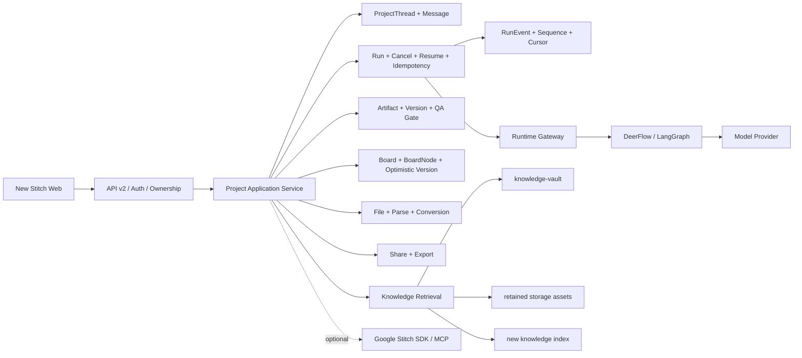

# Google Stitch 风格新前端接入后台系统评估报告（历史版本，已废止）

> 本文是 2026-07-11 的旧接口复用情景评估，仅保留为审计记录，不得作为实施依据。其“继续使用 Vercel AI SDK”“原生 AI SDK 流协议”和“60-85 人日”结论已被后续纯绿地决策废止。当前权威方案为 `docs/workbench-greenfield-implementation-plan.md`，开源组件选型与自研边界见 `docs/workbench-open-source-reuse-strategy.md`，视觉保真合同见 `docs/workbench-visual-baseline.md`。

- 评估日期：2026-07-11
- 文档版本：1.0
- 评估方式：代码、数据结构、运行边界与官方资料只读审计
- 评估对象：`ai-product-workbench` 当前 Stitch 风格新前端、Nest 后台、DeerFlow 运行时、知识库与模型接入方案

## 1. 执行摘要

当前新前端已经达到高保真、可交互演示水平，但还不是已接入后台的业务前端。其主要实现集中在一个约 5300 行的 `stitch-workbench.tsx` 中，项目、模型、PRD、原型、附件、生成进度、分享和导出大多由静态数据、本地状态或定时器驱动。

现有后台并非从零：鉴权、消息流、文件、PRD、HTML 原型、QA、版本、分享、导出、知识检索和 DeerFlow 运行链路已经存在。但后台目前以 `Conversation` 为聚合根，新前端表达的是 `Project + 多屏画布 + 生成任务`，两者不是简单字段映射关系。

本次推荐按新项目处理，不建设兼容层：

1. 新建真实的 `Project / ProjectThread / Run / Artifact / Board` 领域模型。
2. 新前端只消费新 API 和统一流协议，不挂旧 `ActiveChatProvider`，不把 `/projects` 转发到旧 `ConversationService`。
3. 只保留知识库业务资产，不迁移旧会话、消息、PRD、原型、运行记录和分享数据。
4. DeerFlow 作为唯一生产模型运行入口；旧 ModelGateway 不再形成第二套实际模型配置。
5. 新系统验收通过后一次硬切；新生产发布物从首次部署起就不注册旧路由或旧 Provider，新生产库不创建旧表。旧环境在切流点停止、隔离并按获批清理清单销毁。

综合难度评为 **高，4/5**。仅实现可验收核心闭环约 **30–42 人日**；生产级基础范围约 **60–85 人日**；若把多屏可编辑画布、Figma/React/MCP 导出、公开重混和实时协作全部做实，总量约 **85–130+ 人日**。

## 2. 评估范围与前提

### 2.1 已确认前提

- 保留当前 Stitch 风格视觉和主要交互体验。
- 不保留原始对话数据。
- 只保留本地 `knowledge-vault` 及其 Markdown 明确引用的 `storage` 源资产；不复制旧数据库知识行或 embedding，索引在新系统重建。
- 旧业务数据不制作迁移副本、灾难恢复副本或回滚快照。
- 不建设新旧 API 兼容层、双写、历史数据兼容读取或长期降级链路。
- 缺失接口直接新增；不合理旧接口直接改造或退役。
- 最终目标是可长期维护的生产系统，不是在当前演示组件中持续堆补丁。

### 2.2 本报告不包含

- 对业务代码、数据库或外部系统的实际修改。
- 生产切流后的具体删除命令和执行窗口；删除范围已经确定，执行时仍需使用可审计变更清单和残留扫描。
- Figma、第三方 MCP 服务或实时协作产品能力的详细需求设计。
- 模型供应商 token 费用的固定预算；该费用取决于最终模型和调用量。
- Google Stitch 免费服务的永久免费或无限额度承诺。

## 3. 当前系统现状

### 3.1 新前端不是模块化业务应用

当前 `apps/web/components/stitch/stitch-workbench.tsx` 为约 5300 行单文件实现。文件内部虽然包含多个 React 组件和函数，但项目状态、生成状态、画布状态和弹层状态仍集中在同一个本地状态树中，尚未形成可独立演进的业务模块、数据层和领域边界。

关键事实：

| 能力 | 当前实现 | 生产状态判断 |
|---|---|---|
| 应用入口 | `ChatShell` 只渲染 `StitchWorkbench` | 已替换视觉入口，但未接业务 Provider |
| 项目列表 | 单个硬编码调试项目 | Mock |
| 项目打开 | 直接写入固定 prompt、模式和完成状态 | Mock |
| PRD 生成 | 关键词正则 + 1.9 秒定时器 | Mock |
| UI 生成 | 2.2–5.8 秒定时器推进 0/3–3/3 | Mock |
| 模型菜单 | Gemini、Redesign、Ideate 静态选项 | 未接真实模型目录 |
| 附件 | `mockAttachment` 本地标签 | Mock |
| 分享 | 本地开关与复制当前地址 | 未接分享权限和持久化 |
| 导出 | `setExportComplete(true)` 切换成功状态 | Mock |
| 画布 | React Flow 内存节点、缩放和选择 | 可交互，但刷新不恢复 |
| Undo/Redo、复制、删除等 | 部分只有界面或空处理 | 未实现 |

因此，“新前端是完整的一坨代码吗”的准确回答是：**它是单文件集中实现的高保真原型，不是一个不可分割的单组件，但也尚未按项目、运行、产物、画布、文件、分享等业务模块组织。**

### 3.2 现有真实前端数据层仍在仓库中

旧前端接入能力尚未删除，包括：

- `useChat + DefaultChatTransport` 的消息发送与流式接收。
- 历史消息、运行状态、停止生成和断线恢复。
- PRD、原型、投票、文件和运行状态 REST 客户端。
- DeerFlow 运行事件到前端数据流的转换。

这些实现可作为协议和异常处理参考，但不建议把整个旧 `ActiveChatProvider` 重新包到新界面外层。可复用的是经过验证的代码与协议经验，不是旧 `Conversation` 领域边界。

### 3.3 后台已有能力

现有 Nest 后台已经具备：

- JWT 鉴权、用户和权限管理。
- Conversation、Message、文件上传与解析。
- AI SDK v6 `UIMessageStream` 桥接。
- DeerFlow thread/run 调用、停止、状态和事件转换。
- PRD、HTML 原型、QA gate、确认、版本和回滚。
- 登录只读分享，以及 Word、HTML、Canvas 导出。
- 知识条目、候选审核、检索和本地 Obsidian/Quartz vault。

主要问题不是“有没有后台”，而是后台对象和新前端产品语义不一致。

### 3.4 当前真实模型链路

当前生产方向是：

```text
Web -> Nest stream endpoint -> DeerFlow/LangGraph -> Model Provider
```

Vercel AI SDK 当前主要承担浏览器与 Nest 之间的消息/流协议，不直接决定模型供应商。实际模型名按 `selectedModelName -> DEERFLOW_MODEL_NAME -> DEFAULT_MODEL_NAME` 注入 DeerFlow。

仓内 ModelGateway 已具备 OpenAI-compatible 适配器和管理数据结构，但模块注释明确说明当前是 admin-only，DeerFlow-first 主链路不经过它。若不处理，将长期形成“两套模型配置、只有一套生效”的认知和维护成本。

### 3.5 当前知识资产基线

只读审计时的本地快照：

| 资产 | 当前规模 | 保留建议 |
|---|---:|---|
| `knowledge-vault` | 85 个 Markdown，约 600 KB | 全量保留 |
| `storage/source-assets` | 约 212 MB | 保留被 vault 引用的源资产 |
| `storage/imports` | 约 431 MB | 保留被 vault 引用的导入资产 |
| 数据库正式 `KnowledgeItem` | 当前为 0 | 迁移前重新核对 |
| `storage/agent-workflow-eval` | 约 4.2 GB | 默认不属于知识库 |
| `storage/agent-workflow-online-smoke` | 约 420 MB | 默认不属于知识库 |

以上是评估时快照，不是迁移清单。正式迁移前必须重新生成文件数、大小、校验和与引用关系。

## 4. 接入难度判断

### 4.1 难度结论

| 范围 | 难度 | 原因 |
|---|---:|---|
| 只接登录、项目列表、发消息、PRD/HTML 预览 | 中高，3.5/5 | 可复用旧协议，但需重构状态和路由 |
| 当前核心可见能力生产化 | 高，4/5 | 涉及新领域模型、流状态机、版本、权限和恢复 |
| Stitch 全控件真实等价 | 很高，4.5/5 | 已从“接后台”扩张为完整设计工具开发 |

### 4.2 主要复杂度来源

1. **对象模型不同**：新界面是 Project、多屏节点和任务；旧后台是 Conversation、文档和单份 HTML artifact。
2. **状态事实源不同**：当前界面依赖定时器；生产状态必须由 Run 和服务器事件驱动并可恢复。
3. **原型表达不同**：后台核心产物是一份 HTML；界面表现为三张独立可操作屏幕。
4. **持久化缺失**：节点位置、尺寸、缩放、选择和布局版本目前只在浏览器内存中。
5. **产品承诺冲突**：界面有公开访问/重混、Figma/React/MCP 导出；后台目前是登录只读分享和 Word/HTML/Canvas 导出。
6. **测试缺口**：Web 端没有完整自动化测试体系，无法从排期中删除契约测试和 E2E。
7. **运行环境未就绪**：审计时本机 DeerFlow 未启用、模型配置为空，不能以现有前端演示证明真实链路可用。

### 4.3 估算情景对照

| 情景 | 核心闭环 | 生产级范围 | 结论 |
|---|---:|---:|---|
| 将 Project 映射为旧 Conversation、复用旧领域 | 24–32 人日 | 41–64 人日 | 只作比较基线；不符合已确认的无兼容层要求 |
| Project-first 新领域、只迁知识、硬切 | 30–42 人日 | 60–85 人日 | 本报告推荐与后续章节的估算口径 |
| Stitch 全功能真实化 | 不单列 | 85–130+ 人日 | 已属于完整设计工具建设 |

第一种情景短期更快，但会继续保留 Project/Conversation 语义错位和旧接口边界，因此不作为实施建议。

## 5. 推荐建设原则

### 5.1 不建设兼容层

本次明确禁止：

- `/api/v2/projects` 暗中转发到旧 `/api/conversations`。
- 新旧表双写或双读。
- 新前端重新依赖旧 `ActiveChatProvider` 作为长期运行入口。
- 同时维护 AI SDK 两个 major 版本的流协议。
- 保留旧假数据作为真实接口失败时的降级结果。
- 为旧会话、旧 PRD 和旧原型编写迁移兼容逻辑。

代码复用不等于兼容层。可以抽取鉴权校验、幂等、流事件转换、文件安全、QA 规则等成熟代码，但它们必须服务于新领域对象和新接口。

### 5.2 一个领域事实源

- Project 是用户可见业务聚合根。
- Run 是生成状态事实源。
- Artifact/ArtifactVersion 是 PRD 和原型事实源。
- Board/BoardNode 是画布布局事实源。
- DeerFlow 是生产模型运行事实源。
- KnowledgeCorpus/KnowledgeItem 是知识范围事实源。

### 5.3 界面只展示真实能力

一期如果后台只生成一份 HTML，画布就只显示一个真实预览节点。只有后台提供页面 manifest、逐屏 artifact 和逐屏完成事件后，才展示 0/3 多屏进度。

Figma、React、MCP 导出和公开重混如果不在本期范围，应从生产界面删除或明确禁用，不能保留假成功状态。

## 6. 目标架构



Google Stitch SDK/MCP 是可选外部设计能力，不是新前端接入 Nest 后台的前置条件，也不替代 DeerFlow 运行时。

## 7. 新领域模型

| 对象 | 责任 | 关键字段/约束 |
|---|---|---|
| `Project` | 用户可见项目和权限聚合 | owner、title、status、currentView、timestamps |
| `ProjectMember` | 项目成员与角色 | projectId、userId、role、unique constraint |
| `ProjectThread` | 项目内对话上下文 | projectId、title、status、activeRunId |
| `Message` | Thread 内消息 | threadId、runId、role、parts、sequence |
| `Run` | 一次生成任务 | requestId、phase、status、lease、cancel、error |
| `RunEvent` | 可恢复的有序运行事件 | runId、sequence、type、payload、createdAt；`(runId, sequence)` 唯一 |
| `Artifact` | PRD、HTML、未来多屏原型 | projectId、runId、kind、currentVersionId |
| `ArtifactVersion` | 不可变产物版本 | artifactId、version、content/ref、checksum |
| `Board` | 项目画布 | projectId、viewport、version |
| `BoardNode` | 节点布局与产物引用 | boardId、artifactVersionId、x/y/width/height |
| `FileAsset` | 项目文件和解析状态 | projectId、threadId、storageKey、parseStatus |
| `ShareGrant` | 分享权限与期限 | projectId、scope、permission、expiresAt |
| `KnowledgeCorpus` | 全局或项目知识范围 | scope、projectId、status |
| `KnowledgeItem` | 可检索知识 | corpusId、content、source、embedding、version |

即使一期每个 Project 只有一个 Thread，也应保留独立对象，避免再次把项目与对话混为同一概念。`RunEvent` 热恢复事件至少保留 7 天；Artifact 内容和版本独立长期保存，不能依赖临时事件日志还原。

## 8. 推荐 API 边界

| 接口 | 责任 |
|---|---|
| `GET/POST /api/v2/projects` | 列出与创建项目 |
| `GET/PATCH /api/v2/projects/:id` | 打开、重命名和普通属性更新 |
| `POST /api/v2/projects/:id/archive` | 可恢复归档 |
| `DELETE /api/v2/projects/:id` | 明确的不可逆项目清理 |
| `GET /api/v2/projects/:id/bootstrap` | 一次恢复项目、线程、最新产物、画布和运行状态 |
| `POST /api/v2/projects/:id/runs/stream` | 创建 Run 并返回统一 UIMessageStream |
| `POST /api/v2/runs/:id/cancel` | 取消当前 Run |
| `GET /api/v2/runs/:id` | 查询 Run、阶段、错误与恢复信息 |
| `GET /api/v2/runs/:id/events?afterSequence=N` | 按 cursor 重放 N 之后的事件，支持 `Last-Event-ID` |
| `GET/POST /api/v2/projects/:id/artifacts` | 产物列表、创建和当前版本 |
| `GET /api/v2/artifacts/:id/versions` | 版本列表 |
| `POST /api/v2/artifacts/:id/confirm` | 确认指定版本 |
| `POST /api/v2/artifacts/:id/rollback` | 回滚到指定版本 |
| `GET/PUT /api/v2/projects/:id/board` | 读取和带版本号更新画布 |
| `GET/POST /api/v2/projects/:id/files` | 列表、上传与解析状态 |
| `POST /api/v2/files/:id/retry`、`DELETE /api/v2/files/:id` | 重试解析与删除文件 |
| `GET/POST /api/v2/projects/:id/shares` | 列举与创建分享 |
| `DELETE /api/v2/shares/:id` | 撤销分享 |
| `POST /api/v2/projects/:id/exports` | 创建真实支持格式的导出任务 |
| `GET /api/v2/exports/:id` | 查询导出状态和下载信息 |
| `GET /api/v2/runtime/models` | 返回 DeerFlow 实际可用模型目录 |

所有流事件至少包含 `projectId`、`threadId`、`runId`、`requestId`、`sequence` 和协议版本。Artifact 事件还必须包含 `artifactId`、`artifactVersionId` 和 `kind`。断线恢复必须从最后确认的 `sequence + 1` 继续，服务端以 `(runId, sequence)` 唯一约束和客户端去重共同保证不重不漏。

## 9. AI SDK、Stitch SDK 与第三方模型评估

### 9.1 Vercel AI SDK

Vercel AI SDK 是 Apache 2.0 TypeScript 工具包，SDK 本身不收许可费；模型 provider、AI Gateway 和应用托管费用另计。它支持官方 provider、community provider、自定义 provider 和 OpenAI-compatible 服务。

当前仓库使用：

- API：`ai@6.0.116`
- Web：`ai@6.0.116`、`@ai-sdk/react@3.0.118`

它可以继续作为新 Web 与 API 的流协议和 UI 工具。版本选择必须在接口冻结前完成：保留 v6 或升级到 v7 均可，但新系统只允许一个 major，不建设 v6/v7 双协议兼容层。

Vercel AI Gateway 不是必选项。免费层只覆盖部分模型并有较低限流，具体免费 credits、可用模型和请求限制以实施及切流时的官方 pricing/model list 为准，不在本报告中承诺固定金额。购买 credits 后团队转入 paid tier，不再享受每月免费 credit；BYOK 也仅在 paid tier 可用并要求先购买 credits。模型推理按 provider 牌价、零加价，但 Custom Reporting、团队级 Provider Allowlist、团队级 ZDR 等附加能力另行收费。直接连接模型 provider 时，不产生 Gateway 费用，只支付对应供应商费用。

### 9.2 Google Stitch SDK/MCP

Google 已公开：

- 托管 MCP：`https://stitch.googleapis.com/mcp`
- npm SDK：`@google/stitch-sdk`，审计时版本 `0.3.5`
- `stitchTools()`：可直接转换为 Vercel AI SDK tools
- 项目、屏幕、HTML、截图、编辑、变体和 design system 操作

SDK 采用 Apache 2.0 许可证，不收 SDK 许可费。

费用与限制：

- Google 官方 Gemini CLI Stitch 扩展明确写明 “Stitch MCP is free of charge”。
- 未找到 Google 官方公开的固定数值配额或付费套餐。
- SDK 定义了 `RATE_LIMITED` 错误，因此不能承诺无限吞吐，生产接入必须处理退避、熔断和恢复。
- “free of charge” 是当前公开说明，不是永久免费合同承诺。
- `@google/stitch-sdk` 开源项目明确声明不属于 Google 正式支持产品；本次公开资料审计也未找到托管 Stitch MCP 的 GA/SLA 承诺。两者服务边界不同，但生产架构均不能依赖未公开的 SLA。

第三方模型支持必须分成两层理解：

| 层级 | 是否支持第三方模型 | 说明 |
|---|---|---|
| 外层 Agent/编排模型 | 有条件支持 | `stitchTools()` 可交给具备兼容 tool/function calling 能力的 Vercel AI SDK 模型；具体 provider/model 必须通过契约测试 |
| Stitch 内部 UI 生成模型 | 不支持替换 | 当前 schema 仅允许 Gemini 3 Flash、Gemini 3.1 Pro；旧 Gemini 3 Pro 已 deprecated |

因此，外层第三方模型可以在通过工具调用契约验证后决定何时调用 Stitch 工具，但真正执行 Stitch UI 生成的仍是 Google Gemini。Vercel AI Gateway 即使启用，也只能路由外层 Agent/编排模型，不能替换或代理计费 Stitch 托管服务内部的 UI 生成模型。

### 9.3 本项目推荐定位

| 技术 | 推荐定位 |
|---|---|
| Vercel AI SDK | Web/API 流协议、UI hooks、可选工具编排 |
| DeerFlow/LangGraph | 唯一生产 Agent 和模型运行入口 |
| Model Provider | 在 DeerFlow 中配置和路由，费用由供应商产生 |
| Google Stitch SDK/MCP | 可选的 Stitch 项目/屏幕生成与读取、HTML/截图获取、DESIGN.md/design system 交换能力 |
| 现有 ModelGateway | 退役，或缩减为明确的观测/管理用途，不能形成第二条运行链路 |

若一期接入 Stitch SDK，还需单独处理 `STITCH_API_KEY`/ADC、外网访问、可能耗时数分钟的生成任务、SDK 默认 300 秒客户端超时、429 重试、外部 project/screen ID 映射、HTML/截图下载和数据合规。

## 10. 数据保留与清理方案

### 10.1 保留

- `knowledge-vault` 全部 Markdown、目录结构和必要配置。
- vault 明确引用的 `storage/source-assets` 与 `storage/imports`。
- 已结构化写入 `knowledge-vault` 的长期知识条目；旧数据库记录和 embedding 不直接复制。
- 新环境所需的知识索引重建脚本和校验清单。
- 所有资产继续保存在本仓库的本地 `knowledge-vault` 与 `storage` 边界内，不同步到未获授权的外部知识库。

### 10.2 不保留

- Conversation、Message、旧设计状态、PRD、原型、QA、回滚、评论、投票和分享链接。
- RuntimeRun、VibeStream、ModelCall、KnowledgeRetrieval 和旧运行审计日志。
- 会话上传文件、解析中间产物和转换目录。
- DeerFlow thread binding 及对应远端线程。
- 测试评估和 online-smoke 资产，除非另行指定归档。
- 旧模型配置和 provider key；新环境重新 provision。
- 旧用户账号、会话、登录状态和旧业务审计日志；新环境重新初始化管理员和所需用户。
- 任何包含旧对话或产物的默认回滚快照。

### 10.3 特别处理

当前 `KnowledgeItem.sourceConversationId` 删除行为是 `SetNull`，而 `KnowledgeCandidate` 随 Conversation 级联删除。部分候选审核后的知识默认仍可能是 conversation scope；直接硬删会使其成为无法被正常检索的孤儿。

清理前必须：

1. 审核 conversation-scoped 知识和候选。
2. 将确需保留的内容提升为 global 或新的 corpus scope。
3. 生成 vault 与其 Markdown 引用资产的校验和及引用闭包清单。
4. 在干净数据库中导入并重建索引。
5. 完成检索抽样后再删除旧会话和物理文件。

迁移采用 allowlist，而不是逐表 blacklist：只允许 vault、被引用源资产，以及新环境重新 provision 的账号、密钥和系统配置进入新生产环境；知识索引从 vault 重建。

## 11. 实施拆分

### 阶段 0：产品契约冻结

必须先确定：

- 一个 Project 是否允许多个 Thread。
- 一期原型是一份 HTML，还是结构化多屏 artifact manifest。
- 分享采用登录只读，还是公开访问/重混。
- 一期真实导出格式。
- DeerFlow 模型目录和用户可选模型范围。
- 是否把 Google Stitch SDK 纳入一期。
- v2 新物理 schema manifest、旧物理对象 `legacy-schema-manifest` 和各自校验 hash。

### 阶段 1：知识保全

- 重新统计 vault 和 storage 引用资产。
- 审核并提升需保留的 conversation-scoped 知识。
- 制作校验和、引用关系和只读备份。
- 明确测试资产与业务知识资产边界。

### 阶段 2：新后台先行

- 建立 Project、Thread、Run、Artifact、Board 新 schema。
- 建立 `/api/v2`、owner 隔离、幂等、取消/恢复和版本控制。
- 只写新表，不双写旧表。
- 建立 bootstrap 接口，保证刷新可恢复。

### 阶段 3：单一运行链路

- 把 AI SDK 流协议挂到新 Run 服务。
- DeerFlow 成为唯一模型入口。
- 完成真实模型目录、超时、取消、断线重连和错误协议。
- 删除定时器阶段映射；UI 完全使用服务器事件。

### 阶段 4：新前端模块化接入

建议拆为：

```text
features/
  projects/
  threads/
  runs/
  artifacts/
  board/
  files/
  sharing/
  exports/
  knowledge/
```

每个模块分别包含 API、store/controller、类型、视图组件和测试。视觉组件只接收 ViewModel，不直接拼 URL、处理数据库字段或自行推断运行阶段。

### 阶段 5：只迁知识

- 在干净数据库重新初始化管理员、密钥和运行配置。
- 导入 vault、保留的 source assets 和确认后的知识条目。
- 重建 embedding/索引并完成召回抽样。
- 不导入任何旧会话或生成产物。

### 阶段 6：干净环境验收

- 从空数据库 + 保留知识资产启动。
- 完成登录、项目、生成、停止、恢复、文件、PRD、原型、QA、分享和导出 E2E。
- 禁止使用旧数据库残留证明新系统可用。

### 阶段 7：硬切与退役

- 停止旧系统写入。
- 确认新生产发布物未注册旧 controller/provider，新生产库不存在 legacy tables。
- 一次切换前端入口和 API；旧环境同时停止并网络隔离。
- 不制作包含旧业务数据的回滚或灾难恢复快照；按可审计清理清单销毁旧数据库、远端 DeerFlow thread、上传目录和无 FK 日志。
- 切流后的 24–72 小时观察只针对新系统，故障采用新系统 fix-forward，不依赖旧业务数据回滚。

## 12. 工作量估算

估算口径：真实新领域模型、无兼容层、只迁知识、DeerFlow-first；一期分享和导出只兑现最终确认的真实能力。表内前六项是 54–74 人日直接实施量，最后一项是 6–11 人日联调与风险储备，因此 60–85 人日已经是批准基线，不再额外叠加统一百分比缓冲。

| 工作包 | 人日 |
|---|---:|
| 架构与产品契约冻结 | 4–6 |
| 新 schema、Project/Artifact/Board API | 12–16 |
| DeerFlow + AI SDK 新 Run 链路 | 6–8 |
| 新前端拆分与真实接入 | 18–24 |
| 知识保全、迁移和旧数据清理 | 4–6 |
| 安全、测试、部署和退役 | 10–14 |
| 跨模块联调与不确定性 | 6–11 |
| **生产级基础合计** | **60–85** |

### 12.1 按交付层级

| 交付层级 | 累计人日 | 交付内容 |
|---|---:|---|
| 可验收核心闭环 | 30–42 | 登录、项目、真实流、PRD/单 HTML 原型、文件、刷新恢复、基础测试 |
| 生产级基础 | 60–85 | 再含版本、QA、权限、完整异常态、知识迁移、部署和旧系统退役 |
| Stitch 全功能 | 85–130+ | 再含多屏可编辑画布、Figma/React/MCP、公开重混、协作等 |

### 12.2 日历时间

| 团队 | 生产级基础预计 |
|---|---:|
| 峰值 2 名前端 + 2 名后端，平均约 2.5–3.5 研发 FTE，QA/DevOps 部分投入 | 4–6 周 |
| 峰值 1 名前端 + 1 名后端，平均约 1.5–2 研发 FTE，QA 部分投入 | 7–10 周 |
| 1 名高级全栈单人实施 | 13–18 周 |

当前后台处于较大未提交改造期，本机 DeerFlow 和模型配置未启用。60–85 人日已包含已知联调与风险储备；若契约冻结后范围或代码基线发生实质变化，应重新估算，而不是在当前区间上重复叠加固定百分比。

## 13. 主要风险

| 等级 | 风险 | 控制措施 |
|---|---|---|
| P0 | 继续向 5300 行组件直接塞 API，形成新的状态泥团 | 先拆模块和 ViewModel，再接接口 |
| P0 | Project/多屏语义与 Conversation/单 HTML 不一致 | 先冻结新领域和 artifact manifest |
| P0 | 前端定时阶段与真实 Run 事件不一致 | 服务器事件作为唯一事实源 |
| P0 | 只有 Run 状态、没有有序事件日志，断线后无法无损恢复 | 持久化 RunEvent、sequence 和 cursor |
| P0 | 两套模型配置并存但只有一套生效 | DeerFlow-first，退役或收缩 ModelGateway |
| P0 | 删除会话时误删或孤立需保留知识 | 先提升 scope、校验、再清理 |
| P1 | 画布并发保存覆盖其他版本 | Board optimistic version / ETag |
| P1 | 分享文案与权限模型冲突 | 冻结登录只读或公开重混口径 |
| P1 | 导出菜单承诺后台不存在的格式 | 未实现格式从生产 UI 删除 |
| P1 | Google Stitch 限流、实验性和无 SLA | 仅作可选能力，设置超时/429/熔断 |
| P1 | 开发伪登录掩盖真实 JWT 问题 | E2E 使用真实鉴权链路 |
| P1 | 无 Web 自动化测试导致回归 | 单测、契约测试和 Playwright 纳入主排期 |

## 14. 验收标准

### 14.1 架构验收

- 静态边界测试确认新 `features/` 不 import 旧 chat provider，源码和浏览器网络均不存在 `/api/conversations`。
- Nest 生产模块图不注册旧 controller/provider，新生产库 schema diff 中不存在 legacy tables。
- 静态检查确认新前端无 mock 项目、`mockAttachment`、定时器生成进度和假导出成功。
- 运行链路追踪确认模型调用只有 DeerFlow 一条生产路径，UI 模型 ID 与实际 Run 记录一致。
- 在旧数据库地址不可达的条件下，从空库 + 迁移 allowlist 完成启动和全链路 E2E。

### 14.2 功能验收

- 项目创建、打开、重命名、归档、不可逆删除和刷新恢复均有 E2E 覆盖。
- 同一 `requestId` 并发提交 10 次只能产生 1 个 Run，其余请求返回同一 Run 或明确冲突。
- 至少 20 个断线点验证从最后确认的 `sequence + 1` 恢复，事件 gap 和 duplicate 均为 0。
- 使用过期 Board version 更新必须返回 HTTP 409，且不得覆盖最新布局。
- 消息流、停止、重试和取消通过；取消命令重复提交保持幂等。
- PRD/原型落库、版本、确认、QA gate 和回滚通过。
- 文件上传、解析状态、失败重试和删除通过。
- 分享与导出严格遵守最终权限和格式，不显示假能力。

### 14.3 数据验收

- 迁移 allowlist 只包含知识资产和新 provision 的系统数据，不包含旧会话、用户业务数据或运行产物。
- vault 文件数、校验和和引用资产 100% 一致。
- 使用至少 20 条固定 golden queries 验证知识召回，预期来源进入 Top-5 的比例不低于 90%，且来源链接错误数为 0。
- 不存在需保留的 `scope=conversation AND sourceConversationId IS NULL` 项。
- 新生产 schema hash 与阶段 0 批准的 v2 schema manifest 完全一致，migration history 只包含新基线；`legacy-schema-manifest` 中列明的旧物理表、索引、约束和触发器数量为 0。新 `Message/Run/Artifact` 等对象必须使用 manifest 中明确的新物理表名，不能以同名领域概念代替物理对象验收。
- 清理任务输出旧数据库、表、storage 路径、远端 DeerFlow thread 和临时快照的逐项清单、清理前后计数及销毁证明。

### 14.4 安全与质量验收

- 每个 owner-scoped API 均有跨用户 403 测试；分享权限、HTML iframe sandbox/CSP、文件类型和大小限制验证通过。
- typecheck、单元测试、集成测试、E2E 和部署烟测全部通过。
- 覆盖模型失败、流中断、刷新、取消、重复提交、QA 阻断和知识库不可用场景。
- 推荐 SLO 基线：非 AI API p95 不高于 500 ms；Run 接受并发出首个协议事件 p95 不高于 1 s；运行中 heartbeat 间隔不超过 15 s；取消确认不超过 3 s。最终负载模型和阈值在阶段 0 冻结并自动化验收。
- 若接入 Stitch SDK，至少一组具备工具调用能力的第三方编排模型通过 create/get/generate 工具契约测试，并覆盖 429、超时和服务不可用。
- P0/P1 未关闭、知识校验未通过或不可逆删除责任未确认时，不得切流。

## 15. 实施前必须冻结的决策

| 决策 | 推荐默认值 | 不确认的影响 |
|---|---|---|
| Project 与 Thread 关系 | 一个 Project 可有多个 Thread；一期 UI 可只展示一个 | 后续再次拆库和改路由 |
| 原型结构 | 一期单 HTML；多屏需独立 manifest | 0/3 进度和 Board 模型返工 |
| 分享权限 | 先沿用登录只读，公开重混另立项目 | 安全模型和文案冲突 |
| 导出格式 | 只展示真实实现格式 | 假成功和新增产品范围失控 |
| 模型事实源 | DeerFlow-first | 两套配置长期漂移 |
| AI SDK major | 实施启动时选定一个版本 | 双协议和升级返工 |
| Stitch SDK | 默认作为二期可选能力 | 一期引入外部限流和 SLA 风险 |
| 旧数据删除时点 | 新系统生产验收并硬切后按清单物理销毁，不保留快照 | 只能回滚新系统代码/schema，不能切回旧业务数据 |

## 16. 证据索引

### 16.1 本地代码

- 新前端入口：`apps/web/components/chat/shell.tsx:3-6`
- 新前端集中状态：`apps/web/components/stitch/stitch-workbench.tsx:685-698`
- 固定项目打开状态：`apps/web/components/stitch/stitch-workbench.tsx:736-748`
- 定时器生成流程：`apps/web/components/stitch/stitch-workbench.tsx:750-800`
- 静态模型与项目：`apps/web/components/stitch/stitch-workbench.tsx:145-191`
- Mock 附件：`apps/web/components/stitch/stitch-workbench.tsx:1322`
- 本地分享开关和当前 URL：`apps/web/components/stitch/stitch-workbench.tsx:5025-5095`
- 假导出完成：`apps/web/components/stitch/stitch-workbench.tsx:5156-5254`
- 开发预览登录：`apps/web/lib/auth/nest-auth.tsx:91-104`
- AI SDK Web 依赖：`apps/web/package.json:13,24`
- AI SDK API 依赖：`apps/api/package.json:22`
- Web 无测试脚本：`apps/web/package.json:5-10`
- 现有 useChat transport：`apps/web/hooks/use-active-chat.tsx:255-311`
- AI SDK v6 流桥：`apps/api/src/ai/aichat/aichat-stream.service.ts:80-105`
- DeerFlow 模型选择：`apps/api/src/ai/deerflow-runtime.service.ts:493-518`
- ModelGateway 当前边界：`apps/api/src/model-gateway/model-gateway.module.ts:11-24`
- Conversation 聚合关系：`packages/db/prisma/schema.prisma:339-384`
- 单 HTML PrototypeArtifact：`packages/db/prisma/schema.prisma:773-802`
- 分享权限和确认门禁：`apps/api/src/ai/share.service.ts:48-94`
- Word/HTML/Canvas 导出：`apps/api/src/ai/export.controller.ts:9-42`
- KnowledgeItem 删除关系：`packages/db/prisma/schema.prisma:932-955`
- KnowledgeCandidate 级联关系：`packages/db/prisma/schema.prisma:999-1026`

### 16.2 官方资料

- Vercel AI SDK：https://ai-sdk.dev/docs/introduction
- Vercel AI SDK Apache 2.0：https://github.com/vercel/ai/blob/main/LICENSE
- Vercel providers：https://ai-sdk.dev/docs/foundations/providers-and-models
- OpenAI-compatible provider：https://ai-sdk.dev/providers/openai-compatible-providers
- Vercel AI Gateway pricing：https://vercel.com/docs/ai-gateway/pricing
- Google Stitch 2026-03-18 发布说明：https://blog.google/innovation-and-ai/models-and-research/google-labs/stitch-ai-ui-design/
- Google Stitch SDK：https://github.com/google-labs-code/stitch-sdk
- Stitch SDK AI SDK integration：https://github.com/google-labs-code/stitch-sdk/blob/575a9fb6319bd9d1ce8175e4a89e5958e024bbfd/README.md#ai-sdk-integration
- Stitch SDK disclaimer：https://github.com/google-labs-code/stitch-sdk/blob/575a9fb6319bd9d1ce8175e4a89e5958e024bbfd/README.md#disclaimer
- Stitch 内部模型枚举：https://github.com/google-labs-code/stitch-sdk/blob/575a9fb6319bd9d1ce8175e4a89e5958e024bbfd/packages/sdk/generated/src/tool-definitions.ts#L178-L193
- Stitch MCP 配置：https://github.com/gemini-cli-extensions/stitch/blob/e22b3aac9a43bce2d740c5172844e9a2eebba37f/gemini-extension.json#L5-L11
- Stitch MCP pricing：https://github.com/gemini-cli-extensions/stitch/blob/e22b3aac9a43bce2d740c5172844e9a2eebba37f/README.md#pricing

## 17. 最终建议

本项目不应把当前新前端视为“换几个 API 地址即可上线”的模块化应用，也不应回到旧 Conversation 页面外面套一层 Stitch 皮肤。

正确路径是保留经过验证的视觉成果和底层安全能力，重新建立 Project-first 的领域、接口和状态模型；只迁知识资产，以干净数据库完成真实 E2E 后一次硬切。Google Stitch SDK 可以作为后续设计能力接入，但不能成为核心后台依赖；Vercel AI SDK 可以继续使用，第三方生产模型统一由 DeerFlow 路由。

按此口径立项，建议以 **60–85 人日**作为已含联调和风险储备的生产级基础预算；峰值 4 名研发、平均约 2.5–3.5 研发 FTE 时，按 **4–6 周**管理关键路径。
