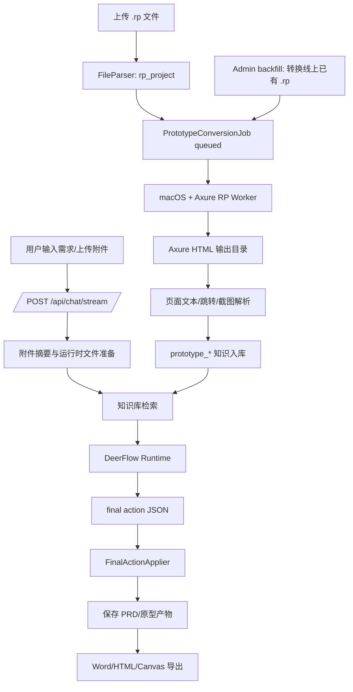

# 线上 AI Agent 执行流程与可视化能力确认

## 执行流程



## 能力矩阵

| 能力 | 当前实现 | 说明 |
| --- | --- | --- |
| `.rp` 源文件接入 | 已支持 | 上传后保存源文件并创建 `PrototypeConversionJob`。 |
| 线上已有 `.rp` 批量预转换 | 已支持 | `POST /admin/prototype-conversions/backfill` 会扫描已有 `.rp` 并批量建任务/启动后台转换。 |
| `.rp -> HTML` 自动转换 | 已接入 Worker 协议 | 需要配置 `AXURE_RP_CONVERTER_BIN`，运行环境需要 macOS + Axure RP。 |
| Axure HTML 页面解析 | 已支持 | 抽取入口文件、页面列表、可见文本、`a[href]` 跳转关系。 |
| 原型页面截图 | 可选支持 | Worker/API 环境安装 Playwright 浏览器后自动截图；未安装时不阻断文本解析。 |
| 原型知识入库 | 已支持 | 自动生成 `prototype_project`、`prototype_page`、`prototype_snapshot`、`prototype_flow_edge`。 |
| PRD 流程图/架构图 | 已支持协议 | DeerFlow 可输出 `diagram` block，Word 导出保留 Mermaid/PlantUML 源码。 |
| PRD 原型截图引用 | 已支持协议 | DeerFlow 可输出 `prototype_snapshot` / `image` block，导出时保留图片路径和说明。 |
| 缺失素材提示 | 已加约束 | Prompt 要求缺少截图/流程图/字段规则时写入 `validationNotes` 或 warning/info block。 |

## Worker 配置

- `AXURE_RP_CONVERTER_BIN`: 转换脚本或二进制路径。
- `AXURE_RP_CONVERTER_ARGS`: JSON 字符串数组，默认 `["{input}", "{output}"]`。
- `AXURE_RP_CONVERTER_TIMEOUT_MS`: 单个转换任务超时时间，默认 180000。
- `AXURE_RP_CONVERTER_VERSION`: 写入任务记录的转换器版本。
- `AXURE_RP_AUTO_RUN`: 默认自动运行；设为 `false` 时只创建排队任务。

转换脚本约定：接收 `.rp` 输入路径和 HTML 输出目录，退出码为 0 表示成功，输出目录必须包含 Axure HTML 入口文件和 `resources` / `data` / `files` 等 Axure 特征目录。

## 批量预转换

管理端接口：

```http
POST /admin/prototype-conversions/backfill
Content-Type: application/json

{
  "conversationId": "可选，只处理某个会话",
  "limit": 500,
  "run": true,
  "background": true,
  "force": false
}
```

- 默认扫描线上已有 `.rp` 文件并创建/重置转换任务，不等生成需求文档时才转换。
- `run=true` 会启动转换；`background=true` 会后台顺序执行，避免 HTTP 请求等待大量 Axure 导出。
- `force=false` 时跳过已经成功转换的 `.rp`；失败、等待和未建任务的 `.rp` 会重新进入预转换队列。
- 未配置 `AXURE_RP_CONVERTER_BIN` 时，任务会停在 `waiting_for_worker`，用于明确暴露线上缺少 macOS/Axure Worker 的部署前置条件。
