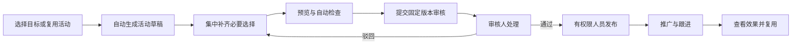

# 策划宝／云溪营销活动平台整体改版方案

方案日期：2026-11-04。状态：产品方案草案，供评审与拆解实施。

核心目标：**用最少、最简单的配置，完成用户真正要做的营销任务。**

面向 31 省的运营装配、省级授权与共享能力建设，详见 [多租户平台建设蓝图](cehuabao-saas-construction.md)。该蓝图细化“平台运营组装方案、省内自助使用”的职责和实施顺序。

范围：允许重构全部模块、导航、页面、配置流程与底层配置模型。覆盖运营管理端、门店移动端、消费者活动 H5，以及素材、权益、渠道、商机、订单、数据、审核、权限和 AI。本文不改变当前应用版本，不是上线记录或生产验收结论。

## 1. 改版的产品判断

建议将策划宝重构为“面向营销目标的工作平台”：用户选择要达到的结果，系统组织页面、规则、资源、投放和数据，用户只做业务决定。

例如，用户要“为本店做一场终端预约活动”，应直接得到一份可编辑、可预览、可送审的预约活动。组织范围、可用终端、门店目录、页面样式、基础表单、渠道参数和审核路由，应尽可能由已授权的组织方案带入。

用户要“用上次活动再做一期”，应只修改本期差异；用户要“换张海报”，应能直接在活动内完成；用户要“查今天哪些客户需要跟进”，应直接看到可处理的客户任务。

这次改版以最终配置结果正确、用户操作负担低为判断依据。模块数量、AI 对话长度和页面视觉效果只是支撑手段。

### 1.1 知识依据与可信边界

本方案基于本地知识库中的平台架构、业务主知识、进化规划、原型规范和来源审读。相关知识说明了平台主流程、模板差异及历史需求；并未提供当前策划宝生产系统的完整代码、全量配置埋点或现场可用性测试。

全文按以下口径使用证据：

| 口径 | 在本文中的用途 |
| --- | --- |
| 知识依据 | 手册或主知识明确描述的对象、流程、权限和限制；不自动等于当前生产已实现 |
| 结构性判断 | 由跨主题资料归纳出的设计问题，需通过现网走查与用户测试核实影响程度 |
| 改版建议 | 本文提出的新产品设计、默认策略、页面和实施方案 |
| 待定版 | 原资料冲突或外部业务合同未明确的规则，实施前需要指定业务负责人裁决 |

知识库明确要求区分平台共性、模板规则、区域案例与原型表达。[K01] 本文中的新导航、场景方案、配置自动化、指标目标均属于改版建议。

### 1.2 从资料中识别的关键问题

| 结构性问题 | 知识线索 | 改版回应 |
| --- | --- | --- |
| 业务目标需要跨多个配置对象完成 | 活动、页面、规则、权益、渠道和报表分别维护 [K02][K04] | 用活动任务串联对象，在一个工作空间完成常用操作 |
| 模板与区域版本差异容易增加选择负担 | 签到机会、门店、抽奖、券化和审核流程存在不同版本 [K05][K09] | 用有适用范围的场景方案自动匹配，保留明确版本 |
| 业务信息可能需要在页面和规则中重复表达 | 奖品、活动时间、表单、热区和成功反馈相互依赖 [K04][K07][K12] | 同一个业务事实只配置一次，自动更新相关展示 |
| 素材使用路径分叉 | 不可编辑图片、可编辑设计、上传及同步各有不同路径 [K06] | 根据素材能力直接给出“使用”或“编辑后使用” |
| AI 历史方案的步骤和确认次数差别很大 | 五阶段、八步、四次确认、五个里程碑等并存 [K12] | 用必要决策数评价助手；普通调整直接完成并允许撤销 |
| 结果概念容易混用 | 展示次数与加粉、受理与竣工、中奖与到账、审批与发布各不相同 [K03][K08][K16] | 用户侧采用准确的业务结果，详情可追溯底层状态 |
| 历史原型有大量未接通的操作表达 | 按钮、静态数据和面板切换不能证明真实保存或调用 [K17] | 核心路径必须按真实业务结果验收 |

这些问题是设计切入点；本文不声称已经测得现网有多少重复字段、用户流失或配置耗时。

## 2. 设计目标与取舍

### 2.1 八条统一原则

1. **先选目标，再出现配置。** 用户选“收集预约”，系统才展示预约相关内容。
2. **一个事实只填一次。** 门店、活动时间、奖品、主标题和表单字段均有一个权威来源。
3. **系统知道的信息直接带入。** 组织、地域、角色、已授权资源、审核路由和渠道标识不重复询问。
4. **默认就能完成常见任务。** 场景方案应包含页面、规则、表单和数据视图，而不只是视觉皮肤。
5. **只在存在真实分歧时询问。** 不让用户确认每个字段、每次预览刷新或每段 AI 输出。
6. **操作处完成关联任务。** 在活动中选择素材、绑定权益、检查门店、生成二维码，无需为普通任务反复跳转。
7. **复杂配置按需出现。** 选择奖品、选号、助力、条件题等能力后，才展开相关设置。
8. **任何简化都能解释和纠正。** 自动带入项可查看来源；普通变更可撤销；关键结果有清晰状态。

### 2.2 三类配置的归宿

| 配置类别 | 例子 | 新归宿 |
| --- | --- | --- |
| 可推导的机械配置 | 图片尺寸、活动码、二维码、页面数据绑定 | 系统自动完成 |
| 可复用的组织策略 | 默认门店、审核流程、可用商品、品牌样式 | 管理人员一次配置，普通用户自动继承 |
| 真实业务选择 | 推什么产品、何时办、是否送礼、分配多少权益 | 用户在任务内明确决定 |

将复杂配置转移给管理员时，同样需要计算管理员维护成本。多个省份仍需反复重建同类规则，就说明平台抽象尚未完成。

## 3. 用户、目标与工作分工

| 用户 | 高频目标 | 默认界面 | 应由系统承担的工作 |
| --- | --- | --- | --- |
| 店长／一线员工 | 用推荐方案做活动、制作海报、分享、跟进预约 | 手机任务入口、活动摘要、待办 | 带入本店资料、可用资源和个人归因 |
| 策划／运营 | 创建活动、调整内容、复用方案、分析效果 | 活动工作空间 | 组合配置、同步依赖、检查完整性 |
| 省市业务管理员 | 分配方案与资源、处理异常、查看区域经营 | 区域工作台及管理入口 | 按权限匹配资源、汇总风险与差异 |
| 审核人 | 判断活动是否可批准、定位变化和风险 | 审核待办和固定版本预览 | 生成变更摘要、校验权限、展示材料 |
| 素材运营 | 上传、整理、审核、分发内容 | 素材与内容 | 提取基础属性、复用标签建议、分析引用影响 |
| 平台管理员／技术运维 | 管理规则、连接能力、排障 | 管理设置、运行诊断 | 汇总异常并关联业务对象 |
| 活动参与者 | 看懂权益、完成参与、获得可信结果 | 简洁的活动 H5 | 登录与资格引导、状态恢复、结果查询 |

身份和数据范围沿用适用的集团／省／市／区县／门店授权关系，但重新设计权限表达与菜单组织。[K24][K10] 允许改页面，不代表自动扩大账号权限。

## 4. 新的信息架构

### 4.1 普通用户只面对五个工作入口

```text
我的工作
  待办、最近活动、推荐方案、常用操作
营销活动
  我的活动、团队活动、创建活动、活动工作空间
素材与内容
  找素材、我的设计、我的上传、专题与收藏
客户与转化
  待跟进预约、商机、订单、权益结果、异常处理
经营分析
  总览、活动效果、渠道效果、素材效果、权益消耗

管理设置（按权限显示）
  场景方案与模板、权益资源、渠道与人员、门店与商品
  组织权限、审核规则、数据口径、外部连接、运行诊断
```

AI 在首页输入框和当前页面中提供帮助，沿用当前活动和用户上下文。常用任务同时提供直接点击和填写的入口，不要求所有用户先聊天。

素材人员默认进入素材工作区，审核人默认进入待审列表，店长默认进入“我的工作”。移动端重点保留工作、活动、素材和客户，经营摘要从工作页进入。

### 4.2 原模块如何重组

| 既有能力 | 新的主要使用位置 | 独立管理能力 |
| --- | --- | --- |
| 活动列表、编辑、详情 | 营销活动 | 按组织查看、批量操作 |
| 模板、活动类型 | 创建时的目标与方案推荐 | 场景方案与模板管理 |
| 页面、楼层、长图、热区 | 活动内的内容编辑 | 组件与样式管理 |
| 活动规则、白名单 | 活动内的参加方式 | 人群与规则方案 |
| 奖品、券、流量包 | 活动内按目标选择权益 | 权益资源及履约治理 |
| 短链、二维码、发展人、运营位 | 发布后的推广面板 | 渠道与人员管理 |
| 门店、表单、销售品、派单 | 活动内的客户接收方式 | 门店与商品目录 |
| 审批、我的申请 | 我的工作待办、活动审核记录 | 审核策略 |
| 商机、订单、发放记录 | 客户与转化、活动结果 | 权限内的治理与对账 |
| 报表、埋点、导出 | 活动效果、经营分析 | 指标与事件口径 |
| AI 搜索、AI 策划、AI 编辑 | 当前任务的上下文助手 | 能力与策略设置 |
| 营销日历、案例、专题 | 首页推荐、场景方案与素材入口 | 内容运营管理 |

“活动集”保留为组织活动的关联对象。普通用户可通过营销主题或活动分组理解它，不要求为每次活动手工创建一个活动集。

## 5. 核心机制：目标、场景方案和自动配置

### 5.1 从技术模板转为业务目标

创建入口使用用户能理解的语言：

- 收集预约／到店线索；
- 推广产品／办理业务；
- 企微加粉；
- 抽奖／发福利；
- 签到／打卡；
- 问卷／反馈；
- 分享助力；
- 宣传海报／聚合展示。

推荐方案可以叫“门店预约”“节日抽奖”“满意度调查”，底层继续绑定稳定模板标识和版本。旧模板名称作为搜索别名保留。区域专用方案仅在适用范围显示，不将江西、广西、贵州等特定规则推广为全平台默认。[K05][K09][K11]

支持“主目标 + 可选增强”，例如预约加送礼、签到加抽奖、问卷加领券。在同一活动内组合已支持的能力，不要求创建多份重复活动。启用增强时说明新增的必要决定与依赖；不支持的组合给出原因，不让用户配置到最后才发现无法执行。预约、答卷等主体结果与奖励结果分别保存，奖励失败不抹掉已经成功的主体业务。

### 5.2 一个场景方案要包含什么

场景方案是完整的业务配置包，建议包括：

| 内容 | 作用 |
| --- | --- |
| 适用目标与对象 | 说明该方案解决什么问题 |
| 适用组织、地域、触点与版本 | 自动排除不能使用的方案 |
| 页面、素材槽位与表单 | 直接生成可预览草稿 |
| 必要业务问题 | 定义何时必须向用户提问 |
| 可继承的默认规则 | 次数、时间建议、门店选择等有明确来源 |
| 资源与外部能力要求 | 标记需要权益、商品、号码、企微等依赖 |
| 审核与发布要求 | 选择匹配的流程，不能自行越过授权 |
| 成功条件与数据视图 | 明确本场景的有效参与和转化结果 |
| 异常与降级处理 | 无库存、门店失效、定位失败等处理 |

系统先判断适用范围，再应用默认值。强制规则与当前有效业务合同不能被个人偏好覆盖。组织默认和个人偏好之间的覆盖关系应可查看；存在版本冲突时先定版，不能按文件日期自动选规则。

### 5.3 配置来源与优先级

优先顺序建议为：平台强制约束与适用业务合同 → 区域／组织授权策略 → 当前场景方案 → 当前活动的显式选择 → 允许覆盖的个人偏好。显式选择只能覆盖允许修改的默认值。

界面用简短提示说明：“来自本店”“沿用上次活动”“组织推荐”“需要补充”。不要求普通用户理解配置继承机制。

| 处理方式 | 条件 | 界面反馈 |
| --- | --- | --- |
| 自动带入 | 来源权威、适用范围一致、无真实业务分歧 | 直接使用，可查看来源 |
| 给出推荐 | 有多个可用选择，存在业务影响 | 展示少量候选及理由 |
| 必须询问 | 缺少活动时间、核心产品、权益额度等关键决定 | 在当前任务中集中补充 |
| 暂不能完成 | 权限、资源、外部能力或适用规则不满足 | 说明原因、责任人和可行下一步 |

不允许为减少字段而编造库存、自动扩大区域、随意设定中奖概率、选择收费产品或猜测审批结果。

### 5.4 一次修改的连带更新

同一个活动使用统一业务配置，页面只是不同视图：

- 换产品：同步产品名称、介绍、适用表单与相关文案；新产品的办理规则需重新校验。
- 换奖品：同步奖品展示、领取条件和结果页；原授权失效时重新确认。
- 改活动时间：同步页面、规则文案、领取窗口检查和投放有效期；不擅自改变已经承诺的领取权利。
- 改门店：同步表单候选、门店列表和派单检查。
- 删表单字段：同步必填校验、同意文案、数据映射检查；受业务合同要求的字段禁止删除。

只让受影响的验证失效，保留无关的有效配置。展示“修改门店后，有 1 项派单检查需要重做”，并直接定位处理。

## 6. 最短创建路径

### 6.1 三种入口，进入同一个活动草稿

1. **直接选目标。** 适合新用户，不需要认识模板名。
2. **复用活动／推荐方案。** 适合重复开展，只处理本期变化。
3. **一句话描述。** 例如“用本店推荐终端，做一场下周的预约活动，不送礼”。

三种入口生成同一套可编辑配置，随时可以直接改字段。AI 对话失败不应阻断手工完成。

### 6.2 常见简单活动的最小业务决定

| 决定 | 示例 | 系统承担 |
| --- | --- | --- |
| 做什么 | 本店终端预约 | 匹配方案、页面、基础表单与数据视图 |
| 用什么内容／资源 | 已授权终端或已选素材 | 带入产品信息、素材尺寸和可用门店 |
| 什么时候开展 | 下周一至周日 | 同步展示、参与及发布检查 |

这些决定可在一句话或一次集中编辑中给出，不强制拆成三步。若目标已经明确含“送礼”，仍需完成权益授权与额度决定；信息不足的复杂活动不能承诺三次点击完成。

不同场景的最小配置建议如下。表中“自动处理”均以前置目录、资源、授权和适用规则已经建立为条件；缺失时在当前页面补齐必要信息。

| 场景 | 用户主要决定 | 系统自动处理 | 按需展开 |
| --- | --- | --- | --- |
| 无奖预约 | 产品、时间；多门店时选择接收方式 | 页面、基础表单、当前门店、归因和审核路由 | 自定义字段、特殊派单 |
| 企微加粉 | 可用人员集合／接收方案、时间、可选权益 | 二维码展示、门店信息、推广物料、分层统计 | 人员导入、特殊分配策略 |
| 抽奖福利 | 奖品、额度、时间及尚未授权的参与策略 | 页面、适用规则展示、结果页、履约记录 | 多奖池、复杂目标人群 |
| 签到打卡 | 周期、任务、适用奖励方案 | 门店、记录、进度和已定版计次逻辑 | 连续签到、前置任务、特殊周期 |
| 问卷反馈 | 问题内容、时间；确需时选奖励 | 题目默认属性、版本、答卷记录和分析 | 条件题、计分权重 |
| 业务订购／号卡 | 产品、开展时间及产品必需的销售选择 | 合同确定的表单、协议、区域和办理连接 | 选号、配送、专用资格 |
| 分享助力 | 目标、已批准的助力条件与奖励方案 | 分享物料、归因、有效事件和结果记录 | 发起与助力资格、场次互斥 |
| 海报／聚合展示 | 内容或目标产品、适用投放位置 | 尺寸、布局、授权渠道和归因二维码 | 自定义热区、特殊跳转 |

活动做得越简单，呈现的选项越少；业务本来需要的复杂决定则明确保留。组织已确认的方案可保存为团队默认，个人可保存内容偏好。复用时仍检查适用范围与资源有效性。

### 6.3 从配置到上线的完整流程



按现有平台共性，审核通过与发布保持两个明确动作。[K03][K10] 自动发布可以作为将来组织级授权策略单独评审；不能因为某一份 AI 讨论稿采用自动发布，就直接设成全平台默认。[K12]

### 6.4 配置页面只保留一个持续工作的空间

建议使用“编辑内容 + 实时预览”的双区布局。AI 帮助和高级设置按需打开，避免固定三栏挤压操作空间。

```text
终端预约活动               本店 · 草稿 · 已保存
预约目标摘要／开展时间                         [查看检查] [提交审核]
---------------------------------------------------------------
编辑区                         活动预览
  活动内容                     手机预览／结果预览
  参加方式                     直接点击内容即可定位编辑
  结果处理
  上线安排

  仅显示本场景需要的设置         “姓名、手机由预约表单统一维护”
  [更多设置] [让 AI 帮我改]
---------------------------------------------------------------
已就绪  ·  使用本店推荐方案  ·  1 处改动可以撤销
```

四组内容对应用户问题：展示什么、谁怎么参加、参加后怎么办、何时在哪里上线。分组数量可随场景减少，不要求用户逐组点击“下一步”。

自动保存反馈区分“正在保存”“已保存”“保存失败”。未保存内容不能被当成已送审版本。离开、重开和网络恢复后能继续已确认的工作。

## 7. 全模块重构方案

### 7.1 我的工作：以待办和继续工作为中心

首屏优先显示“新建活动／制作海报”“继续上次工作”“需要我处理”。店长看待跟进预约，策划看草稿和驳回，审核人看待审，管理员看失效资源和异常。

推荐方案按当前组织可用性、业务适配和近期主题展示。历史浏览或登录频次不足以证明方案效果，不能据此标注“高转化”。营销日历作为选题入口，不成为创建活动的额外配置步骤。

异常卡片给出可执行动作，例如“本活动使用的奖品将在活动结束前失效 → 更换奖品”。正常状态默认收起，首页避免堆积无关指标和公告。

### 7.2 营销活动：活动是日常工作的主容器

活动列表默认显示“我创建的／与我相关”，可切换授权内团队活动。常用列为名称、目标、业务状态、时间、负责人、待处理事项和主操作。按状态给出一个主操作：继续编辑、处理驳回、等待审核、发布、去推广、看效果。

活动详情围绕“内容、推广、结果、记录”组织。编辑态直达配置空间；上线后默认展示结果及运营动作。已上线活动修改生成新草稿版本，在审核与发布前不影响当前线上版本。

复制活动默认保留可复用结构和内容，生成新活动身份；重新检查日期、门店、商品、权益、审核和渠道。旧预览白名单、测试用户和一次性资源授权不应无条件复制。

### 7.3 模板与场景方案：普通用户少选，管理员能治理

普通用户通过目标、适用范围和效果预览选择方案。默认优先展示少量适配结果，提供“查看全部”；实际展示数量需通过用户测试确定。

管理员管理稳定标识、适用范围、版本、业务问题、默认配置、资源要求和检查规则。方案改名不改变历史活动、中奖记录或统计标识；新版本不直接覆盖已经发布活动。[K04]

区域差异通过受控规则和扩展表达，共性能力复用。管理员不能为了隐藏复杂性，把每个新活动再造一个完全独立模板。

### 7.4 页面配置：默认完整，改内容比搭页面容易

默认生成能完成目标的页面。常用操作为改文案、换图、换顺序、选择整体风格。图片选择时自动读取槽位规格，提供裁剪预览；不得静默裁掉关键文字。

可编辑素材进入编辑后原位回填，不可编辑图片直接使用；本地上传同样在当前位置完成。[K06] “横幅”“主按钮”“活动规则”等按页面位置解释，不要求用户理解组件树。

长图支持直接标注目标区域并选择行为，系统检查位置和适用动作；不能从不同历史稿拼出统一的热区数量上限。[K12] 复杂楼层、条件展示、多奖池等保留高级编辑入口，且可通过搜索直接定位。

必需的预约、抽奖、领取等主入口不能被误删。规则正文可以从配置生成，特殊说明由用户补充；有实际业务含义的手工修改需要检查是否与执行规则冲突。

### 7.5 素材与内容：围绕“找到、改好、用上”

统一搜索、专题、标签、类型与组织可见范围；活动内的选图面板复用同一套能力。推荐排序先保证可用、已授权、适配规格，再考虑相关性。

素材详情直接回答：能否使用、能否编辑、能否下载高清、谁可见、哪些活动在使用。系统根据当前权限给主操作，不让用户判断该去“设计”“上传”还是“同步”。

上传流程减少重复录入：提取格式、尺寸、来源组织，给出名称与标签建议，支持批量修正；批量修改前明确作用范围。审核和下载规则按适用来源执行，不能将未审核内容自动变成可公开使用素材。

引用绑定素材版本。更新原素材不会静默替换线上活动。下架时列出引用活动并提供替换处理；如素材需要紧急停用，应支持有权限人员集中阻断相关使用并通知负责人。

素材库替换稿曾提出取消部分画布路径，而既有指南保留可编辑设计。[K06][K14] 建议新模型按素材能力区分，实际保留的编辑能力以可维护工具链和业务定版为准。

### 7.6 权益资源：运营选可用方案，管理员维护履约能力

活动内主要选择“是否提供奖励、选哪项权益、分配多少额度、何时发放”。如果场景目标本身要求奖励，奖励配置就是必要决定。纯宣传或普通预约不会被默认加上奖励。

候选资源已按组织、活动类型、有效期、适用渠道和权限过滤。组织已有经过授权的固定权益方案时，允许带入并在活动摘要中清楚展示；动态额度和不足的授权不能自动补齐。

后台统一查看资源来源、库存／配额、活动分配、预占、已发、失败、结果待核实与核销。内部库存与外部配额采用各自适用合同，不把历史库存图与后期配额稿强行合并。[K07][K14]

用户侧准确区分“已中奖”“待领取”“发放中”“已到账”“结果待核实”。外部超时先查询原请求，结果未明不换请求号再次发放。明确失败沿原业务记录处理，补偿不能重复扣发。

改版提供只处理异常的工作列表；人工操作显示影响和权限要求。额度、概率等复杂设置可由有权限管理员维护为可复用策略，活动中可查看采用了什么规则。

### 7.7 渠道、发展人与企微：选投放对象，自动生成物料

发布后进入推广面板，选择实际需要的投放范围或人员集合。系统为已授权组合生成长链、短链、二维码和海报，普通用户不手工拼接活动码、发展人或运营位参数。

发展人、运营位、门店、客户经理分别保存，不混成“来源”。参数由服务端校验，跟随活动参与、商机和订单形成可追溯链路。[K08]

企微活动只出现适用的人员、门店和二维码选择。名单导入支持预检、重复检查与失败明细；部分失败明确标记。二维码展示次数与成功加粉分开统计。

外部内容分发按已接通的能力提供入口，展示投递对象和内容后由用户触发。券多多等区域、模板专用能力保持适用限制，不增加未经授权的全平台外发渠道。[K14]

### 7.8 门店、商品与商机：尽量从目录选，避免反复导表

建立受权限约束的门店、产品及人员目录。普通活动优先继承当前门店或选择授权目录项；只有目录缺失、活动确需独立名单时才导入。

选择产品后带入适用字段、说明和办理要求。选择派单方式后再显示必要配置：本店接收、用户选店、按已批准的就近规则派单。未接通的派单能力不能只靠界面选项开放。

导入自动识别能确定的列，歧义集中确认一次；给出有效、重复、错误数量及修复文件。无效行不应伪装为全部成功，用户应能明确选择是否使用有效部分。

客户工作区按“待联系、待处理、处理中、已完成、异常”等业务任务组织，实际状态映射由适用商机合同定义。记录、分配和跟进均有权限检查。预约提交、订单受理、业务竣工和奖励发放分别呈现。[K09][K16]

### 7.9 号卡与业务订购：将差异包装成可用产品方案

用户选产品和适用销售方案后，系统带入合法的套餐、区域、表单、协议、渠道和号码策略。选号、证件、配送、特定骑士资格等仅在对应产品需要时出现。

前台对门店无匹配、号码不足、套餐不可办、在途订单等给出独立结果。请求处理中展示可查询记录，避免通过重复提交创建多个订单。[K09]

历史省内 SSO、字段拼写、金额和状态枚举需要依当前联调合同适配。[K16] 连接配置由有权限管理人员维护，普通运营选择名称明确、状态可用的连接方案。

### 7.10 签到、任务和分享：只配置真实的奖励关系

签到场景主要决定开展周期、任务内容、奖励方案；门店与样式可以继承。前台清楚显示本次完成得到什么、累计达到什么条件、奖励是否实际到账。

每次打卡加机会、首次打卡给总次数、月度清零等作为不同场景策略，不混用。[K11] 经验值、抽奖券、抽奖次数和积分保留不同对象；首期不为了统一导航而新增全平台积分商城。

分享场景明确什么叫有效助力、谁可助力、周期及上限。复制链接、展示二维码、好友登录与有效助力分别计数，不能用按钮点击冒充任务成功。

### 7.11 问卷：问题优先，奖励和计分按需开启

以编辑问题为主路径，选择调查方案后带入可复用题目，默认不要求配置计分、权重和奖励。确需奖励时显示领取规则和可用资源；确需计分时才出现评分设置。

稳定保存题目、选项与提交版本。改题形成新版本，历史答卷按当时快照解释。正式答卷保存成功后，领取资格和发放状态独立处理；发券失败不丢答卷。[K13]

权重公式、默认值、奖励数量与双清单映射存在来源差异，作为专门规则定版，不能通过默认值掩盖。[K15]

### 7.12 审核与发布：一次看清风险，一次完成决策

送审前集中展示活动对象、时间、区域、关键规则、资源额度、数据采集及材料。确定性检查自动执行，只展示未通过项与需要关注的差异。完整预览、材料和配置始终可查看。

审核人默认看到“本次改变了什么、影响什么、是否通过检查”。本人不能审批自己发起或按适用规则参与编辑的活动；审核绑定固定版本，审批后内容变化必须重新判断是否需要送审。[K10][K12]

组织预先配置审核路由，普通用户无需每次挑节点。审核人缺位、权限失效、流程冲突时明确阻断及转交责任人，不能自动跳过。

发布后物料单项失败不抹掉成功的活动发布结果，支持只补生成失败物料。发布失败只重试已经批准的相同版本；修改内容后按规则重新审核。

### 7.13 数据与经营分析：默认给业务答案

活动创建时同时绑定场景指标与事件检查，运营不再另做一遍报表配置。

| 场景 | 默认回答的问题 |
| --- | --- |
| 预约 | 有多少有效预约、分给谁、多少待跟进、后续结果如何 |
| 抽奖／权益 | 多少人有效参与、中奖／领取／到账多少、资源还剩多少 |
| 企微 | 展示、扫码、成功加粉分别多少，渠道和人员效果如何 |
| 订购 | 提交、受理、支付及竣工分别如何，哪里失败 |
| 问卷 | 提交人数、完成情况、答案分布及奖励结果 |
| 素材 | 被使用、生成物料和关联活动的情况，哪些内容需要维护 |

每项指标带更新时间、统计范围、去重定义和明细入口。跨端 UV 无可靠统一标识时分开显示，不能简单相加当去重人数。[K08]

测试数据默认独立；展示用基础参与数与真实行为统计分开。AI 可依据实际数据概括现象、提示检查方向，不能在缺乏实验和成本数据时宣称因果提升或精确投资回报。

导出继承当前筛选和数据权限。敏感明文批量导出保持独立权限与适用审批，不因新导航将其并入普通下载。[K14]

### 7.14 管理设置、权限和运行诊断

管理端围绕可复用配置管理：适用场景、组织策略、资源目录、审核路由、数据口径和业务连接。优先提供经过验证的标准方案，再允许高级扩展。

菜单访问、数据范围、具体操作、素材可见范围和审核资格分别授权。员工调岗、跨省或权限收回后，所有写入与导出重新鉴权。

业务排障先定位活动、参与／订单记录和处理结果，再进入有权限的技术日志。运营看到“权益结果尚未确认”，技术人员可继续追溯外部请求、回执和解析状态；不把原始报文和个人信息铺在普通工作流中。[K16]

## 8. 消费者 H5 与门店移动端

### 8.1 活动 H5

首屏回答三件事：能得到什么、需要做什么、现在能否参加。一个页面优先突出一个主动作，条件说明和次要入口按需展开。

能自动读取且得到授权的信息不让用户重复输入；每次提交前清楚展示实际办理或领取内容。涉及定位时提供手动选城市／门店的替代路径。用户拒绝定位后不反复打断。

结果页明确区分“预约已收下，等待联系”“业务已受理，待完成”“奖励发放中”“已到账”。提供参与记录／订单／权益记录，刷新返回后能查看真实结果。

统一空态和异常语言，例如：尚未开始、已结束、无资格、次数用完、库存不足、正在处理、失败可重试、需联系门店。不用一个“系统异常”覆盖全部情况。[K07][K09][K11]

### 8.2 门店手机端

以“用方案、改时间、预览、送审、推广、跟进”为高频能力。复杂楼层编排与批量组织管理放在适合的大屏界面，手机端可查看并清楚说明操作入口。

PC 创建、手机补资料、审核、分享和跟进使用同一活动及版本。不能要求用户在手机端重新填一份。

## 9. AI 的具体职责

### 9.1 三种协作方式

| 方式 | 用户操作 | 系统行为 |
| --- | --- | --- |
| 目标生成 | “做下周的本店终端预约” | 匹配可用场景，生成草稿，集中询问缺少的真实决定 |
| 当前内容修改 | “换成更简洁的文案”“改为下周” | 修改授权内配置并同步依赖，展示简短变更摘要 |
| 运营解释与定位 | “为什么有预约没转化” | 依据可见记录区分未跟进、处理中及缺回传，给出检查入口 |

不让 AI 逐字表演字段填写，也不为动画强制等待。普通表单编辑、选图、拖动和保存使用确定性业务流程，无需每次调用模型。[K12]

### 9.2 确认策略

低风险、可撤销的内容调整可以直接应用到草稿，并提供撤销。目标不清、存在不同产品／门店／资源选择时，集中询问一次。

权益额度、付费产品、素材授权、派单真实分歧、送审、审核决定、发布和外部投递在适用权限与规则下处理。用户在一次业务摘要中可确认相关决定，但不能替代独立审核人，也不能把未明确授权的动作混入普通修改。

主流程不固定套用历史稿的四次、五次或八次确认。真正的确认次数由场景风险和缺少的信息决定。

### 9.3 可靠执行

模型提出候选变更，业务服务执行字段、权限、资源和版本检查，再原子写入。模型不能直接认定保存、审核、发奖或发布已成功。

页面展示业务进展、已完成变更和检查结果。模型不可用时保留草稿与手工编辑；外部业务系统不可用时保留明确处理中或失败记录。

AI 使用去标识的配置摘要和知识，不接原始客户姓名、手机号、证件、生产凭据或完整订单报文。组织隔离与字段授权在服务端执行。[K12]

## 10. 状态与异常的统一表达

### 10.1 将不同维度分开保存

| 维度 | 典型状态 | 为什么需要独立 |
| --- | --- | --- |
| 内容与审核版本 | 草稿、待审、驳回、通过 | 审核决定绑定具体内容 |
| 投放可用性 | 待发布、已上架、已下架、发布失败 | 决定正式入口是否开放 |
| 活动时间 | 未开始、进行中、已结束 | 自然结束与人工下架含义不同 |
| 业务处理结果 | 待处理、处理中、成功、失败、结果待核实 | 回调或接口受理不等于完成 |

用户列表可以将多个维度合成一句准确摘要，例如“审核通过，待发布”“已上架，尚未开始”“活动已结束，仍有 2 笔权益处理中”。底层保留各维度，避免用一个状态字段承担全部含义。

### 10.2 异常处理规则

- 普通配置失败：保留原有效内容和用户输入，在失败项重试。
- AI 生成失败：保留已经完成的有效草稿，可手工继续。
- 保存冲突：保留双方修改，安全的独立变化可合并，业务冲突需选择。
- 外部结果不明：查询原业务请求，阻止可能重复扣款、下单或发奖的重提。
- 活动自然结束：新参与及已有领取窗口按该场景规则判断，历史结果仍可查询。
- 人工下架：阻止新进入的交易或领取范围按适用规则执行，已受理结果继续对账。
- 资源临时失效：定位受影响活动，暂停相应新业务能力并通知负责人，不伪造成功。

## 11. 五个典型任务的目标体验

以下为新体验示例，产品、日期、资源和门店均为假设，不代表真实业务配置。

### 11.1 店长创建无奖励预约活动

前提：账号已绑定本店，组织已维护可用产品、门店目录与审核流程。

1. 从“本店预约”进入，选择推荐产品，填写开展日期。
2. 系统带入门店、基础表单、样式、默认文案、渠道与审核要求，立刻提供预览。
3. 用户需要时改文案，在同页查看检查与摘要后送审。
4. 审核人批准，有权限人员发布，店长直接取得本人的推广物料。

用户无需填写门店编码、发展人编码、表单技术字段或重复上传产品信息。必需审批材料缺失时直接定位上传，不假装流程已经完成。

### 11.2 复用上月活动再做一期

选择“再做一期”后默认只展示本期日期及已经失效、变化的资源。其余有效结构保留。旧授权不适用时提示重新选择，不无条件沿用旧库存或旧用户白名单。

系统给差异摘要：“时间已更新；原产品仍可用；旧奖品已失效，需要更换”。只处理本期差异，再送审新活动。

### 11.3 做一场已授权权益的抽奖

用户选“抽奖发福利”，选择可用奖品、分配额度及开展时间。组织已批准且适用于该活动的参与与概率策略可以继承，并在摘要中展示。

若没有适用策略，由有权限人员补齐，不能让 AI 随意决定。页面、奖品展示、结果反馈和资源视图由系统组合。上线前检查重复参与、库存不足、结果不明与领取记录。

### 11.4 为已上线活动换推广海报

进入活动推广面板，选择“更换海报”，选已有授权素材或创建新设计，自动读取投放规格和归因信息。预览后按适用素材审核策略生成新物料版本。

单纯替换推广物料无需让用户重走全部活动配置；如果海报改变实际业务承诺，则触发对应审核。旧物料保留版本和失效／替换记录。

### 11.5 查看预约为什么没转化

在活动结果中看到有效预约、已分配、已跟进、订单受理与业务完成。点击未转化可区分未联系、用户暂缓、处理中、缺回传等已定义原因。

缺少外部回传时显示数据缺口，不能默认客户失败或把受理量当竣工量。用户可直接进入待办跟进或有权限的异常处理。

## 12. 页面与交互规范

### 12.1 最重要的页面清单

| 页面 | 核心任务 | 主操作／完成标志 |
| --- | --- | --- |
| 我的工作 | 发现下一步、继续工作 | 直接进入当前待办 |
| 创建入口 | 表达目标或复用 | 生成可编辑活动草稿 |
| 活动工作空间 | 配置、预览、改内容 | 可送审的有效配置 |
| 活动列表／详情 | 管理与运营 | 按状态给出下一步 |
| 素材搜索／选取 | 找到可用内容 | 原位使用或编辑后使用 |
| 素材编辑／审核 | 生产和开放使用 | 可追溯的素材版本 |
| 资源选择／资源管理 | 使用或维护权益 | 有效授权、额度和履约记录 |
| 审核待办／审核详情 | 审核固定版本 | 明确通过或驳回原因 |
| 发布／推广面板 | 上线与获取物料 | 准确区分发布和物料结果 |
| 客户与转化 | 跟进与处理异常 | 业务任务状态收敛 |
| 活动分析／经营分析 | 复盘结果 | 指标能回到明细 |
| 场景／组织管理 | 一次配置供多次复用 | 适用范围和版本明确 |
| H5 参与／结果／记录 | 完成参与并查询 | 可信结果与可恢复状态 |

### 12.2 通用规范

- 一个任务区域突出一个主操作；危险动作与普通编辑分开。
- 字段名称使用业务语言，内部 ID、原始状态码和参数名放在授权详情中。
- 必需项、自动带入项和可选项清楚区分；不把所有字段都标成必填。
- 配置项可搜索；已折叠的高级设置也能被定位。
- 表格支持保存常用筛选；批量操作展示选中范围及不适用项。
- 所有关键页面有加载、空态、错误、无权限、部分成功和恢复行为。
- 预览反映已经保存的配置版本；尚未保存的内容有明确提示。
- 键盘操作、焦点、文字对比和触控区域纳入验收，异常不能只依赖颜色表达。
- 页面组件与业务状态采用统一词汇；各场景保留必需业务差异。

## 13. 支撑产品简化的技术重构

这是逻辑能力建议，需要结合策划宝实际源码与团队条件设计，不是对当前仓库已有接口或表结构的声明。

### 13.1 五项优先能力

1. **统一活动配置模型。** 一个权威业务配置驱动页面、规则、表单、资源、投放和分析；减少重复字段与双向同步。
2. **场景方案与规则解析。** 根据目标、组织、地域、产品和触点确定适用规则、默认值及必要问题。
3. **资源目录与能力校验。** 用户只看到可用资源，写入和发布前再次检查权威状态。
4. **变更与依赖处理。** 记录版本、变更来源和依赖影响，支持撤销与局部重新验证。
5. **业务事件与结果映射。** 将参与、受理、支付、竣工、发放、核销关联起来，明确不相互替代。

这些能力可以先在现有部署中划分职责，不预设需要拆成五个独立服务。

### 13.2 服务端承担的责任

服务端统一执行组织与字段授权、业务规则、幂等、并发版本检查、审核门禁和导出权限。前端的自动填写和隐藏控件仅用于改善体验。

AI 与手工编辑通过同一业务入口修改配置。资源预检有时效，发布和实际履约仍按权威规则复核；不能把编辑时“检查通过”当成永久库存保证。

外部连接保存适用版本、能力及状态映射。请求、受理与最终结果分别处理；历史未定合同必须补齐后才能开放自动化。

### 13.3 以业务可用结果定义完成

“生成成功”要求草稿可读取、可编辑；“保存成功”要求权威配置持久化；“发布成功”要求指定版本可正式访问；“物料成功”要求文件可用；“发放成功”要求符合对应履约合同。

不以按钮提示、模型回复、静态原型或任务状态代替业务结果。

## 14. 历史兼容与迁移

允许完整重构产品体验，但已经生效的活动、链接、客户记录、资源承诺和历史指标应持续可解释。

1. 建立原模板、字段、规则、状态、资源和新场景模型的映射清单。
2. 每个旧模板标记：可以无损映射、需要业务裁决、暂留旧编辑路径。
3. 已发布活动绑定旧版本继续运行，新建活动逐步使用新路径。
4. 切换时明确每个活动由哪个版本写入，避免新旧后台同时写同一个配置。
5. 保留活动 ID、可兼容的链接及归因关系；确需变更时提供明确重定向或兼容策略。
6. 对新旧配置做同一输入下的资格、次数、权益、表单和状态结果对照。
7. 发生回退时恢复明确的前端与规则版本；已发生的订单、库存、发奖不能通过界面回退自动撤销。

历史活动复制到新模式时需要重新检查适用资源和规则。不能把旧模板中语义未明的开关按名字直接映射，例如“默认收起”和“默认展开”极性相反。[K04]

## 15. 实施路线与交付门槛

建议按五个里程碑交付。尚未完成实际源码评估、外部系统联调清点和团队排期，因此此处以完成条件驱动，不给出未经验证的上线日期。

| 阶段 | 范围 | 必须交付 | 进入下一阶段的条件 |
| --- | --- | --- | --- |
| M0 业务与体验定版 | 现网任务、规则、资源、指标 | 用户任务基线、字段来源表、冲突裁决、目标路径原型 | 典型用户能理解新路径，关键规则有负责人 |
| M1 最短闭环 | 无奖预约、素材选取、海报制作、审核发布、基础结果 | 场景方案、单页配置、组织带入、真实持久化和业务链路 | 不跨后台即可完成主任务，真实权限与结果验收通过 |
| M2 权益与渠道闭环 | 抽奖、企微、渠道物料、权益异常 | 授权资源选择、幂等履约、渠道归因、可对账明细 | 重复请求与结果不明不会重复发奖，归因可核对 |
| M3 复杂场景与组织推广 | 签到、问卷、分享、号卡、区域方案 | 版本化扩展、管理员配置、批量导入与迁移工具 | 场景规则定版，复杂任务可完成且不影响简单任务 |
| M4 全平台迁移与优化 | 长尾模板、旧导航退场、规模化使用 | 覆盖矩阵、迁移对照、支持流程、指标复测 | 历史业务可追溯，关键体验指标达标 |

AI 目标生成在 M1 随可控场景接入，权益自动化随 M2 规则成熟扩大，复杂跨场景执行在 M3 以后考虑。确定性配置与手工路径先可用，模型能力再提升效率。

### 15.1 首批建议试点

首批选择“无奖终端预约”和“素材选用／活动海报”，检验自动带入、表单、门店、素材、审核、投放和结果展示。第二批加入“门店抽奖”和“企微加粉”，验证资源授权、履约和归因。

选择标准是覆盖有代表性的任务、默认配置可获得、外部依赖可联调。若现网使用数据证明其他场景更高频且条件更成熟，应按证据替换试点顺序。

### 15.2 首期工作包

| 工作包 | 优先级 | 依赖与交付 |
| --- | --- | --- |
| 用户任务走查与操作基线 | P0 | 明确耗时、回退、求助和重复输入 |
| 活动与字段权威来源梳理 | P0 | 为自动配置和迁移提供依据 |
| 组织、门店、产品目录接入 | P0 | 确保带入信息有可靠来源 |
| 场景方案与适用规则 | P0 | 支持预约与素材相关试点 |
| 单页配置与实时预览 | P0 | 生成、手改与保存使用同一配置 |
| 校验与影响定位 | P0 | 同页修复，拒绝无效提交 |
| 版本、审核、发布 | P0 | 固定版本，准确区分状态 |
| 最小业务事件与结果页 | P0 | 从第一期就能衡量任务完成 |
| 权益资源与外部结果处理 | P1 | 对接和规则明确后开放奖励场景 |
| 渠道物料与企微名单 | P1 | 依赖发布身份、目录与归因 |
| AI 草稿及局部修改 | P1 | 依赖统一配置和服务端确定性校验 |
| 区域复杂模板与批量迁移 | P2 | 依赖适用规则定版和回归覆盖 |

P0 代表最短真实闭环的必要工作；P1 不代表可以跳过权益场景的资损保护。

## 16. 如何验收“好用、易用、最少配置”

### 16.1 评价单位

以完整业务任务为单位，分别记录：主动做决定的次数、手工输入字段数、跨页面跳转、主动操作时间、系统等待、求助、纠错与最终结果正确性。产品、奖品、额度等独立选择分别计数，不能把多个独立决定包装在一张卡片中就算一次；三类决定只是简单场景的设计归纳。

送审前准备时间与审批等待分开统计；AI 等待计入总体验时间，不能只计算鼠标点击；管理员维护方案的投入单独计量，并摊到复用次数。低字段数但多轮问答、隐藏错误或依赖人工后台修补，不算达标。

### 16.2 建议首轮目标

以下是待基线测试校准的设计目标，不是当前成绩或对所有活动的承诺。计时前提为账号、目录、授权资源和审批策略已经具备。

| 指标 | 建议目标 |
| --- | --- |
| 简单预约创建到可送审 | 主动操作 P90 不超过 5 分钟，另列系统等待 |
| 简单场景必要业务决定 | 通常不超过 3 组；同一事实不重复输入 |
| 简单场景初始必填可编辑项 | 原则上不超过 5 项；按场景说明为何需要 |
| 再做一期活动 | 有效配置仅编辑本期差异，不重填共同信息 |
| 常用任务跨模块跳转 | 主路径不要求离开活动工作空间完成关联配置 |
| 面向运营的技术编码输入 | 常见流程为 0 项，缺少目录时单独记录例外 |
| 需要高级设置的常用任务 | 首批试点任务至少 80% 可在默认路径完成 |
| 首次独立完成 | 首轮研究中至少 90% 的试点任务无需讲解完成 |
| 业务正确性 | 发布、权限、重复参与和权益边界的关键用例全部通过 |

不可通过取消必要业务选择、关闭用户原本要用的能力或合并不同业务结果来达到指标。

### 16.3 用户测试安排

首轮建议邀请店长／一线、策划／运营、审核／管理三类用户各 5 人，使用脱敏或合成数据完成匹配职责的任务。样本用于发现主要体验问题，不代表统计学上证明全体用户表现。

任务包括新建预约、复用活动、换素材、修改时间、修复无效门店、送审与驳回修改、发布获取二维码、跟进预约、查看发放异常及理解活动效果。每项先走旧路径获取基线，再以平衡顺序测试新路径，降低熟练效应。

记录任务成功、求助、错配资源、误解状态、放弃点和主观难度。错误和卡点回到具体设计修改，不用总体满意度代替任务结果。

### 16.4 必须覆盖的业务验收

- 多组织账号不能越权查询、写入、审核或导出。
- 自动带入的资源确实可用，跨地域或版本不匹配时被阻止。
- 正式与测试数据分开，二维码展示和成功加粉不混算。
- 同一请求重复提交不重复建单、扣次数、扣库存或发奖。
- 结果不明时保留原记录查询；明确失败按原业务记录恢复。
- 审核通过与发布分开；发布版本与批准版本一致。
- 内容或关键资源变化使对应验证、授权和审批正确失效。
- 自然结束、人工下架、领取窗口及已受理结果分别按适用规则执行。
- 历史答卷、订单、发奖和指标能回到当时的配置与资源快照。
- AI 不接收原始个人敏感数据，不越过字段与操作授权。
- 模型、网络和外部系统失败时，已有工作和业务记录可恢复。

## 17. 实施前需要定版的规则

这些不是阻止方案继续推进的问题。首期选择明确规则，涉及差异的场景在进入建设时由指定业务负责人定版。

| 事项 | 已知差异 | 建议处理 |
| --- | --- | --- |
| 审核后是否自动发布 | 主手册手工发布，部分 AI 稿自动发布 | 首期沿用明确分离，自动发布另作授权策略 |
| 审核链 | 同级、多级、省级终审、虚拟部门并存 | 按组织与场景维护版本，不能全局选一条 |
| 签到给机会 | 每次加、首次给总量等 | 作为不同策略，复制保留原语义 |
| 经验与积分 | 经验、券、次数及建议积分对象不同 | 保留不同对象，暂不统一为积分资产 |
| 奖品库存与外部配额 | 扣减、预占、释放规则来源不同 | 按实际履约合同适配，先补结果不明流程 |
| 分享助力 | 生成链接即奖与登录后有效助力冲突 | 场景定版有效事件，再配置上限 |
| 问卷奖励 | 两券共限额与全部奖品各一份不同 | 各自独立策略，禁止隐式合并 |
| 问卷权重 | 公式、缺值、默认值和精度不一致 | 首期不开默认计分，独立定版后开放 |
| 双清单字段映射 | 单一码与多组三类码版本不同 | 按适用触点与合同选择方案，由管理员维护 |
| 素材编辑与上传 | 替换稿、可编辑设计、30／50MB限制不同 | 按能力和实际服务限制定版，不伪造统一现状 |
| 数据去重与归因 | 跨端人数相加、点击参与数等 | 建立新口径并保留历史口径标识 |
| 订单与回调 | 字段、状态、金额、SSO差异 | 使用当前签订与联调确认的合同 |

## 18. 本轮建议确定的产品方向

整体采用五个用户工作入口与按权限开放的管理设置。以营销目标进入，以完整场景方案承接，以活动工作空间完成跨模块任务。

优先建设“系统自动带入、同一事实只配置一次、默认方案可直接用、只询问真实分歧”。复杂能力仍可到达，但不占用普通任务的首屏。

第一阶段先用无奖预约和素材海报证明最短路径，后续扩展权益、渠道及区域复杂场景。每次扩展同时验证配置成本、业务结果与异常恢复。

## 19. 知识来源

本文引用主知识描述业务依据；来源审读页仅用于核验版本差异和局限。没有连接生产平台验证，也没有读取或传播原始人员明细。本文保存在本地产品文档目录，不自动写入知识发布或外部知识库。

- [K01] 知识分层与冲突裁决。
- [K02] 产品能力地图。
- [K03] 端到端业务流程。
- [K04] 活动发布与模板配置。
- [K05] 模板配置手册完整审读补充。
- [K06] 素材库与营销资产。
- [K07] 奖品券与资损核销。
- [K08] 数据报表与渠道归因。
- [K09] 号卡 OAO 与商机预约。
- [K10] 权限审核与运营治理。
- [K11] 签到与任务积分活动。
- [K12] AI 助手版本与执行边界。
- [K13] 问卷与答卷版本。
- [K14] 权限分权与内容分发。
- [K15] 问卷权重与双清单。
- [K16] 历史对接合同与日志定位。
- [K17] 本机资料完整审读索引。
- [K18] 产品进化路线图。
- [K19] 前后台页面框架。
- [K20] 原型生成总规则。
- [K21] 验收风险清单。
- [K22] 结构化数据与测试依据。
- [K23] 核心对象模型。
- [K24] 权限数据风险模型。

[K01]: ../../knowledge-vault/00-知识库使用规范/知识分层与冲突裁决.md
[K02]: ../../knowledge-vault/01-产品架构/产品能力地图.md
[K03]: ../../knowledge-vault/01-产品架构/端到端业务流程.md
[K04]: ../../knowledge-vault/02-业务域知识/活动发布与模板配置.md
[K05]: ../../knowledge-vault/02-业务域知识/模板配置手册完整审读补充.md
[K06]: ../../knowledge-vault/02-业务域知识/素材库与营销资产.md
[K07]: ../../knowledge-vault/02-业务域知识/奖品券与资损核销.md
[K08]: ../../knowledge-vault/02-业务域知识/数据报表与渠道归因.md
[K09]: ../../knowledge-vault/02-业务域知识/号卡OAO与商机预约.md
[K10]: ../../knowledge-vault/02-业务域知识/权限审核与运营治理.md
[K11]: ../../knowledge-vault/02-业务域知识/签到与任务积分活动.md
[K12]: ../../knowledge-vault/02-业务域知识/微信资料审读-AI助手版本与执行边界.md
[K13]: ../../knowledge-vault/02-业务域知识/问卷与答卷版本.md
[K14]: ../../knowledge-vault/02-业务域知识/微信资料审读-权限分权与内容分发.md
[K15]: ../../knowledge-vault/02-业务域知识/微信资料审读-问卷权重与双清单.md
[K16]: ../../knowledge-vault/02-业务域知识/历史对接合同与日志定位.md
[K17]: ../../knowledge-vault/07-来源资产索引/本机资料完整审读索引.md
[K18]: ../../knowledge-vault/03-产品进化规划/产品进化路线图.md
[K19]: ../../knowledge-vault/05-原型设计规范/前后台页面框架.md
[K20]: ../../knowledge-vault/05-原型设计规范/原型生成总规则.md
[K21]: ../../knowledge-vault/04-产品文档规范/验收风险清单.md
[K22]: ../../knowledge-vault/02-业务域知识/微信资料审读-结构化数据与测试依据.md
[K23]: ../../knowledge-vault/01-产品架构/核心对象模型.md
[K24]: ../../knowledge-vault/01-产品架构/权限数据风险模型.md
