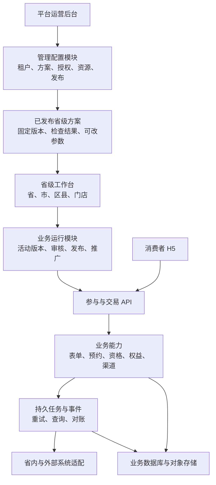

# 策划宝多租户平台建设蓝图

日期：2026-11-04。状态：建设建议，供产品与技术评审，不代表实施、发布或生产验收。

建设目标：平台统一建设业务能力，平台运营组装并发布省级方案，各省在授权范围内用少量参数自主开展业务。

关联：[整体改版方案](cehuabao-platform-redesign.md)。本文补充运营端、省级工作台、共享能力、核心对象及开发顺序。

## 1. 建设结论与适用前提

建议按“两个管理使用端 + 消费者 H5 + 共享业务内核”建设，并把**版本化的省级业务方案**作为运营交付的核心对象。

在逻辑上分为管理配置与业务运行两部分。前者负责各省的方案、授权、资源和发布，后者负责活动参与、客户提交、订单、发奖与数据。微软多租户架构对管理层与业务使用层有类似的职责划分。[W01]

初期采用边界清楚的模块化应用，交易与异步任务按职责部署。是否进一步拆成微服务，依据实际业务量、团队边界与独立扩缩容需求决定。

### 1.1 当前已知与需要补齐的信息

知识库已经描述活动、素材、权益、渠道、商机、订单、审核和区域权限，也保留了多个区域及版本差异。[K01][K02][K03]

当前仓库是 AI 产品工作台，不能直接视为策划宝生产业务源码。落到代码前，应取得实际业务系统的源码、技术栈、数据库与外部合同清单，并确认可改造范围。本文不依据工作台所用框架推定策划宝必须使用相同框架。

默认采用分阶段接入与迁移：先复用经过核验的现有业务能力，在新方案体系下封装；不能复用的部分按明确边界重建。

## 2. 系统总体结构



### 2.1 两个管理使用端

| 端 | 用户 | 建议首期菜单 |
| --- | --- | --- |
| 平台运营后台 | 平台运营、方案管理员、资源管理员、研发支持 | 省份与组织、需求台账、能力目录、方案装配、资源连接、方案发布、运行诊断 |
| 省级工作台 | 省市区店业务人员与审核人 | 我的工作、可用方案、营销活动、素材、客户与结果、业务分析 |

消费者 H5 是实际参加活动的入口，读取已发布活动版本并调用受控业务 API。

运营可以预览省内界面，但代理操作须有明确授权、操作身份与审计，不因“预览省端”自动获得该省客户明细。

### 2.2 运行边界

- 已发布方案生成可直接读取的固定配置，活动运行无需实时访问运营编辑器。
- 运营端短时不可用时，已发布活动仍应能够参与和查询结果。
- 授权撤销、下架、资源停用等运行策略仍由业务 API 实时或按规定时效执行，不能被配置缓存绕过。
- 高权限运营接口、凭据访问和普通业务 API 分别授权，使用不同的服务身份和必要的部署隔离。
- 31 省先作为逻辑业务空间设计；独立数据库或独立部署依据隔离、地域和容量要求选择，不由省份数量直接决定。[W03]

## 3. 最重要的对象：省级业务方案

例如“某省终端预约送券方案”需要完整说明：预约如何形成、用户何时获得券、使用哪些资源、哪些组织可以用、哪些参数可改、如何审核、结果如何统计。

建议区分以下六个对象：

| 对象 | 内容 | 谁维护 |
| --- | --- | --- |
| 业务能力版本 | 经过研发实现的表单、预约、发券等能力及合同 | 研发与能力负责人 |
| 通用方案版本 | 可复用的业务组合、页面、规则、参数定义 | 产品与平台运营 |
| 省级方案版本 | 固定通用方案版本及省级差异 | 平台运营，省内业务确认 |
| 省级授权 | 哪个省、哪些组织、角色可用，何时生效 | 授权人员 |
| 资源绑定 | 该省实际可用的门店、商品、权益和连接 | 资源管理员与省内负责人 |
| 活动版本 | 本次活动参数、固定业务方案、材料与审核结果 | 省内业务人员 |

省级方案、授权与资源绑定分别存储，省级方案不能凭配置自行授予资源权限。发布方案不等于批准具体活动。

### 3.1 方案内容示例

以下为逻辑示例，不是现有协议，也不含真实资源：

```text
业务方案：终端预约送券
引用版本：预约方案 / 固定版本
能力：基础页面、预约表单、门店接收、权益发放、渠道统计
资格：使用已定版的适用策略
触发关系：有效预约创建成功后，建立独立领取资格
资源要求：可用终端、门店目录、授权权益
省内可改：产品、活动时间、主视觉、本次授权额度
固定内容：字段标识、重复提交规则、履约状态、归因定义
组织范围：由独立授权记录确定
检查：权限、资源、参数、依赖、重复提交、结果不明路径
```

如果某省要求竣工后发券，应选择另一条已支持的业务触发策略，并绑定可用的竣工事件来源。不能只修改页面文案而保留预约后发券的执行逻辑。

### 3.2 配置继承与覆盖

首期仅建立“通用方案 → 省级方案 → 活动参数”三层，固定父版本，不开放任意深度继承。

每个可覆盖字段必须声明类型、必填条件、默认来源、取值范围、可改角色、资源要求及修改后需要重做的检查。省级和活动覆盖值只能收窄或在授权范围内修改，不能覆盖平台强制约束。

公共方案升级形成新版本。已有省级方案和活动不自动漂移；先显示影响与迁移计划，验证后再采用。

## 4. 如何把功能建设成可组合能力

### 4.1 能力既包含业务行为，也包含界面与检查

| 能力 | 输入 | 输出 | 关键责任 |
| --- | --- | --- | --- |
| 表单 | 已定义字段、活动版本、用户授权上下文 | 校验后的提交记录 | 字段验证、同意记录、重复提交处理 |
| 预约 | 有效提交、产品、门店接收规则 | 预约编号及业务状态 | 幂等建单、区域与派单检查 |
| 参与资格 | 场景、用户标识、适用策略 | 可参与或明确原因 | 次数、周期、前置条件 |
| 权益领取 | 有效资格、资源绑定、稳定业务请求标识 | 发放记录与最终／待核实状态 | 配额、幂等、查询、对账 |
| 渠道 | 活动、授权渠道与人员 | 推广物料及归因信息 | 参数校验、明细关联 |
| 数据视图 | 已定义事件、业务结果及权限 | 场景指标和明细 | 口径、去重、更新时间 |

页面按钮调用的只是能力入口。能力的资格、幂等、状态和错误处理应在服务端实现，不能仅通过前端组件拼接来保证业务正确性。

### 4.2 每项能力的最小合同

- 稳定标识与版本；
- 输入、输出和事件定义；
- 可配置参数及适用范围；
- 所需权限、资源和前置能力；
- 允许的后续动作、互斥关系与组合限制；
- 业务成功、明确失败、结果待核实的定义；
- 超时、幂等、重试、取消和查询责任；
- 可展示组件、运营说明及标准测试场景。

不能因存在“发券能力”就认为可以在任意节点触发。需要明确触发事件是否可信、资源是否适用、重复事件是否安全。

### 4.3 能力组合的边界

首期提供经过验证的组合类型，例如“预约”“预约后领券”“问卷后领取”“签到获得抽奖机会”。运营选择组合类型、策略和资源，系统限制无效连线与缺失依赖。

研发负责新增算法、外部协议和新的副作用；平台运营负责使用已有能力与策略完成组合；省内负责活动参数与执行。

## 5. 配置工具的建设顺序

### 5.1 第一期：结构化装配

运营在一个装配页面完成以下工作：

1. 选择业务目标和已有通用方案。
2. 选择支持的能力与执行策略。
3. 指定省内需要填写的参数和固定规则。
4. 绑定授权资源或声明必需的资源槽位。
5. 检查省内预览、消费者预览和异常结果。
6. 运行标准检查，提交方案验收与发布。

这些是运营的工作内容，不要求做成六个强制确认步骤。相同方案可复制为另一省的待配置版本，仅替换有效差异。

### 5.2 发布前进行“方案解析与检查”

将配置转换成一份确定的、可运行的发布结果，至少完成：

- 解析引用的能力与方案固定版本；
- 检查前后事件和数据是否匹配；
- 检查互斥条件、不可达动作和缺少结果路径；
- 生成省内最小参数表单与必要说明；
- 校验省级适用范围及资源绑定；
- 校验页面内容、执行规则和数据视图的一致性；
- 生成发布摘要、完整性摘要和检查记录。

未通过检查不能成为可用方案。运行时还要复核可能变化的授权、资源、额度和活动状态。

### 5.3 后续：受限的可视化编排

当稳定组合不能高效覆盖实际需求时，再增加流程画布、规则编辑和更多布局能力。画布复用同一能力合同与验证逻辑。

首期不开放任意脚本、SQL、HTTP 地址或无约束循环。业务连接由研发实现受控适配，运营只选择经过授权的连接方案。

## 6. 省级工作台如何自动简化

省内用户选择可用方案后，系统根据“活动可改参数”生成对应配置页。默认值来自组织目录、当前资源和适用策略。固定内容可查看说明，但不能随意改写。

例如预约方案仅呈现产品、时间、宣传内容；送券方案追加本次授权额度或权益选择；已绑定本店的账号不再填写门店。

所有界面由稳定的业务组件渲染。跨组件共享信息来自同一业务配置，修改产品、门店、时间或权益时，统一更新相关内容并重新检查受影响项。

AI 可辅助匹配方案、生成文案和提出候选变更。写入、授权与执行使用同一业务入口，模型故障时保留直接编辑路径。AI 安排在确定性配置和执行能力可用之后扩展。

## 7. 多租户、组织与授权

### 7.1 逻辑边界

每个省作为一个主要业务空间，其下维护省、市、区县、门店组织。集团管理员通过明确授权获得跨省管理或汇总视图，普通平台运营不因能装配方案而默认读取全部客户数据。

每次业务访问同时判断：当前身份、可信的省级上下文、方案授权、组织范围、操作权限、目标资源范围及必要状态。

省级上下文由服务端根据认证身份和成员关系确定。客户端传来的省份 ID 只能作为请求目标，不能直接作为授权证据。

### 7.2 数据与资源隔离

- 省内业务表保存省级空间和所属组织，跨对象关联检查归属一致。
- 缓存、任务、导出、文件下载与回调处理同样携带可信省级上下文。
- 公共素材／方案使用明确的共享目录与可见策略，不以缺少省份值自动视为公共。
- 队列按租户设置可配置的并发和资源预算，减少单省高峰对其他省的影响。
- 针对跨省访问、修改、导出、文件签名及后台任务执行建立隔离测试。

若新模块采用 PostgreSQL，可用行级安全增加数据库防护。但表所有者、超级用户和 BYPASSRLS 角色存在绕过条件，应使用受限运行身份，并正确管理连接池中的事务级省份上下文。[W04] 已有数据库的选择以实际改造条件为准。

### 7.3 功能开放、灰度与人员权限分别管理

省份可用能力使用正式授权记录；新版本灰度使用发布策略；用户操作使用角色、组织和资源权限。界面据此显示可用项，服务端执行最终校验。

微软多租户部署指南也区分渐进发布的功能开关和客户能力授权。[W02] 本方案不要求引入商业计费，先把能力授权与使用范围建清楚。

## 8. 建议的数据模型

以下为逻辑对象建议，需要在实际技术设计中确定命名、字段、索引及迁移方式。

| 分类 | 建议对象 | 重点关系 |
| --- | --- | --- |
| 身份组织 | 省级空间、组织、成员、角色、操作权限 | 成员归属和数据范围 |
| 能力目录 | 能力、能力版本、依赖及兼容规则 | 固定业务合同 |
| 方案设计 | 通用方案、方案版本、省级方案版本 | 固定引用、覆盖与完整性摘要 |
| 授权资源 | 方案授权、资源目录、资源绑定、连接配置引用 | 适用省份、组织、用途和有效期 |
| 活动发布 | 活动、活动版本、审核记录、发布记录 | 固定方案、参数、材料及批准版本 |
| 业务运行 | 参与、表单提交、预约、订单、领取资格、发放记录 | 稳定业务关联与各自状态 |
| 额度事件 | 资源额度／账本、业务事件、待投递事件、去重记录 | 原子约束、恢复与对账 |
| 治理 | 需求、方案变更、审计、导出任务 | 责任人、影响与权限 |

核心业务字段和金额／额度使用有明确类型与约束的模型；布局、表单定义及受控规则可以采用经过验证的结构化配置。避免将全部业务数据放入无约束 JSON。

方案、活动、审批、业务记录之间保存清楚的版本引用。业务副作用的稳定标识绑定业务记录，不因配置升级或技术重试产生新的领取资格。

凭据只存在受控服务端存储，方案中保存连接引用，不保存密钥、Cookie 或账号密码。

## 9. 真实业务如何可靠执行

以“有效预约后领券”为例：

1. 服务端校验活动状态、固定配置、授权、资格和用户提交。
2. 在业务事务中创建或取得同一预约记录，并记录待处理事件。
3. 异步消费者按稳定事件和业务标识建立领取资格，防止重复事件重复建资格。
4. 发放前按权威规则检查并处理额度，持久化原请求及必要预占。
5. 调用受控外部适配。明确成功后结算，明确失败按合同释放或处理。
6. 超时或返回不明时保留原请求，先查询或对账，不换请求标识盲目补发。
7. 用户可查询预约与奖励各自状态；奖励失败不删除预约成功事实。

消息投递按可能重复设计，去重记录、唯一约束和账本约束保证本地处理安全。无法替外部系统承诺“绝对只执行一次”，需要核对其幂等与查询合同。

首期可用数据库事务、事务内待投递事件、持久队列和业务状态机承接这类有限流程。大量跨天等待、复杂补偿或跨系统编排出现后，再评估专门流程引擎的收益。

业务审核和方案审核分开：方案检查证明组合可用；活动审核批准具体配置；发布必须使用批准版本。回退配置不会撤销已经成功的订单或发奖。[K04][K05]

## 10. 初期技术与部署建议

### 10.1 技术选择顺序

1. 核实策划宝实际技术栈与现有模块边界，优先复用可维护且符合合同的能力。
2. 保持核心团队熟悉的主技术栈，新增模块采用一致的接口与版本治理。
3. 若独立新建，可采用组件化 Web 前端、模块化后端、关系型数据库、持久任务和对象存储；具体框架由团队能力及基础设施确定。
4. 复杂流程引擎、独立搜索集群、流式分析平台等，在有真实需求与收益后引入。

### 10.2 最小部署边界

- 平台运营 Web 与省级工作台／H5 构建入口；
- 管理 API 与业务 API 的明确权限边界；
- 独立异步 Worker，避免外部调用阻塞页面请求；
- 关系型权威数据库；
- 对象存储及按权限提供的媒体下载；
- 已有可靠消息设施或可恢复的任务设施；
- 日志、业务追踪和按省份的运行指标。

能力模块可先共享业务服务进程，管理与运行模块按权限及可靠性需要隔离。不能因划分了业务能力就为每项能力立即创建一个微服务。

微软的多租户指南建议采用一致、自动化的部署与渐进发布，减少逐租户人工变更的不一致。[W02] 本项目具体发布仍遵守适用环境的现有运维合同，本文不发起生产操作。

## 11. 建设顺序和阶段交付

### 阶段 A：建立可实施基线

交付业务源码与系统边界清单、外部合同清单、用户任务基线，以及“共性／省级差异／新能力”需求分类。选择差异明确且愿意参与的试点省份，不先铺开全部省份。

先设计并评审六份合同：省级空间与权限、业务能力、方案版本与覆盖、资源绑定、活动版本与发布、业务事件与结果。

### 阶段 B：跑通一省无奖预约

交付最小运营后台、一个预约通用方案、一个省级方案、能力授权、参数生成、省内创建活动、审核发布、H5 提交、预约查询及基础归因。

完成标准：从运营发布方案到省内开展活动的完整链路真实可用，省内不用了解底层配置。先验证抽象能落地。

### 阶段 C：加入第二省和奖励组合

在试点所需的省级规则及外部合同明确后，增加另一省的资源或流程差异，以及“预约后领券”组合。

完成标准：已有能力能通过省级配置复用；确需新增的策略经过研发后进入公共能力目录。超时、重复事件和部分失败可恢复，基础预约结果不受奖励失败影响。

### 阶段 D：加入第三省并验证方案升级

选择另一类业务差异，完成方案复制、授权、资源绑定、升级影响预览、单省灰度和回退。确认升级没有改变其他省已发布活动。

通过试点数据确定需要补哪些运营工具，包括需求匹配、批量开通、可视化流程或更细权限。

### 阶段 E：扩展业务与迁移

扩展问卷、签到、抽奖、企微和号卡，按能力依赖和现网频率排序。旧活动继续绑定旧规则运行，新建逐步进入新方案路径；每个业务对象在切换期有唯一权威写入路径。

第一期先交付阶段 B 的完整纵向链路，再通过 C、D 证明省级差异能够复用。排期和人员数量需要实际源码与依赖评估，不能仅根据“31省”估算。

## 12. 研发与运营分工

| 责任 | 建议负责人 |
| --- | --- |
| 共性需求、场景与差异裁决 | 产品负责人，联合省内业务负责人 |
| 多租户、配置合同与运行边界 | 技术负责人 |
| 能力、适配、交易和任务 | 后端研发 |
| 装配工具、参数表单、工作台与 H5 | 前端研发 |
| 隔离、组合、异常、升级与体验验收 | 测试与业务验收人员 |
| 装配、资源协调、开通和方案维护 | 平台运营 |
| 活动承诺、资源用途与省内业务验收 | 省内业务负责人及适用审核人 |

需求台账分别标记：省内可自助、可直接开通、可组合交付、需新增研发。记录从受理到可用的时间及反复修改原因。

## 13. 试点验收标准

- 同类省级需求可复用能力与通用方案，差异明确记录，不复制整套业务代码。
- 省内只填写被开放的业务参数，关键公共信息不重复输入。
- 运营配置无效组合时，系统能在发布前指出具体缺项或冲突。
- 方案发布、能力授权、资源绑定与活动批准分别正确生效。
- 省级数据、文件、导出、缓存和后台任务隔离通过测试。
- 活动固定方案与批准版本，模板更新不会静默改变线上活动。
- 重复消息、重复点击及超时恢复不会重复创建本地业务资格或重复结算。
- 外部结果不明能查询原请求，不能显示为已到账或盲目补发。
- 运营配置服务不可用时，已发布活动的常规业务仍可运行。
- 首省及后续省份的研发投入、运营配置耗时、省内操作成本分别可测。

第一轮目标是验证“方案能复用、省内更简单、业务结果可信”，具体量化目标沿用整体改版方案的用户任务测量方法，并用试点基线校准。

## 14. 首先安排的具体工作

1. 提供真实策划宝源码与架构清单，核对现有能力和外部合同。
2. 选择预约相关的代表需求，形成一份共性与省级差异对照表。
3. 确定省级空间、方案、授权、资源绑定和活动版本的逻辑模型。
4. 设计运营装配、方案检查发布、省内最小配置三个关键页面。
5. 先实现一个无奖预约的真实闭环，再验证第二省和奖励能力扩展。

## 15. 依据

### 本地业务依据

- [K01 核心对象模型](../../knowledge-vault/01-产品架构/核心对象模型.md)。
- [K02 权限数据风险模型](../../knowledge-vault/01-产品架构/权限数据风险模型.md)。
- [K03 产品进化路线图](../../knowledge-vault/03-产品进化规划/产品进化路线图.md)。
- [K04 权限审核与运营治理](../../knowledge-vault/02-业务域知识/权限审核与运营治理.md)。
- [K05 奖品券与资损核销](../../knowledge-vault/02-业务域知识/奖品券与资损核销.md)。

以上描述知识依据，不能代替策划宝真实源码、当前生产状态及外部联调合同。

### 外部架构参考

- [W01 Microsoft：多租户管理层的职责与设计](https://learn.microsoft.com/en-us/azure/architecture/guide/multitenant/considerations/control-planes)：用于管理与业务运行分工的参考。
- [W02 Microsoft：多租户部署与配置](https://learn.microsoft.com/en-us/azure/architecture/guide/multitenant/approaches/deployment-configuration)：用于统一代码基础、自动化发布及授权与灰度分工的参考。
- [W03 Microsoft：租户与部署模型](https://learn.microsoft.com/en-us/azure/architecture/guide/multitenant/considerations/tenancy-models)：用于区分逻辑省级空间与独立部署。
- [W04 PostgreSQL：行级安全策略](https://www.postgresql.org/docs/current/ddl-rowsecurity.html)：用于数据库隔离能力及绕过条件说明，不构成强制迁移数据库的建议。

架构与实施顺序为本方案的项目判断。本文仅保存为本地建设文档，不发布知识版本，不同步外部知识库。
