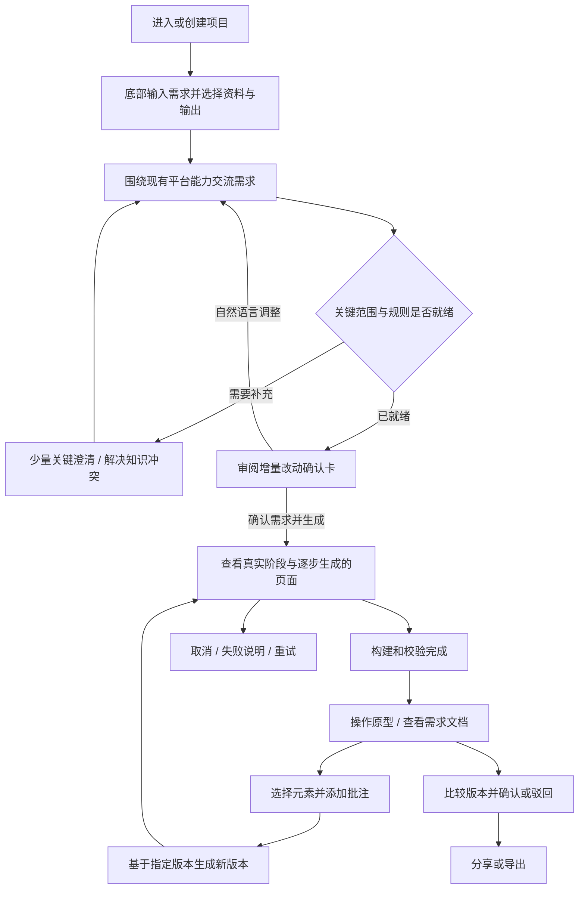

# AI 可视化原型工作台：参考 Muse 视频的前端重构需求

| 项目 | 内容 |
| --- | --- |
| 文档性质 | 完整前端产品需求与实施约束，可用于设计、开发和验收 |
| 文档版本 | 1.2；全新前端，以合适的开源项目二次开发，不兼容旧前端，该编号不是应用发布版本 |
| 编写日期 | 2026-11-15 |
| 适用项目 | ai-product-workbench，本机代码与 GitHub 为维护来源 |
| 需求依据 | 用户提供的 Muse 参考视频、已确认的产品取舍、当前本机代码 |
| 交付边界 | 本文定义待实施的重构要求，不表示这些新增能力已实现或通过验收 |

## 1. 项目概述

### 1.1 产品目标

将当前工作台升级为以页面预览为中心的可视化创作产品。用户在底部居中的对话框表达需求，在中央主工作区看到页面逐步形成，随后直接操作页面、选中元素提出修改、比较版本，并完成分享或导出。

产品应接近参考视频的空间组织、浅色界面、悬浮工具和可见构建过程。选择合适的开源前端项目作为新基线，通过二次开发形成新的信息架构、路由、组件、状态、页面舞台和交互流程，将现有产品能力完整落实到新体验中。旧前端整体退出交付范围，不以旧界面、旧画布、旧路由、旧状态结构或兼容层约束新方案。

用户最新明确要求：“前端是舍弃旧的，完全按照完美的新项目来做，不要兼容旧的。”本版本据此撤销 1.0 中关于旧页面入口保留、旧链接转换、旧 query 参数恢复、旧资料画布备用视图和旧元素锚点兼容的要求。后文的“保留能力”均指新产品提供对应业务功能，不指保留旧实现。

用户随后在前端实施对话明确补充：“前端不要自己0-1手搓，用合适的开源项目二开。”因此，开源应用基线与实际核心代码复用也是必需交付条件；仅参考截图后从零重写，或仅使用通用 UI 库，不满足本次实现要求。

本次交付同时满足四个结果：

1. 页面是视觉主体，聊天输入固定在底部中央，功能面板按需展开。
2. 生成期间能看见真实的中间页面与当前处理范围，不必一直等待最终结果。
3. 最终原型仍能真实点击、输入、切换页面、提交表单和改变状态。
4. 现有需求文档、原型、资料、知识、运行、版本、批注、分享、导出与发布流程无功能退化。

### 1.2 参考视频及采纳范围

参考文件：`v2800fgi0000dbptc3vog65qievc5s70.mp4`。视频约 9.7 秒，分辨率 720 × 1280，内容是对桌面显示器的拍摄。画面可辨认出 Muse 页面，以及一个逐步构建的账户设置界面。

| 视频中可观察的内容 | 本项目需要形成的体验 | 适用边界 |
| --- | --- | --- |
| 浅灰背景、白色圆角页面、紧凑导航 | 浅色工作台、清晰层级、页面占据主区 | 参考整体语言，不复制品牌、账户和业务内容 |
| 设置页文字、图标、行内容逐步出现 | 随真实生成结果更新页面草稿 | 不将完成后的页面拆开播放，冒充实时生成 |
| 蓝色元素边框、尺寸标记 | 当前元素定位、选择轮廓与尺寸查看 | 基于实际节点和真实位置 |
| 多个彩色指针 | 可以借鉴当前处理位置的可视反馈 | 视频无法证明真实多代理协作；本次不要求模拟多用户光标 |
| 底部黑色进度工具条 | Composer 上方的精简生成状态条 | 保留本项目底部居中的对话框 |
| “Scanning page…”、图层计数、“22 agents” | 用用户能理解的阶段与可验证数量解释当前进展 | 不硬编码代理数、图层总数或虚假百分比 |
| “Tour”、倍速、声音、滚动提示 | 仅借鉴轻量提示和不过度遮挡的表达 | 不把演示播放控件强行加入生产工作流 |

视频是外观和交互参考，不是端到端功能规格，也不是“9.7 秒完成生成”的性能承诺。本文补齐视频没有展示的资料输入、审批、异常处理、版本管理和交付流程。

原始视频不随本文提交到公开仓库；录屏中的账户信息不用于产品示例、宣传素材或测试数据。

### 1.3 已确定的产品取舍

- 保留底部居中的 Composer，不改成长期占据半屏的侧边聊天栏。
- 以可视化原型与需求文档协同为核心，允许进行重大版本重构。
- 完整重建产品功能；旧前端组件树、布局、样式、状态与画布实现不作为必须复用的资产。
- 主工作区统一组织页面、文档和资料，只有一套新产品界面，不提供“返回旧画布/旧工作台”完成业务的备用路径。
- 不开发旧路由、旧 query、旧组件 API 或旧前端协议的兼容层，不维护新旧两套前端。
- 以经过源码、许可证与依赖评估的开源应用作为前端基线，实际复用其适合本项目的核心工作台、编辑或预览能力，再接入业务后端；不从零手写整套前端。
- 真实阶段、真实草稿、真实交互和完整交付是必需项；高级自由排版编辑器、多人实时协作、代理编队展示不属于本次必需项。
- 使用现有运行与版本体系实现前端升级。本次不因页面外观而重新替换 Temporal、DeerFlow 或建立第二套任务编排。

### 1.4 术语

| 术语 | 本文含义 |
| --- | --- |
| 工作区 | 项目内承载页面、文档、资料及工具的整体界面 |
| 页面舞台 | 中央显示当前页面或页面总览的区域；不限定使用哪种画布库 |
| Composer | 底部居中的需求输入框，以及附件、模型、输出类型、设计上下文等控件 |
| 计划 / Plan | 一次生成或修改的输入和审批对象 |
| 运行 / Run | 实际执行生成任务的记录；重试可能包含不同 attempt |
| 草稿预览 | 生成过程中的受限、未冻结投影，不等同于可交付版本 |
| 修订版本 / Revision | 有明确身份、状态和内容校验值的原型版本 |
| 图层 / 节点 | 页面结构中的可定位单元，不等同于浏览器所有 DOM 节点 |
| 浏览模式 | 用户操作生成页面本身的模式 |
| 选择模式 | 用户选择元素、查看范围并提出批注的模式 |
| 冻结产物 | 已校验并不可变保存的可预览、可分享或可导出内容 |

本文的版本历史、源版本和旧 attempt 指新产品运行中的业务记录与并发隔离，不是旧版前端的兼容要求。新产品仍需完整拥有版本管理和数据一致性能力。

## 2. 需求概述

### 2.1 当前代码基线与主要缺口

以下为本次阅读到的代码事实，用于盘点产品能力与后端依赖，不构成旧技术复用或兼容要求。运行结果与发布状态以项目当前审计为准。

| 领域 | 当前代码基础 | 本次需要完成的变化 |
| --- | --- | --- |
| 前端基础 | Next.js、React、React Query、Zustand、Radix、Tailwind；已有 React Flow 画布 | 建立统一布局与设计体系，选择适合页面预览的舞台承载方式 |
| V2 主界面 | 独立全屏覆盖面板、深色界面、侧栏、单个预览区；打开时隐藏其他主区内容 | 以新架构重建统一工作区，移除旧覆盖式工作台与备用入口 |
| 输入 | 当前 ProjectComposer 已有附件、模型、输出类型及设计上下文 | 新 Composer 完整提供这些能力，重新设计主次、空间与状态 |
| 生成展示 | V2 页面主要轮询 Plan/Revision；已有 Run 事件体系未完整接入该界面 | 接通项目授权的进度与草稿投影，建立真实渐进预览 |
| 中间内容 | 现有 generationPreview 有受限节点与页面投影 | 安全渲染这些中间结果，处理更新、缺口、重连与最终版本切换 |
| 页面交互 | 隔离 iframe，已有页面选择和点击、焦点、输入、改变、提交事件桥接 | 显式区分浏览与选择模式，增加真实几何定位 |
| 版本闭环 | 已有版本、差异、反馈、确认、驳回、再生成 | 在新信息架构中完整实现，可调整接口以支持目标体验 |
| 交付 | 已有分享、撤销、HTML/React 导出及下载流程 | 改善入口和状态表达，保持真实产物和权限约束 |

### 2.2 用户与权限

保留现有项目角色 `owner`、`editor`、`viewer`。下表是原型 V2 当前服务权限的前端表达，其他项目管理能力继续遵循其已有服务权限，不因换界面而扩大授权。

| 操作 | owner / editor | viewer | 匿名分享访问者 |
| --- | --- | --- | --- |
| 查看授权项目的计划、版本、页面、差异与批注 | 允许 | 允许 | 仅能看分享允许的公开页面 |
| 在授权预览中操作页面控件 | 允许 | 允许 | 允许操作公开原型中的展示交互 |
| 创建/审批/取消/重试计划 | 允许 | 不允许 | 不允许 |
| 新增/解决批注、发起修改、确认/驳回版本 | 允许 | 不允许 | 不允许 |
| 创建/撤销分享、创建/重试/取消导出 | 允许 | 不允许 | 不允许 |
| 查看项目内已有分享、导出记录及下载可用导出 | 允许 | 允许 | 不提供项目管理入口 |

按钮状态应解释不可操作的原因，服务端仍负责最终授权。匿名分享不得通过隐藏按钮、页面源码或请求返回获得项目内部数据。

### 2.3 信息架构

| 位置 | 默认内容 | 展开内容与规则 |
| --- | --- | --- |
| 顶部轻量栏 | 项目名称、当前上下文、保存/运行状态 | 版本选择、分享、导出；小屏收进菜单 |
| 左侧窄导航 | 项目、页面、文档、资料、运行等入口 | 点击展开对应面板；名称可见或有可访问标签 |
| 左侧上下文面板 | 按需展示页面列表或资料目录 | 页面、图层、版本、运行等互斥切换，不永久挤占主区 |
| 中央页面舞台 | 当前页面预览 | 多页面总览、文档、空态、生成中间结果 |
| 右侧工具面板 | 默认收起 | 元素信息、批注、差异详情；与选中对象关联 |
| 底部中央 | Composer | 输入、上下文标签、附件、模型、输出、发送/停止 |
| Composer 上方 | 有运行时显示精简状态条 | 展开阶段明细；完成后收敛为简短结果入口 |

桌面布局示意，尺寸是本次设计起点：

```text
┌──────────────── 项目 / 当前页面 / 版本 ─────────── 分享 导出 ┐
│ 窄导航 │ 可收起目录 │                                  │工具│
│        │ 页面/文档  │         中央页面舞台              │面板│
│        │ 资料/运行  │     白色页面、选择框、缩放         │可收│
│        │           │                                  │起  │
│        │           │       生成状态与阶段明细入口       │    │
│        │           │      底部居中的 Composer          │    │
└───────────────────────────────────────────────────────────┘
```

### 2.4 核心用户流程



“需求文档＋原型”继续是默认联合输出；“生成文档”和“生成原型”保持独立可选。文档单独生成时展示文档的真实生成过程，不强行制造空白原型页。

## 3. 功能需求

### 3.1 工作区与视觉体系

#### FR-01 统一项目工作区

进入项目后显示同一套新导航、主区、上下文面板和 Composer。页面预览、文档、资料与运行记录在新工作区内切换；切换视图不会创建新任务、重置项目或丢失已提交状态。旧覆盖式工作台与其备用入口应移除，所有业务功能由新的产品入口承载。

#### FR-02 参考视频对应的视觉语言

默认采用浅中性背景、白色页面、细边框、适度圆角、轻阴影和蓝色选择强调。深色仅可用于小面积状态工具条等辅助元素。工作台外壳主题不强制改变生成页面自身的配色。新主题系统统一设计，不为兼容旧主题变量或旧组件外观增加分支。

设计起点：顶部栏高 48–56 px，窄导航宽 52–64 px，展开目录宽 240–288 px，右侧面板宽 280–336 px，Composer 最大宽 760 px。使用统一的颜色、间距、圆角、字阶和层级变量，不在各模块分别堆叠固定颜色。

在 1440 × 900 的桌面场景下，左右面板收起时主区至少占可用内容宽度的 80%；展开一个常用面板时仍保持页面为视觉主体。面板和输入框遮挡的区域不能算作可见页面面积。最终数值可经设计验证微调，但不得回到聊天占半屏的布局。

#### FR-03 新信息架构中的完整产品功能

新项目应提供项目首页/列表、文件及导入源、知识上下文、设计系统/预设、模型选择、运行历史、产物、分享/导出和发布能力。从项目工作区打开任一一级功能不超过两次操作。低频功能可进入菜单，不能仅保留 API 而没有新产品入口。

资料、文档、原型、媒体、关系以及编辑/变体能力需要在新视图或上下文菜单中重新组织。不得用挂载旧 React Flow 资料画布、旧运行页或旧发布页的方式满足本条。产品能力清单用于验收业务完整性，不要求保留旧控件、旧路径或旧交互形式。

### 3.2 底部对话与输入

#### FR-04 底部中央 Composer

桌面端 Composer 相对中央可用舞台居中，停靠底部并保留安全距离；展开左右面板后随可用舞台重新居中。输入框默认紧凑，多行自动增长但设置最大高度，超过后内部滚动。状态条与输入区构成稳定底部区域，不随每条消息上下跳动。

主区需预留底部可见空间或允许将页面平移到无遮挡位置。焦点元素、页面底部按钮、弹出菜单不得永远被 Composer 挡住。用户可主动收起输入区进入专注预览，并有一键恢复入口；生成结束不擅自收起正在输入的内容。

#### FR-05 完整保留输入能力

新输入体系完整支持文本需求、图片、文档、屏幕截图、网站/GitHub/Figma 导入源、源码原型导入、模型、目标终端、输出类型、设计预设/自定义设计系统以及文档或产物上下文。现有服务用于能力盘点；需要调整的接口应与新前端一起形成明确合同，不以旧适配层形状限制新体验。

附件分别显示等待、上传/解析、可用、失败和移除状态；未就绪输入不得被静默丢弃后提交。模型不可用、设计预设加载失败、资料无权限等情况提供明确解释和重试入口。默认联合输出不得在重构中无提示变成仅生成原型。

#### FR-06 新建与修改意图

Composer 明确显示“新建计划”或“修改版本 N”，并展示所引用页面/元素/批注。提交前能清除上下文。选择一个元素不自动提交修改；切换版本不把输入悄悄附到新版本。

修改版本默认引用该版本的资料和设计上下文，提交前明确显示本次固定输入。需要变更上下文时，采用新合同定义的修改计划并保留来源关系，不因旧接口限制而静默忽略新资料。纯文字修改具有直接入口，并明确关联源版本；不能要求用户必须先点击元素。

#### FR-07 对话记录与生成期间输入

对话记录默认收敛为可展开的历史面板，展示用户输入、面向用户的回复、必要工具结果、审批问题和产物链接。不得把内部调试日志或模型隐藏推理作为产品正文。

生成期间允许继续编辑本项目的未提交草稿，也允许将后续要求保存到讨论中；明确说明这些要求尚未进入当前冻结基线，后续需重新梳理和确认。若当前流程不允许并行执行，不暗示已排队生成。停止与发送采用不同状态，不因快速重复点击产生多个计划。输入中文时，输入法确认键不能误触发送；支持明确的发送与换行快捷键提示。

### 3.3 计划、审批和运行状态

#### FR-08 可审阅计划

生成前展示需求目标、增量范围、输出类型、已绑定资料/设计上下文、当前状态及可用操作。只有服务端真实返回的页面建议或任务拆解才可展示；不存在的数据不能作为“已规划”内容编造。“确认需求并生成”是唯一一次生成前审批，服务端内部 Plan 审批并入该操作，不再要求第二次点击。此操作不表示确认最终成果。

待审批计划的调整采用新合同定义的明确动作，并保持用户输入和资料绑定完整。已审批执行中的输入不能被静默改写，变更应创建有来源关系的新计划。不能以旧接口缺少更新动作作为保留旧交互的理由，也不能展示没有对应服务能力的按钮。

#### FR-09 真实进度条与阶段说明

状态条展示当前阶段、已耗时、已知页面数量或当前活动，并提供展开详情和停止入口。已耗时表示经过时间，不表示完成百分比或剩余时间。只有服务提供有含义的 `progress` 时才展示百分比，阶段切换时标明它属于当前阶段还是整个任务。

用户文案可把现有阶段归为“理解需求、整理资料、编写需求文档、建立页面结构、生成界面、校验与准备预览”等。界面按真实事件出现，不预先逐个点亮所有阶段；未执行的阶段可以不存在。重复、回退或重试阶段有明确说明。

#### FR-10 生成过程中的页面展示

收到经校验的中间预览后，在中央展示对应页面草稿，并随新的真实投影更新。文字、结构、图标或区域可以按真实更新短暂淡入和高亮。按 2026-11-17 用户追加的 Swarm 展示目标，允许使用开源绘制光标、框选和打字动效表达收到的节点变化；仅由真实投影触发，未变化的内容不重播，更新中保留仍有效的绘制任务。动效光标不代表后台代理身份或协作者数量。提供关闭入口，尊重减少动态效果设置，切页、退出草稿、终态及后台标签页及时停止或暂停。绘制期间保留共同文字前缀并及时露出新内容；第 6.1 节事件到实际可见画面 P95 ≤ 500 ms 的要求不变。连续更新或长文本时，一轮完整绘制最多两秒后退场，让当前真实草稿直接显示；此退场上限不代替首次可见更新的性能指标。初始没有草稿时显示阶段与占位，不用示例成品冒充结果。

草稿显著标注“生成中，内容可能变化”，其互动范围按数据类型说明：当前惰性节点投影不执行生成脚本，也不能被误认为最终可操作原型。最终版本只有在构建、校验和冻结成功后才标为可交付。

本次必须打通真实增量展示：验收样例至少能在终态前看到两次内容有变化的有效中间投影，其中至少一次能定位到变化页面或节点。只接入状态文字、只显示最终页面、或事后播放成品动画，均不满足此需求。

#### FR-11 页面、图层与当前处理位置

有稳定页面/节点身份时，显示当前处理页面以及新增或更新节点的轮廓；短暂高亮结束后恢复普通显示，不持续闪烁。已生成节点数来自实际接收的结构。总数未知时只显示“已显示 N 个节点”或当前阶段，不出现伪造分母。

同一对象多次更新只计一次已存在节点；删除或替换按真实结构处理。多个活动没有坐标时仅显示活动列表，不能绘制虚假的多个代理光标。Swarm 绘制光标的位置来自实际草稿的 DOM 测量，只表示视觉重建，不标注模型、Agent 名称或协作人数。尺寸标签使用实际页面坐标中的宽高，并明确单位为 CSS px。

当上游只提供页面级完整快照时，高亮“该页面已更新”；只有能可靠获得节点差异时才细化到图层。本次不要求推断模型内部正在编辑的精确位置。

#### FR-12 草稿覆盖范围与最终切换

当前中间预览合同每次最多包含 4 个页面、每页 120 个节点，这是受限投影，不是最终原型的页面上限。新版不能把该限制误显示为“项目最多 4 页”，也不能将投影中的部分节点总数当作全项目图层总数。

超出当前投影范围的页面显示“该页暂无中间预览”和真实状态；需要扩展覆盖时，以有界、按页或窗口读取的方式补齐，不放开为无上限事件。最终版本仍完整支持现有最多 50 页的合同。切换最终版本时保留能匹配的当前页面、视口和选择，并清除过期草稿高亮；匹配失败则明确返回页面列表。

#### FR-13 恢复、断线与事件一致性

刷新、重新打开项目、切换页面后恢复同一计划和运行，不自动再次提交。断线显示“正在恢复连接”，保留最后一次有效画面，并区分网络状态与任务状态。

重复事件不得重复增层，旧 attempt 的迟到消息不得覆盖新任务。事件缺口先同步权威快照再继续应用；断线恢复不回放完整装饰动画。切换项目立即解除旧订阅，旧页面回调不得污染新项目。查看历史版本时，正在运行的任务只提示有新结果，不强制抢走当前版本。

#### FR-14 取消、失败、重试与审批等待

取消提交成功后显示“停止请求已提交，等待确认”，收到真实终态后才显示“已停止”。失败展示面向用户的原因、可重试性和诊断编号；最后有效草稿可保留查看，但不得开放为已成功的分享或导出。

重试显示与源计划的关联并沿用服务规定的固定输入，不覆盖历史失败记录。运行要求补充输入或审批时，在状态条和对话中给出待办，避免任务看起来一直运行。重新连接、重试和重新创建是不同动作，不能用同一个按钮隐式混用。

### 3.4 页面舞台与真实预览

#### FR-15 多页面目录与总览

提供页面名称、缩略图、顺序、当前状态和当前选中标识，支持按名称查找。页面总览显示多个页面卡片，点击聚焦单页；返回总览时保留位置。总览用于浏览和选择，不默认变成无限制拖拽排版工具。

最多 50 页时仍能访问每一页。缩略图延迟加载，优先当前页与可见页，不同时运行 50 个完整交互 iframe。缩略图失败仅影响对应卡片，不阻塞其他页面。

#### FR-16 视口、缩放与移动

提供适应可见区域、100%、缩小/放大和恢复视图。支持桌面鼠标/触控板与移动端触摸；画布移动手势应与页面内部滚动区分，并有操作提示。放大后可以访问页面四角和底部，不出现无法恢复的离屏状态。

“目标终端”决定生成上下文，“预览尺寸”用于检查当前页面布局，两者不能混为一谈。调整预览宽高不自动触发重新生成。尺寸预设和自定义值需要有合理边界；不得把视觉缩放当成页面响应式重排。

#### FR-17 浏览模式

浏览模式为最终可交互页面的默认模式。点击、输入、下拉、单选/复选、提交、弹层、页面跳转和本地状态变化保持有效。选择框、批注覆盖层和进度层不得拦截正常操作。

使用完整、已验证的预览文档及其页面切换协议；不能单独执行页面 DOM 片段导致脚本、样式或路由丢失。浏览器刷新、切换版本或重新载入预览会重置临时表单状态时，需要保持行为可预期；本次不承诺保存生成页面自身的临时业务数据。

#### FR-18 选择模式与图层定位

选择模式有清楚的开启/退出入口和当前模式标识。悬停显示轮廓，点击选中节点并打开元素信息；点击生成页面按钮在此模式下用于选择，不触发业务操作。按 Esc 退出选择或关闭顶层面板；键盘也能通过图层列表选中元素。

新页面模型统一定义稳定节点 ID、页面 ID 与版本身份，并据此完成定位。图层列表与画面选择双向联动，可定位父级，显示可用的名称、类型、层级和尺寸。内部定位可使用有界 selector，但不为旧节点协议建立回退链路。新生成内容缺少必需的节点身份时，应修复生成/构建合同，不用兼容旧产物掩盖缺失。

#### FR-19 几何定位与覆盖层

元素边框、尺寸、批注锚点随页面滚动、舞台缩放、浏览器缩放、预览尺寸变化和窗口 resize 同步。不可见、被移除或零尺寸节点清理覆盖层。不能通过读取跨源 iframe DOM 或放宽沙箱来实现定位。

几何由沙箱内测量，经有界消息传递；接收端校验当前 frame、页面、版本/草稿身份及消息序列。画面覆盖层仅为当前浏览状态，不修改已冻结 HTML 或其校验值。

### 3.5 批注、修改与版本

#### FR-20 元素批注与普通批注

用户可对当前版本整体、页面或选中元素写批注，保存前显示绑定范围。正文具备明确长度上限及校验，支持失败后重试且不产生重复批注。新锚点合同明确页面、节点、源版本和必要引文，不要求兼容旧 `pageId + selector + quote` 的数据形状。

在新产品的版本迭代中，源版本节点被删除或无法匹配时显示“原元素未找到”，保留原页面、引文和正文；不得静默绑定到相似但不同的元素。只读用户可查看和定位，不能发送、解决或改写批注。

#### FR-21 批注驱动修改

批注列表区分未解决/已解决，支持按页面和状态筛选、选择部分未解决批注，明确显示此次修改会采用的批注。现有提交上限为 1–100 条，并受合成提示词长度校验；超限时给出拆分或减少选择的提示。

提交后生成新计划/新版本，不修改源版本。批注已被其他人解决或版本状态变化时，刷新相关记录并让用户重新确认选择，不偷偷替换输入。生成成功不等于所有批注自动解决；沿用真实服务状态，保留人工核对入口。

#### FR-22 版本历史与差异

按版本号展示时间、标题、来源和状态，支持打开历史版本、返回当前版本、查看与源版本的差异。差异至少准确展示页面新增、删除、修改与未变更；元素级差异只有服务数据支持时才显示。

选择历史版本后，页面、批注、分享和导出都明确绑定该版本。新结果就绪时显示提示，由用户选择切换。前后版本画面对比可使用单独的比较视图，不能混用一份 iframe 状态造成内容错配。

#### FR-23 确认、驳回与冻结版本

“生成完成”“待确认”“已确认”“已驳回”分别表达，避免把成功生成自动解释为用户认可。确认和驳回使用服务端允许的状态变化，操作中防止重复提交；并发冲突后拉取最新状态解释原因。

冻结版本内容、校验值和历史导出不因主题、选择框或后续生成而变化。内容更新通过新的版本完成，界面状态变化不能直接写回冻结产物。

### 3.6 文档、资料和交付

#### FR-24 需求文档与原型关联

需求文档具有独立可阅读视图、版本/运行来源和现有操作入口。联合输出时能从原型找到对应需求文档，也能从文档进入关联原型；展示真实来源关系，不根据相近时间猜测关联。

保留文档继续完善、基于 PRD 生成界面、多屏流程及已有文档产物下载/导出能力。纯文档任务不被原型计划界面阻断，联合任务某一产物失败时明确分项状态，不能把整组标为全部成功。

#### FR-25 文件、导入源、知识与设计上下文

资料面板保留现有上传、导入、解析、选用、失败查看与管理能力；各资料是否参与当前生成应可见。知识能力继续使用本项目已经配置的数据源与权限，不因界面重构自动外传或改接其他知识库。

设计系统/预设与模型保留当前加载、选择、不可用和重试行为。引用已删除或无权限资料时，按服务返回解释并提供移除/替换入口；已冻结版本仍可查看，不因源资料列表改变而被前端重新生成。

#### FR-26 分享与公开访问

创建分享前显示绑定版本和有效期，成功后可复制真实链接；复制失败给出可手动复制的文本。分享列表显示有效、已撤销或已过期，支持撤销并显示真实结果。更换当前版本不会自动把旧分享升级到新版本。

公开页采用一致的轻量视觉，支持允许范围内的页面切换与真实交互，不展示 Composer、内部运行、资料、私有批注或编辑控件。无效、过期、撤销、无可用预览和加载失败有独立状态，不暴露内部存储路径。

#### FR-27 HTML / React 导出

导出前显示版本、格式和说明；提交后展示排队、构建、成功、失败或取消状态。成功必须有实际可下载文件，浏览器真实下载的内容应与服务提供的大小和 SHA-256 一致；不能以创建任务成功替代导出成功。

失败可查看原因并在服务允许时重试；排队/构建中可取消，等待真实终态再标记取消。旧版本导出不受当前选择或新版本生成影响。HTML 可打开，React 包按随包说明能够安装、构建并运行代表性交互。

#### FR-28 项目、账户、运行与发布入口

新项目完整提供登录、注册、邀请接受、项目进入、项目管理、运行历史、产物查看、分享和发布功能。统一设计新的路由与导航结构，不要求保留或重定向旧 `/share`、`/share/[token]`、`/prototype-share/[token]` 等地址。新生成的链接必须准确指向新产品资源并支持直接访问。

账户和辅助页面使用相同基础设计变量。需要的集成功能通过新产品入口提供，不挂载旧前端页面；本次不扩展外部系统功能。运行历史可跳到对应计划、版本或产物，并区分技术运行失败与某个产物失败。

### 3.7 通用状态、响应式与可访问性

#### FR-29 加载、空态、失败与冲突

每个主要区域分别具备首次加载、无数据、加载失败、无权限、数据失效和可恢复错误状态。局部失败不清空整个工作区。Toast 只作为补充，关键失败与待办必须能在原位置重新找到。

HTTP 202 或请求成功只表达“操作已接受”，除非响应已经给出对应终态。401 保留允许保留的未提交文本并引导重新登录；403 说明权限变化；404/失效链接提供返回项目入口；409/412 冲突刷新权威数据后保留用户输入。不得用无限自动重试掩盖明确业务错误。

#### FR-30 响应式布局

桌面以中央舞台为主；平板默认只展开一个侧面板；手机使用全屏目录/底部抽屉，关闭后返回原页面位置。Composer 在手机上仍位于底部中心，适配安全区和软键盘；键盘弹出后发送、停止和正文输入可见。

至少验收 1440 × 900、1280 × 800、768 × 1024、390 × 844 和 360 × 800。工作台外壳不得出现横向溢出；生成页面自身的宽页面可在预览视口内滚动或缩放。手机支持输入、查看结果、批注、版本、分享及导出入口，不仅能看静态缩略图。

#### FR-31 键盘、读屏和减弱动画

导航、面板、计划操作、模式切换、页面选择、批注和导出可通过键盘完成；焦点轮廓可见。弹窗管理焦点并在关闭后返回触发点，不产生多层不可退出的焦点陷阱。iframe 有明确标题，图标按钮有名称。

状态变化采用适度的读屏通知，不逐字播报高频节点更新。提供减弱动画支持，系统偏好开启时取消逐层淡入和移动装饰，但真实进度、页面更新和选择信息保持完整。颜色不是区分运行状态或批注状态的唯一方式。

#### FR-32 页面与上下文恢复

按新路由合同实现刷新、直接访问及浏览器前进/后退，正确恢复计划、修订版本和页面。不要求识别或转换旧 `prototype=1`、`prototypePlan`、`prototypeRevision`、`prototypePage` 参数，也不为旧前端状态建立恢复适配。

视口、面板展开和最后选页按用户与项目隔离；版本级选择不能串到其他版本。未提交文字可按项目保存，退出登录应清理相关私有缓存；附件只保存授权引用和状态，不能把临时 URL 当永久资源恢复。

#### FR-33 全新前端架构与旧实现退出

交付只有一套新应用架构：新的应用外壳、路由、组件体系、状态边界、页面舞台、资料与文档视图，以及业务访问层。业务能力可以调用适合新合同的现有后端，也可以通过配套变更调整后端；底层通用库按新需求选型。

新应用不得运行旧工作台作为隐藏层、嵌入页、备用入口或兼容模式；不交付旧 query 翻译、旧组件 API 包装和旧节点协议回退。被替代的前端实现及只服务旧 UI 的适配代码从交付路径移除，相应测试改为验证新产品行为。现有生产环境的切换由后续集成发布阶段负责，不在前端开发阶段直接清理线上数据。

#### FR-34 开源应用基线与二次开发

选择能支撑目标视觉与交互的开源应用，固定仓库、提交和许可证作为新前端基线。需要实际复用其核心工作台、编辑/预览、元素选择或相关应用模块，再完成底部 Composer、真实生成过程、业务面板和现有后端接入。仅添加一个开源依赖、复制少量样式或在文档中引用项目名称，不构成合格的二次开发。

交付应说明上游来源、实际复用文件/模块、保留的许可证与署名、删改范围、后端适配边界、外部服务依赖及独立运行条件。上游不相关功能可以裁剪，不要求保留上游全部产品形态；也不把上游的账户、任务或数据系统强行并行接入。本项目的新产品体验与完整业务能力仍是最终验收依据。

### 3.8 基于知识库的需求交流与单次确认生成

本节补充 FR-35 至 FR-44，FR-01 至 FR-34 的业务能力、性能、安全及开源二开要求继续有效。业务知识描述用户要迭代的目标平台；本工作台自身的整体前端重建仍按既定授权实施。

#### FR-35 普通发送先交流需求

三种输出路径统一经过“需求交流 → 就绪判断 → 单次确认 → 生成”。普通发送保存用户消息并获取面向用户的分析、关键问题或确认卡，不直接创建产物 Run。讨论复用当前项目的 Thread/Entry、权限和资料；不把纯文档 Run 当作讨论，也不新增另一套账号或任务系统。初始输入充分时可以直接展示确认卡，不强制对话轮数。

#### FR-36 平台能力依据与增量边界

理解目标后，按已有知识规则检索目标平台的历史/当前能力，分别呈现已有能力、复用、局部修改、新增以及影响页面和流程。新增功能确定合理模块归属，保留与本次增量无关的导航、登录、权限、审核、报表等已有能力。知识中未找到不等于平台不存在，不得据此重画完整平台。平台级改造及成本单独列出，未明确确认不得纳入生成承诺。

#### FR-37 少量关键澄清与结构化就绪

优先利用当前输入、历史讨论、授权资料及知识，围绕会改变业务规则、角色/数据范围、资损、外部依赖或交付承诺的问题进行少量高价值澄清，不重复提问或强迫填写长表。就绪依据为业务基线/模块、复用与新增边界、关键规则、未决冲突和平台级范围的结构化状态；不按字数、固定轮数或任意百分比判断。普通视觉细节可给出符合平台规范的显式建议，关键缺口不能由模型自动补成已确认事实。

#### FR-38 可审阅的增量改动确认卡

确认卡显示目标、角色/模块、已有能力及证据、复用项、新增/修改、影响页面/流程、终端/设计、产物类型、建议假设、用户已明确事实和未解决事项。分开标注用户事实、来源事实和模型建议，不能将模型建议伪装成用户确认。知识不足、冲突或失效、范围不清和权限问题有可理解的解释与继续交流入口。用户可以在同一底部 Composer 自然语言调整，不要求编辑 JSON 或内部任务字段。

#### FR-39 一次显式确认与不可变基线

只有“确认需求并生成”或等价明确意图可以触发生成。“按建议直接生成”可以表达确认意图，但不能绕过关键缺口、知识冲突、权限和平台级边界。确认绑定最新讨论/摘要修订、完整需求内容、输出选择、固定来源和知识发布版本，服务端原子冻结并开始既有执行流程；旧 Plan 审批合并为同一确认，不出现第二轮审批。编辑或新消息导致基线变化后，旧确认失效并要求审阅最新卡片。

#### FR-40 三种产物共用需求基线

联合输出、仅需求文档、仅原型使用相同的已确认需求及固定引用。界面展示共同基线和各产物结果，沿用来源关系、版本历史、反馈、分享和导出。联合输出分项失败可独立说明与恢复，不静默换用另一份理解。核对 PRD 和原型是否遵守复用/新增范围，不以“引用真实”代替增量设计语义验收。

#### FR-41 讨论、确认与并发恢复

讨论消息、结构化摘要、依据、未决问题与确认回执由服务端持久化；刷新或丢失响应后读取权威状态，按同一动作幂等键恢复，不重复消息或生成。确认采用修订/CAS；两标签并发修改时保留未发送输入、提示核对最新内容，不能将旧卡重新确认为新卡。查看历史记录不抢切当前页面，不泄露其他用户/项目的私有缓存。

#### FR-42 生成期间追加需求

确认后的本次输入不可变。生成期间的新消息单独记录为后续讨论，明确区分当前执行基线与尚未采用的追加要求；允许继续梳理，但不能静默影响正在生成的版本或暗示已自动排队。刷新后仍能恢复两者关系。取消、重试、追加后的再次确认均沿用既有 Plan/Run 和版本身份，不建立第二套生成系统。

#### FR-43 知识缺口、冲突与范围呈现

证据包含可核对的来源标识、发布版本、适用范围与引用位置；只展示当前用户有权查看的内容。本地维护源不等于已发布、已索引或在线可检索。平台共性、模板规则、区域案例与原型表现分层显示；未裁决冲突保留双方来源，不以更新时间或文件名自动判定替代。缺失/失效/无权限有各自状态，不自动将区域规则推广为全平台规则。

#### FR-44 前后端分工与真实接入边界

前端交付底部 Composer、讨论历史、关键问题、改动确认卡、恢复和生成状态的完整交互；后端交付服务端模型调用、知识检索/授权、持久化、正式共享合同及生成接入。前端只消费正式合同，不自行定义另一套线上 schema、调用供应商或暴露密钥。受控数据可用于独立 UI 验证，必须明确记录，不能当作真实接入完成。真实模型联调只允许 `deepseek-flash = deepseek-4.1-flash`，无其他模型及回退。

## 4. 数据与接口需求

### 4.1 数据归属与保存范围

| 数据 | 权威来源 | 保存与恢复要求 |
| --- | --- | --- |
| 项目、成员、资料、知识引用 | 经集成确认的业务服务与数据库 | 按新合同建立一致身份与权限，不复制成第二套前端业务库 |
| Plan、Run、attempt、Revision | 现有运行与原型服务 | 保持不同身份的对应关系，不能用标题或时间推断 |
| 页面、冻结内容、校验值 | 已校验的版本及产物服务 | 只读访问；修改产生新版本 |
| 批注、状态、源版本关系 | 反馈与版本服务 | 服务端持久化；刷新、重试和跨设备查看一致 |
| 分享、导出与公开投影 | 现有分享/导出服务 | 按资源及版本授权，不能缓存为永久有效 |
| 当前阶段和草稿 | 授权的运行投影 | 可恢复最后有效快照；不作为已交付产物 |
| 页面选择、视口、面板、模式 | 前端 UI 状态 | 用户、项目、版本隔离；无效引用有回退路径 |
| 未发送文字 | 本项目输入草稿 | 限定保存范围，提交成功后清理，退出账户清理私有缓存 |
| 高亮、悬停、尺寸框、动画队列 | 当前会话 | 临时状态，不写入冻结内容或业务历史 |

### 4.2 现有状态与前端补充状态

下列状态值来自当前合同。显示文案可以优化，但不得由前端创造新的服务端终态。

| 对象 | 现有状态值 | 前端说明 |
| --- | --- | --- |
| Plan | `draft`、`approved`、`generating`、`ready`、`failed`、`cancelled` | 已审批不等于已完成，ready 的页面版本还需查看自身状态 |
| Revision | `queued`、`generating`、`ready`、`confirmed`、`rejected`、`failed`、`cancelled` | ready 显示生成完成/待确认，confirmed 才表示已确认 |
| Feedback | `open`、`resolved` | 采用服务端真实解决状态 |
| Share | `active`、`revoked`、`expired` | 展示时同时考虑服务端对有效期的判断 |
| Export | `queued`、`building`、`succeeded`、`failed`、`cancelled` | succeeded 仍需有完整下载产物信息 |

“正在连接”“恢复连接”“提交中”“等待停止确认”“待补充输入”“当前为草稿”是 UI 或运行层的组合状态，不能直接替换上述合同值。错误详情应包含用户可理解的原因和可复制诊断编号；公开页面不得输出内部堆栈。

### 4.3 现有接口业务对照清单

以下路径摘自当前控制器，均为相对于现有 API/BFF 基地址的路径，仅用于对照已有业务能力。这些旧客户端适配方式与路径不构成兼容约束。新前端建立统一业务访问层，适合目标体验的接口可直接使用，需要调整的接口随新合同交付；不为保留旧适配层而限制新设计。

令 `P = projects/:projectId/prototype-v2`，下表的 `P/...` 是文档缩写，不是实际请求中的字面字符。

| 能力 | 当前接口 |
| --- | --- |
| 计划列表、创建、详情、版本列表 | `GET P/plans`；`POST P/plans`；`GET P/plans/:planId`；`GET P/plans/:planId/revisions` |
| 审批、取消、重试 | `POST P/plans/:planId/approve`；`POST P/plans/:planId/cancel`；`POST P/plans/:planId/retry` |
| 版本、差异、修订 | `GET P/revisions/:revisionId`；`GET P/revisions/:revisionId/diff`；`POST P/revisions/:revisionId/revise` |
| 确认、驳回 | `POST P/revisions/:revisionId/confirm`；`POST P/revisions/:revisionId/reject` |
| 批注读取、创建、解决 | `GET P/revisions/:revisionId/feedback`；`POST P/revisions/:revisionId/feedback`；`POST P/feedback/:feedbackId/resolve` |
| 分享读取、创建、撤销 | `GET P/shares`；`POST P/shares`；`POST P/shares/:shareId/revoke` |
| 授权预览 | `POST P/revisions/:revisionId/preview-token` |
| 导出列表、创建、详情、下载 | `GET P/exports`；`POST P/exports`；`GET P/exports/:exportId`；`GET P/exports/:exportId/download` |
| 导出重试、取消 | `POST P/exports/:exportId/retry`；`POST P/exports/:exportId/cancel` |
| 公开分享与预览 | `GET public/prototype-v2/shares/:token`；`GET public/prototype-v2/previews/:token` |
| Run 查询与事件 | `GET runs/:runId`；`GET runs/:runId/events`；`GET threads/:threadId/runs` |

按现有动作合同发送 `Idempotency-Key` 和需要的 `If-Match`。同一次用户动作因传输重试应复用幂等键；用户新的动作生成新键。`revision` 并发修订号与用户看到的内容版本号分别处理，不能互换。

### 4.4 必须补齐的生成进度衔接

当前公开 Plan 类型没有 `runtimeRunId`，虽然服务内部有绑定。前端不能自行推断 Run，也不能读取内部数据库。需要增加一个经项目权限校验的进度投影，或在现有响应中提供授权运行引用并复用 Run 事件；二者由合同评审选择其一，不同时建立两套事实来源。

下表是**新增接口需要表达的语义**，不是宣称这些字段或端点已经存在。实现时必须在共享合同、OpenAPI、适配层与验证中一次定义完整，不能仅由页面临时约定。

| 语义 | 必需程度 | 用途与约束 |
| --- | --- | --- |
| 项目、计划、运行身份及绑定 | 必需 | 防止跨项目订阅和错绑任务，服务端验证绑定关系 |
| 当前 attempt | 必需 | 隔离重试前后的中间状态 |
| 有序序列、快照对应游标 | 必需 | 去重、检测缺口、恢复订阅 |
| 当前权威状态与必要活动 | 必需 | 解释排队、执行、等待输入和终态 |
| 草稿身份、内容版本/校验值 | 有草稿时必需 | 去重、替换及判断事件是否属于当前投影 |
| 有界页面/节点投影 | 有中间内容时必需 | 安全渐进显示，不传任意可执行代码 |
| 已知页面范围、完整性说明 | 有部分投影时必需 | 明确“部分预览”，避免把截断当删除 |
| 稳定节点差异与总量 | 有可靠数据时可选 | 精确高亮和真实计数；没有时按页面更新显示 |
| 可恢复终态及最终版本引用 | 终态时必需 | 切换到真实冻结产物，并结束中间动画 |

复用现有 `workbench.run.v1` 事件语义：`run.generation.stage.changed`、`run.phase.changed`、`activity.changed`、`artifact.preview.updated`、`artifact.draft.created`、原型 patch 事件，以及输入和终态事件。`artifact.draft.created.screens` 是元数据，不能当作完整可渲染 HTML 或完整图层树。

现有 `artifact.preview.updated` 提供惰性节点投影，适合作为第一版真实渐进渲染的基础。必须明确其整体替换/按页替换语义；被截断或未包含的页面不能据此认定已删除。若补充按页读取、增量差异或几何接口，均需标注为本次新增，并给出容量限制和恢复规则。

### 4.5 预览交互与几何桥接

新预览通信合同统一定义页面切换、业务交互、选择和几何测量，不叠加旧前端协议兼容层。保留隔离 iframe 的安全边界。消息至少约束：协议版本、当前 frame 会话身份、页面身份、版本或草稿身份、消息序列、节点身份，以及有限范围的坐标/尺寸；具体字段名经共享合同固定后使用。

消息接收先检查 `event.source` 是否为绑定的当前 frame，再校验消息结构和当前身份。opaque-origin iframe 的消息 origin 可能为 `null`，不能只依据 origin 字符串信任消息，也不能为方便读取 DOM 加入 `allow-same-origin`。frame 重载后旧会话消息作废。

坐标定义必须说明是页面 CSS 坐标还是视口坐标，并提供足够的滚动与视口信息完成转换。拒绝非有限值、超大数组和失效节点。滚动测量合并到动画帧或有界频率，不在每个 pointer 事件里全量遍历页面。

输入事件保留现有敏感输入脱敏与长度限制；密码、令牌和用户表单正文不进入通用遥测。选择批注默认保存必要的节点引用和用户主动填写的正文，不自动采集整页表单值。

### 4.6 新项目切换边界

新前端按单一新合同运行，不要求旧 UI、旧链接、旧状态或旧节点数据直接兼容。若最终集成为使用既有业务数据而需要转换，应定义一次性、可验证的迁移并落入新模型，不在浏览器维持长期双读、双写或旧格式回退。

新产品生成的每个版本按新节点与预览合同构建，选择和测量覆盖层不改写已冻结字节。新产品自身的版本历史、批注关联和分享绑定按统一模型实现。前端重建不包含直接删除生产数据库、原始资料或备份的操作。

### 4.7 需求交流的前端接口与字段依赖

下表是前端所需能力和显示字段清单，供后端固定合同使用，不是新的 HTTP 路径或自行发布的 wire schema。正式共享类型、版本、错误码、分页/CAS/幂等规则及 `docs/product/visual-workspace-client-contract.md` 由后端对话维护；前端依其固定提交接入。讨论权威状态在服务端，前端不靠本地规则宣告业务就绪。

| 能力 | 前端需要的输入/响应信息 | 一致性与展示要求 |
| --- | --- | --- |
| 讨论恢复与目录 | project/thread 身份、讨论修订/ETag、按序消息及分页游标、最新摘要修订、当前生成绑定、允许的动作 | 复用 Thread/Entry；直接访问和刷新可恢复，不根据标题猜身份；跨项目/账户拒绝 |
| 普通发送/自然语言调整 | 用户正文、已有资料/上传回执、模型/终端/设计/产物选择、固定产物/版本/批注上下文、客户端动作键、期望修订 | 只提交讨论意图；成功回执绑定消息和最新状态；重复/丢响应恢复同一动作；解析失败不能丢资料 |
| 回复与关键问题 | 面向用户的回复、问题标识/原因/关联业务范围、是否关键、问题解决状态、处理/失败状态 | 不输出隐藏推理；仅展示实际问题；已有回答不重复要求；模型/检索失败保留输入 |
| 结构化摘要/改动确认 | 目标、角色/模块、已有能力、复用、新增/修改、页面/流程、范围排除、终端/设计、输出类型、假设及其用户/来源/建议归属 | 摘要有稳定标识、修订/内容摘要，与当前讨论及输入一致；平台级改造独立列出，不能默认勾选 |
| 就绪与未决事项 | 基线/模块、增量边界、关键规则、知识冲突/权限/平台级承诺的结构化状态，阻断原因，服务端允许确认与否 | 无任意百分比；关键问题阻断；普通建议清晰标识；客户端状态失效时禁用旧确认 |
| 授权知识证据 | 引用标识、来源标题/定位、适用平台/模板/区域范围、知识 release 标识与版本、可访问位置、检索状态及冲突关联 | 知识缺失/冲突/无权限分开；仅授权证据；历史固定发布可复核；本地路径存在不代表在线可用 |
| 单次确认与回执恢复 | 摘要身份/修订/内容摘要、期望讨论修订、幂等键；冻结基线标识、确认/执行回执及实际 Plan/Run/Revision 关联 | 同一动作最多开始一次；内部 Plan 审批合并；409/412 核对最新卡；不在前端串联两个非原子生成动作 |
| 生成期间追加 | 本次冻结基线、当前运行状态、追加消息与后续讨论修订、是否已纳入当前/后续版本 | 追加不修改当前基线；无自动排队暗示；新一轮需确认；刷新可恢复 |
| 权限、错误与撤回 | 项目角色、服务端可操作性、稳定错误类型/诊断标识、最新修订、取消/重试的权威结果 | viewer 可读不可发起；401/403 清私有状态；错误不清输入；取消请求已接收不等于任务已停止 |
| 三种交付的来源 | 共用冻结基线及知识版本、输出项状态、固定产物版本、原型/PRD 关联、反馈/分享/导出引用 | 分项结果可独立失败；旧版不可变；真实基线与增量语义共同验收 |

固定合同接入补充（2026-11-17）：已依次接收后端 `58730ad`、`3e85ab2`，以修订版为准。当前 `RequirementContext` 仅包含 `new`、`revision` 两类，后者可固定原修订、批注与元素锚点。**尚缺旧 draft Plan 的来源身份表达**：需要服务端受控的草稿身份、期望修订及既有输入关联，并明确确认后继续原计划还是派生计划；前端不新增 wire 字段，也不能将旧草稿冒充 `new` 创建。该缺口补齐前保留本地完整草稿并显示不可确认原因，不能继续旧审批绕过。另需注意 ThreadEntry 目前仅有项目 Thread/sequence，未返回 requirement session 或操作者标识；前端将其标作“项目交流记录”，不把其他人的消息标作“你”，也不声称这是某一讨论会话的独占历史。

前端可先以明确标记的受控数据完成展示与交互验证；正式接口固定前不猜测 endpoint、持久化字段或供应商调用方式。接入后仍需验证实际用户权限、消息/确认并发与回执丢失，不以组件状态代替服务端原子性。

## 5. 查询、筛选与可观察信息

本次不新增独立统计平台，所需查询围绕当前工作流。

| 位置 | 查询/筛选能力 | 显示结果 |
| --- | --- | --- |
| 页面目录 | 名称查找；当前页面定位 | 名称、顺序、缩略图、预览状态 |
| 版本面板 | 版本选择、源版本关系 | 标题、内容版本号、创建时间、状态 |
| 批注面板 | 当前版本、页面、未解决/已解决 | 数量、正文、锚点可用性、可选操作 |
| 运行面板 | 当前/历史运行，沿用现有筛选 | 阶段、耗时、输入待办、结果及诊断编号 |
| 分享面板 | 绑定版本、有效性 | 链接、到期时间、撤销状态 |
| 导出面板 | 版本、格式、任务状态 | 创建时间、状态、下载或恢复操作 |

查询列表达到现有返回上限时应明确显示范围，并使用服务支持的分页/加载更多机制；没有分页能力时不得假装所有历史已加载。项目、版本切换后筛选条件应重置或按明确范围恢复，不能把其他项目的数据短暂闪现出来。

可记录页面首次可见时间、事件到画面延迟、断线恢复时间、导出成功率和用户可见错误码，用于验收和排障。统计不采集提示词、完整资料、表单值、分享 token 或密钥；不把实施遥测变成新增用户操作步骤。

## 6. 非功能性需求

### 6.1 性能与容量目标

下列为本次新增验收目标，不是对当前性能的实测结论。验收记录固定提交、浏览器版本、设备、网络条件及样本数，区分 UI 本地延迟和模型/构建耗时。

| 场景 | 目标 | 验证口径 |
| --- | --- | --- |
| 主操作即时反馈 | 点击后 200 ms 内显示操作状态 | 已加载工作区，至少 30 次操作，记录 P95 |
| 收到有效中间事件到画面更新 | P95 不超过 500 ms | 从客户端完成接收/校验起计；不包含模型生成耗时 |
| 已缓存页面切换 | P95 不超过 500 ms | 代表性多页项目，不重新请求模型 |
| 首次中间投影渲染 | 投影收到后 1 秒内出现有效内容 | 在合同容量范围内，单独记录数据传输时间 |
| 50 页目录/总览 | 可滚动、可查找、每页可进入，无持续卡死 | 使用真实合同的 50 页 fixture；避免 50 个活动 iframe |
| 连续生成与切换 | 20 分钟使用后无订阅、iframe 和监听器持续累积 | 记录开始/结束资源数与性能轨迹，检查主要泄漏 |
| 断线后同步 | 网络恢复后主动恢复，不依赖用户刷新 | 故障注入验证游标、权威快照和最终状态一致 |

总体加载采用工作区骨架、按需面板和预览资源加载。动画目标为流畅呈现，性能不足或减弱动画时降低装饰频率，不能丢失业务状态或伪造成功。生成总耗时依赖模型和基础设施，未测量前不向用户展示固定完成时间。

### 6.2 安全与隔离

- 延续项目成员、租户、版本和公开投影权限；新增进度与几何能力不绕过授权。
- 延续 iframe 禁止 same-origin、禁止任意外网、限制资源与表单行为的沙箱边界，不为视觉效果扩大执行权限。
- 草稿惰性投影不执行任意 HTML/脚本；最终原型继续经过当前校验、构建与冻结流程。
- 密钥只在现有服务端配置链路使用，不进入浏览器、Markdown、公开 GitHub、分享或导出内容。
- 前端日志不记录原始敏感输入；公开错误不包含数据库、对象存储内部路径或运行时配置。
- 多窗口并发按幂等和 CAS 处理，不能以乐观 UI 覆盖服务端冲突。

### 6.3 可访问性与浏览器

文本与控件采用可读的字号和对比度；触摸主操作目标不小于 44 × 44 CSS px。键盘放大至 200% 时，关键操作仍可访问。状态不依赖颜色或动画单独传达。

核心流程至少覆盖当前项目支持的 Chromium 桌面环境、macOS Safari 与移动 Safari 的代表性设备/模拟视口；其他已承诺浏览器不能因重构无说明失去支持。涉及 iframe、下载、剪贴板、触摸和软键盘的差异单独记录，不以桌面 Chromium 通过代替全部验证。

### 6.4 排障与可维护性

用户可见错误保留稳定诊断编号；开发诊断能够关联 project/plan/run/attempt/revision 和最后事件序列，但界面默认不展示这些实现细节。重复事件、事件缺口、失效 frame 消息、预览超时和导出失败有可区分记录。

新工作区外壳、Composer、页面舞台、进度投影、预览桥接、批注/版本和交付面板划分清晰，业务访问集中于新应用明确的模块边界。移除被替代的旧工作台、旧适配层、重复订阅和失效入口。有效业务测试应迁移到新实现；数据库迁移与发布证据按项目规范维护，不以保留旧 UI 测试的导入路径作为架构约束。

## 7. 风险评估与处理

| 风险 | 对用户的影响 | 处理要求 |
| --- | --- | --- |
| 只完成浅色换肤 | 仍看不到构建过程 | FR-10 的真实中间投影为硬性验收项 |
| 当前 Plan 与 Run 缺少公开绑定 | 无法可靠订阅，可能串任务 | 先实现项目授权的进度衔接，再做生成动画 |
| 部分投影被当成完整结构 | 页面/图层被误删，数量错误 | 标明投影范围和完整性，终态以冻结版本为准 |
| 选择层拦截页面事件 | 表单、导航不可操作 | 浏览/选择模式明确隔离，并做真实交互回归 |
| iframe 几何与缩放不一致 | 批注落错元素 | 坐标合同、沙箱内测量、跨尺寸与滚动验证 |
| 直接迁入外部完整前端 | 引入第二套账户、任务和数据模型 | 优先移植可复用界面/交互，统一现有业务身份 |
| 新架构遗漏资料、文档或其他业务功能 | 产品能力退化 | 建立“产品能力→新入口→验收证据”清单，不依赖旧画布补齐 |
| 全页面同时运行 iframe | 内存、脚本和交互失控 | 当前页优先、可见区加载、缩略图替代 |
| 假完成或取消状态过早 | 用户误判结果、重复操作 | 操作接受、执行中和终态分开表达 |
| 展示覆盖层改写已冻结内容 | 新产品的版本、分享与校验失效 | 临时覆盖层与存储字节分离，内容变更走新版本 |
| 为省开发工作保留旧工作台或兼容适配 | 新项目仍受旧架构约束、体验割裂 | FR-33 和 AC-35 为硬性验收项，移除所有旧前端运行路径 |
| 选型停留在截图借鉴或依赖标签 | 实际仍从零手写，违背二次开发要求 | 固定上游来源并检查核心代码复用、构建和适配证据 |

## 8. 业务降级与恢复

| 故障或能力缺失 | 用户仍可进行的操作 | 提示与恢复方式 |
| --- | --- | --- |
| 事件流暂时断开 | 查看最后有效画面、编辑未提交文字、访问已有版本 | 显示恢复连接；同步快照后续接；必要时使用既有状态查询 |
| 当前阶段没有中间投影 | 查看真实阶段、活动和已存在页面 | 显示暂未提供中间预览，不显示假节点；后续投影到达即更新 |
| 部分页超出中间投影范围 | 浏览已投影页面、查看其他页状态 | 明确部分预览；完成后打开完整版本 |
| 元素几何不可用 | 真实浏览、页面级/普通批注 | 关闭错误的定位框，说明暂不能定位并允许重载 |
| 新生成节点缺少合同规定的稳定身份 | 查看页面与提交普通批注 | 标记构建/数据问题并修复新合同，不退回旧节点协议 |
| 缩略图失败 | 点击页面尝试真实预览 | 对应卡片显示失败和重试，不影响其他页 |
| 单个预览失败 | 查看版本信息、批注、其他页面 | 提供重载和错误详情，不直接触发重新生成 |
| 导出失败 | 继续预览、分享、查看旧导出 | 保留失败任务，可重试；不得伪装已下载 |
| 权限过期或被撤销 | 查看允许保留的非敏感界面状态 | 停止订阅和写操作，重新验证权限，不继续读取缓存敏感资源 |

降级用于运行中异常，不得作为长期不实现核心需求的替代方案。发布验收必须完成真实渐进生成、最终交互和完整交付闭环。

## 9. 实施与验收

### 9.1 技术实现建议与取舍

按全新前端项目实施，并以选定的开源应用为代码基线进行二次开发。基于其适合本项目的核心能力，建立新应用入口、信息架构、路由、设计体系、状态与业务访问层，完整实现本文产品能力。现有后端认证、Run、版本和交付能力可以继续作为服务来源；不继承旧前端外壳、组件树、画布入口或兼容链路。

画布库按新产品交互选择。可以采用合适的通用库或独立缩放/平移容器与隔离 iframe，但不能把旧 React Flow 工作台作为新产品的资料视图继续挂载。资料、文档、关系、原型和变体能力应在新信息架构中重新实现。旧界面换肤、在外层包一层新导航、保留旧页面作为兜底，均不满足本次目标。

| 方案/项目 | 可借鉴内容 | 本次采用边界 |
| --- | --- | --- |
| [Onlook](https://github.com/onlook-dev/onlook) | 页面舞台、选择轮廓、测量、图层与页面导航 | 优先评估能否作为实际二次开发基线；代码与 DOM 编辑模型需适配本项目生成/冻结产物，不能假定直接替换即完成 |
| [OpenFuse](https://github.com/CopilotKit/openfuse) | 对话组织、任务状态、富内容呈现 | 与参考视频逐步构建页面的需求不同；其运行依赖及账户模型需单独评估，不作为默认整套替换方案 |
| [Muse 设计说明](https://muse.ai/blog/how-we-designed-muse) | 产品视觉方向与空间组织参考 | 以用户视频和本项目需求为验收依据，不复制品牌和未授权资产 |

本次源代码调研记录使用的 Onlook 提交为 `423e2e924366419e418ee049093872d535eea41a`，OpenFuse 提交为 `7771e2db03a4b25d8bc8ee32f7a5c0dddafe3bfc`。这些仅是阅读基线，不表示已安装、集成或完成许可证审核。引入代码时保留适用许可证与署名，核实实际文件依赖；不能仅凭截图认定可直接替换。

DeerFlow 继续承担当前生成运行职责，Temporal 继续承担当前可靠执行职责。前端外观重构不需要借此重新实施整套后端；为实时展示补齐授权投影、节点范围和几何合同属于必要接口工作。

### 9.2 工作包与依赖顺序

| 工作包 | 交付物 | 完成条件 |
| --- | --- | --- |
| WP-01 开源选型与新架构设计 | 固定上游来源、核心复用方案、产品能力清单、新信息架构与主要页面设计 | 选定能实际运行的开源基线；每项业务能力有新位置，确认底部中央 Composer 和舞台布局 |
| WP-02 统一工作区与输入 | 新外壳、导航、面板、完整 Composer、文档/资料入口 | 现有输入与项目功能可用，静态视觉和小屏布局通过 |
| WP-03 真实运行投影 | 授权 Plan/Run 衔接、阶段与草稿渲染、重连恢复 | 真实中间内容在终态前更新，attempt/sequence 隔离通过 |
| WP-04 页面舞台与选择 | 多页面、缩放、浏览/选择、图层和几何桥接 | 页面控件不退化，滚动/缩放后定位准确 |
| WP-05 完整业务闭环 | 批注、修改、版本差异、确认/驳回、分享与导出 | 所有动作有真实状态和产物，新产品中的版本链与交付完整可用 |
| WP-06 旧实现退出与发布验收 | 单一新前端、回归证据、GitHub 同步和发布资料 | 旧工作台与兼容链路退出，全部必需验收通过，实际发布与回退流程可执行 |
| WP-07 需求交流与单次确认 | 授权知识依据、结构化就绪、增量确认卡、Thread/Entry 恢复与冻结基线 | 前端按后端固定合同接入，三种输出和版本修改均单次确认，新增 AC-37 至 AC-50 与原验收一起通过 |

WP-01 确定信息架构后，WP-02 与 WP-03 可由实施团队按资源安排推进；WP-04 依赖明确的预览与节点合同；WP-05 需要在新界面中贯通现有服务；WP-06 验证完整结果。该顺序用于内部执行，不能把仅完成外壳或仅接入进度的阶段宣布为最终交付。

具体工期需要在入口盘点、进度接口与几何桥接验证后估算。本文不以未经验证的固定天数替代工作量评估，也不把任务拆分视为多次对用户交付残缺产品。

### 9.3 验收矩阵

下列均为本次必须完成的验收；涉及服务状态的用例应使用真实服务。故障场景可使用明确标记的测试注入，但不能用 mock 成功响应替代正常业务闭环。

| 编号 | 关联需求 | 操作/条件 | 通过标准与证据 |
| --- | --- | --- | --- |
| AC-01 | FR-01、FR-02 | 同一项目查看桌面默认、展开目录、展开工具面板 | 浅色预览优先布局一致，主区比例达标，无重叠工作台；截图 |
| AC-02 | FR-03、FR-28 | 按产品能力清单逐项完成新界面中的操作 | 每项功能有统一的新入口且可操作；全程不跳到旧工作台或旧页面 |
| AC-03 | FR-04 | 展开两侧面板、输入长文本、滚到页面底部 | Composer 相对舞台居中，输入和页面底部操作不被永久遮挡；录像 |
| AC-04 | FR-05 | 分别使用已有附件、导入、模型和设计上下文 | 实际请求引用正确，失败输入不会被忽略，默认联合输出保留；请求与 UI 证据 |
| AC-05 | FR-06、FR-07 | 普通文字修改、元素上下文修改、新建计划；中文输入 | 上下文明确、不串版本、不误发送；生成期间可保留未提交草稿 |
| AC-06 | FR-08、FR-39 | 查看改动卡、单次确认与重复点击 | 输入可审阅，确认后才执行；内部计划审批合并，无第二次审批或重复生成 |
| AC-07 | FR-09 | 实际生成包含多个阶段、未知总量 | 阶段来自真实事件，未知总量不显示假百分比/固定图层数/代理数 |
| AC-08 | FR-10 | 真实模型与服务生成代表性多页面原型 | 终态前至少两次有效中间内容变化，录屏与对应事件能关联；无最终动画伪装 |
| AC-09 | FR-11、FR-12 | 节点重复更新、页面级更新、部分投影、投影外页面 | 计数不重复、不误删除、不伪造节点定位；范围提示准确 |
| AC-10 | FR-12、FR-17 | 中间草稿转最终版本 | 草稿限制清楚，完成后使用冻结完整文档，页面和可保留视口连续 |
| AC-11 | FR-13、FR-32 | 生成中刷新、断网重连、直接打开链接 | 恢复原计划/运行，不重复生成，最终状态正确；事件/资源身份记录 |
| AC-12 | FR-13 | 注入重复/缺口/旧 attempt 消息并切换项目 | 去重、补快照、丢弃失效消息，无串项目和历史版本被抢切 |
| AC-13 | FR-14、FR-29 | 排队与执行中取消、服务失败、重试、等待审批 | 接受与终态分开，取消真实生效，重试输入正确，待办清晰 |
| AC-14 | FR-15、FR-16 | 50 页样例浏览、搜索、缩放、总览与单页往返 | 每页可到达，无 50 个同时活动 iframe，视图可恢复，满足性能目标 |
| AC-15 | FR-17 | 真实输入、下拉、复选、表单提交、弹层和跨页跳转 | 浏览模式无覆盖层拦截，各操作产生预期状态；浏览器录像 |
| AC-16 | FR-18 | 鼠标与键盘选择元素、父级和图层，退出选择 | 选择对应正确，不误触业务按钮，退出后交互恢复 |
| AC-17 | FR-19 | 内页滚动、舞台缩放、浏览器缩放、不同 DPR 与 resize | 边框/批注定位准确；静止后误差不超过 2 CSS px，失效节点清理 |
| AC-18 | FR-20 | 元素/普通批注、请求重试、新产品版本迭代后节点不存在 | 不重复保存、不串版本，缺失锚点明确标记且正文保留 |
| AC-19 | FR-21 | 选部分批注修订、超限、并发解决批注 | 新版本只引用明确选择，冲突可理解，源版本内容不变 |
| AC-20 | FR-22、FR-23 | 历史版本、差异、确认/驳回、后台新结果到达 | 版本关系正确，无强制抢切或假确认，源版本 hash 不变 |
| AC-21 | FR-24 | 分别执行仅 PRD、仅原型、默认联合输出 | 三种路径可用，联合成果具有正确来源关系，分项失败不误报全部成功 |
| AC-22 | FR-25 | 资料解析失败/删除/无权限，模型/预设不可用 | 入口完整、失败可恢复、引用明确、历史版本仍可看 |
| AC-23 | FR-26 | 创建分享、匿名访问、撤销、过期和无效 token | 页面真实可操作，撤销/过期失效，不泄露项目数据 |
| AC-24 | FR-27 | HTML 与 React 实际下载并验证文件 | 字节数/hash 匹配，HTML 可打开，React 包可安装构建并操作 |
| AC-25 | FR-27 | 导出排队/构建中取消、失败重试 | 状态与实际任务一致，取消后无成功产物错报，重试不重复提交 |
| AC-26 | FR-28、FR-32 | 新登录/注册/邀请/分享路由，直接访问、刷新及前进后退 | 按新路由合同恢复正确业务上下文，不依赖旧 query 或旧路径重定向 |
| AC-27 | FR-29 | 分别触发加载失败、无权限、过期、并发冲突 | 局部错误不清空工作区，关键反馈可重新找到，用户输入不被静默丢弃 |
| AC-28 | FR-30 | 五个规定视口与手机软键盘 | 无外壳横向溢出，输入/停止/批注/分享/导出可访问；截图与操作证据 |
| AC-29 | FR-31 | 全键盘、读屏重点流程、200% 缩放和减弱动画 | 焦点不丢失、按钮有名称、通知不过载、真实生成信息完整 |
| AC-30 | FR-32 | 两个项目、两个版本、退出登录再进入 | 页面/面板/草稿正确隔离，私有缓存清理，链接恢复正确 |
| AC-31 | 第 4、6 章 | viewer、非成员、跨项目 ID、匿名访问进度接口 | 服务端拒绝未授权操作，无敏感响应或缓存泄漏 |
| AC-32 | FR-19、第 4.5 节 | 伪造 frame 消息、旧会话、异常坐标、外部请求 | 消息被拒绝，iframe 安全边界未放宽，冻结内容不变 |
| AC-33 | 第 6.1 节 | 固定提交、设备与样本执行性能场景 | 记录 P95 与容量结果，达标或有已解决的问题记录；无只报平均值 |
| AC-34 | 第 8 章 | 事件流/几何/缩略图/导出分别故障 | 降级仅影响对应能力，提示诚实，恢复不重复生成或破坏历史 |
| AC-35 | FR-01、FR-03、FR-33 | 从新应用入口启动并完成资料、文档、运行、生成、版本与交付流程；检查路由与产物依赖 | 只有一套新前端；不包含旧工作台渲染路径、旧资料画布备用入口、旧 query 翻译、旧组件 API 包装或旧节点协议回退；构建与真实流程证据齐全 |
| AC-36 | FR-34 | 核查上游仓库/提交/许可证、实际复用的核心模块、二次开发差异、构建与业务接入 | 新前端确实基于合适的开源应用二开；来源和署名完整，核心模块实际运行，外部依赖明确；仅样式借鉴、通用库依赖或文档引用不算通过 |
| AC-37 | FR-35、FR-37 | 分别提交一句简短目标和业务信息充分的需求 | 前者只问缺失的关键问题；后者可直接到确认卡；普通发送均不创建产物 Run，无固定轮数/字数门槛 |
| AC-38 | FR-36、FR-38 | 基于已有活动做字段/规则局部扩展 | 确认卡显示固定已有能力和证据、复用及新增边界、影响页面；未要求的登录/权限/报表/导航不被重建 |
| AC-39 | FR-36、FR-37 | 提交确需新增的业务能力和平台级改造建议 | 新能力有合理模块归属；平台级改造与成本单列，未经明确确认不纳入范围 |
| AC-40 | FR-37、FR-43 | 缺失知识、来源冲突、区域规则、受限资料 | 四种情况真实区分；冲突保留双方范围与版本；区域案例不升级为全局规则；关键缺口不被“按建议生成”绕过 |
| AC-41 | FR-38、FR-39 | 卡片含模型建议，用户自然语言调整、切换产物或新增资料后点击旧确认 | 建议未伪装为用户事实；旧确认失效，展示最新摘要和差异；不发送旧基线开始生成 |
| AC-42 | FR-39、FR-40 | 联合、仅文档、仅原型分别显式确认生成 | 每条路径均只有一次生成前确认；产物绑定相同语义的完整冻结基线和知识版本，内部 Plan 不再弹第二次审批 |
| AC-43 | FR-41 | 同一消息/确认快速重复、服务已接收后丢响应，再刷新恢复 | 讨论消息和生成分别最多一次；按原动作键恢复实际回执；未发送输入保留，无重复生成 |
| AC-44 | FR-41、FR-43 | 两标签并发改动、viewer、非成员、跨项目/跨账户及直接链接访问 | 旧 CAS 不确认新摘要；权限由服务端拒绝；私有输入和证据不串范围；仍保留可恢复的合法草稿 |
| AC-45 | FR-42 | 生成时发送新要求、刷新、停止/重试，再确认后续需求 | 当前冻结版本不变；追加明确标记未纳入当前生成，持久恢复；后续独立确认，不暗示自动排队 |
| AC-46 | FR-40、FR-43 | 对照实际 PRD/原型与确认卡、来源 release 历史 | 两产物均遵守复用/局部修改/新增范围；真实引用与增量语义分别通过；来源/历史/分享/导出不退化 |
| AC-47 | FR-35、FR-38、FR-41 | 小屏、长讨论、历史分页、输入法与全键盘完成澄清/确认/恢复 | Composer 保持底部居中；关键问题和确认可达；焦点与输入保留；讨论不替换页面舞台或强占半屏 |
| AC-48 | FR-44 | 实际检索与模型失败、重连和真实三种输出 | 服务端使用授权知识和 Flash-only；失败不悄悄回退模型；fixture 单独标记；前端无供应商密钥/直接调用 |
| AC-49 | FR-10、FR-27、FR-40 | 新流程真实生成到交付及性能/可访问性全量回归 | 保留至少两次真实终态前中间变化、真实最终交互、失效分享、HTML/React 实际下载并安装构建运行、DOCX/PDF 与既有性能/可访问性门槛 |
| AC-50 | FR-44、第 4.7 节 | 对照固定后端合同提交、前端实现和 GitHub 源码身份 | 前后端身份/状态/幂等/CAS 一致，无并行私有 wire schema；真实联调/全量验收完成后按既有授权集成替换线上版本 |

### 9.4 发布完成标准

以下条件同时满足才可称为“前端重构完成”：

- FR-01 至 FR-44 与 AC-01 至 AC-50 全部有对应实现与验收结果；原 34 项功能与 36 项验收不削减，新增项和未通过项明确列为未完成。
- 参考视觉、底部中央 Composer、真实渐进页面、最终交互与完整交付闭环全部具备。
- 产品能力清单逐项通过，每项能力由新前端独立承载；旧工作台、旧画布备用入口和旧兼容链路已退出交付。
- 选定开源应用的核心能力有实际代码复用与运行证据，二次开发来源、许可证、差异和后端适配可审查。
- 必要类型检查、构建、合同/权限/事件/桥接测试与真实浏览器流程通过；无密钥进入前端或仓库。
- 验证生产配置、静态资源与 API 匹配，实际访问可用；按项目既有发布要求验证回退与再次恢复。
- 本机与 GitHub 同步到明确可审查提交；不维护不存在的外接硬盘副本。
- 执行结果更新到 [当前审计](../audit/1.0.0.md)，测试输出位于 `output/audit/1.0.0/`；本文只维护产品需求和合同，不代替运行证据。

### 9.5 代码定位与配套资料

| 阅读位置 | 对应内容 |
| --- | --- |
| [现有 V2 完成计划](visual-prototype-v2-completion-plan.md) | 既有产品闭环与不可退化范围 |
| [项目主视图](../../apps/web/components/workbench/workbench-project-screen-view.tsx) | 当前主区、React Flow 与 V2 覆盖关系 |
| [V2 面板](../../apps/web/components/workbench/workbench-prototype-v2-panel.tsx) | 计划、版本、反馈、分享、导出和 URL 选择 |
| [Composer](../../apps/web/components/workbench/workbench-project-composer.tsx) | 输入、模型、目标终端、设计上下文 |
| [Composer 菜单](../../apps/web/components/workbench/workbench-composer-menus.tsx) | 输出类型、附件与导入入口 |
| [V2 应用层](../../apps/web/lib/workbench/features/prototype-v2/application/index.ts) | 当前查询、轮询和动作入口 |
| [V2 API 适配层](../../apps/web/lib/workbench/features/prototype-v2/api-adapter/index.ts) | 请求封装、返回校验与业务访问 |
| [原型 V2 合同](../../packages/workbench-contracts/src/visual-prototype.ts) | 状态、版本、反馈、分享、导出与容量 |
| [Run 合同](../../packages/workbench-contracts/src/runs.ts) | 阶段、attempt、sequence、草稿与终态事件 |
| [中间预览合同](../../packages/workbench-contracts/src/generation-preview.ts) | 有界惰性节点与页面投影 |
| [Run reducer](../../apps/web/lib/workbench/run/reducer.ts) | 去重、事件缺口和 attempt 一致性 |
| [预览桥接](../../apps/web/components/workbench/prototype-v2-preview.ts) | 沙箱、页面选择、交互事件与敏感输入处理 |
| [V2 控制器](../../apps/workbench-api/src/modules/prototypes/prototype-v2.controller.ts) | 现有 API 路由 |
| [V2 服务](../../apps/workbench-api/src/modules/prototypes/prototype-v2.service.ts) | 权限、幂等、CAS、运行绑定、修订和冻结 |

本次明确不新增的产品范围：任意源代码 IDE、完整 Figma 式自由绘制/约束编辑器、多人光标协作、代理数量面板、视频 Tour/倍速系统、计费套餐和外部知识库迁移。后续若要加入，应单独定义产品价值、数据模型和验收标准，不能作为完成本次前端重构的隐含前置条件。

### 后续生成流程的业务基线约束（2026-11-17 用户补充）

此约束面向业务用户要迭代的目标平台。知识库中的平台历史功能、流程、权限、设计规范和技术约束是设计基线。生成前需先检索、理解现有能力，并区分已有能力复用、局部调整、确需新增和平台级改造；需求确认、PRD 和原型应围绕增量范围和影响展开。知识未记载不能推断能力不存在，遇到缺口或冲突应澄清或补充资料，不能自行重画整个平台。用户明确要求的新增功能允许新增，需与历史能力依据分别表述。检索成功且引用真实，不等于已经证明设计语义符合历史基线。

这不撤销工作台自身前端重构授权。用户随后已明确确认需求交流、结构化就绪判断和单次需求确认生成的方向，并授权前后端一并实施和完整验收后上线替换旧版。正式范围见 FR-35 至 FR-44、AC-37 至 AC-50 和第 4.7 节。当前对话负责需求正文和前端，后端对话负责服务端及正式合同；最终集成对话由协调对话按既定流程创建。受控 UI 验证不能代替真实后端接入和全量验收。
