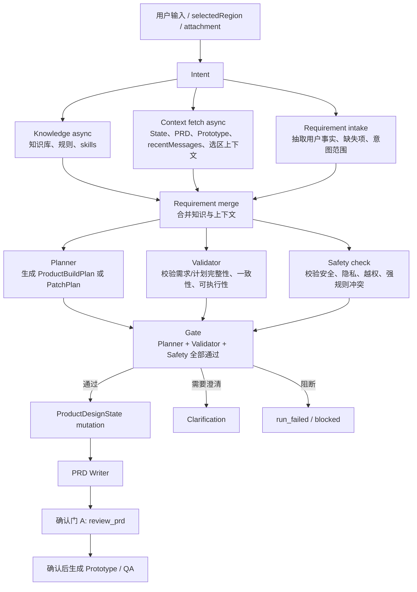
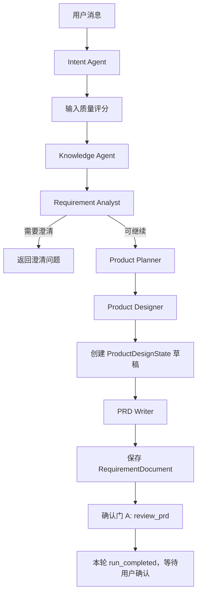
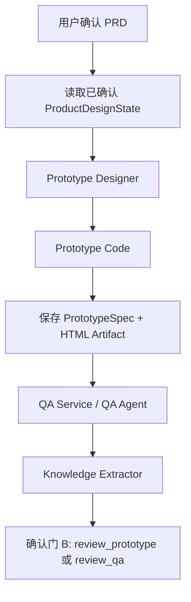
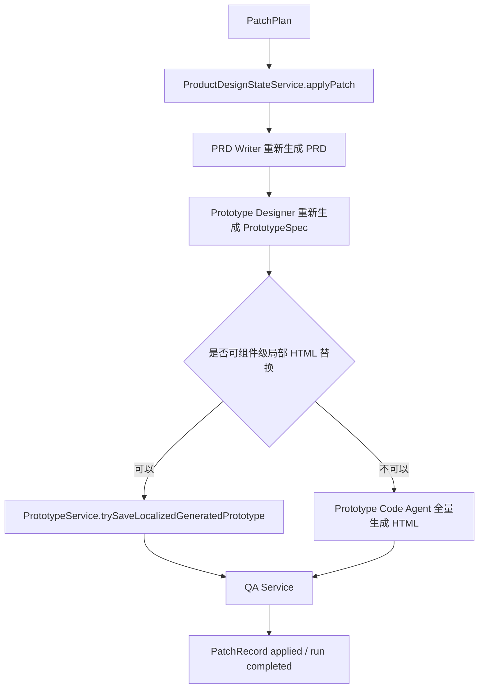

# Vibe Coding 当前执行链路说明

更新时间：2026-06-24

本文按当前代码实现梳理 Vibe Coding 的真实运行方式，重点回答三个问题：

- 用户发一条消息后，系统到底按什么顺序执行。
- 每个 agent 负责什么、输入输出是什么、不能做什么。
- PRD、原型、Patch、QA、fallback、前端执行路径分别在哪里发生。

相关代码入口：

- 后端入口：`apps/api/src/ai/vibe.service.ts`
- 主编排器：`apps/api/src/ai/ai-orchestrator.service.ts`
- Patch 链路：`apps/api/src/ai/patch.service.ts`
- Agent 职责定义：`apps/api/src/ai/agent-charter.ts`
- Agent 基类与 fallback：`apps/api/src/ai/agents/base-agent.service.ts`
- 前端执行路径展示：`apps/web/src/app/workspace/phase1-workspace-client.tsx`

## 0. 系统需求总览

本节描述 Vibe Coding 作为一个完整产品系统应满足的需求。后续章节描述当前代码如何执行这些需求。

### 0.1 产品目标

Vibe Coding 的目标不是单纯调用多个大模型，而是把用户的自然语言需求稳定转成一组可审阅、可确认、可追溯、可局部修改的产品产物：

```text
用户需求
  -> 结构化需求理解
  -> ProductDesignState 唯一事实源
  -> PRD
  -> 可交互 HTML 原型
  -> QA 报告
  -> 可审核知识候选
```

系统必须让用户知道当前处于哪个阶段、下一步需要谁确认、是否使用了 fallback、失败在哪里、能否继续。

### 0.2 目标执行 DAG

Vibe Coding 的目标运行方式不应该是简单线性链路，而应该是一个有依赖关系的 DAG。真正的前半段应更接近：

```text
Intent
  ├── Knowledge (async)
  ├── Context fetch (async)
  └── Requirement
        ├── Planner
        ├── Validator
        └── Safety check
```

这代表三层含义：

1. `Intent` 只负责识别用户要做什么、属于哪类 flow、需要哪些上下文。
2. `Knowledge` 和 `Context fetch` 应在 Intent 之后并行启动，避免把检索、历史状态、附件、当前产物读取全部串进模型等待链路。
3. `Requirement` 是需求归一层，之后再分出 Planner、Validator、Safety check 三个职责。

更完整的目标 DAG 应是：



其中 `Validator` 和 `Safety check` 不是 QA：

- `Validator` 是生成正式产物前的结构与可执行性校验，检查 requirement、plan、state patch 是否完整、一致、可落库。
- `Safety check` 是生成正式产物前的安全与边界校验，检查提示注入、真实接口调用、密钥泄漏、隐私、越权、强规则冲突。
- `QA` 是产物生成后的质量检查，检查 State、PRD、PrototypeSpec、HTML 和 Patch 结果是否一致。

因此目标架构应拆成两段：

```text
Intake DAG: Intent -> Knowledge/Context/Requirement -> Planner/Validator/Safety
Artifact DAG: ProductDesignState -> PRD -> Confirm -> Prototype -> QA -> Knowledge Candidate
```

当前代码还没有完全实现这个目标 DAG，当前 runtime 的真实执行顺序仍以第 2 节为准。

### 0.2.1 Intake DAG 节点契约

目标 Intake DAG 的每个节点必须有稳定输入、稳定输出和可观测事件。

| 节点 | 运行方式 | 输入 | 输出 | 不负责 |
|---|---|---|---|---|
| Intent | 同步优先，必须最先完成 | 用户输入、选区摘要、入口类型、最近消息摘要 | `IntentResult`、`flowType`、`requiredContext`、`riskHints`、`canUseParallelIntake` | 查知识、读完整 State、生成计划、写产物 |
| Knowledge | Intent 后异步 | 用户输入、intent、附件摘要、知识范围、skill routing hint | `KnowledgeContext`、命中规则、引用案例、skills | 读取项目产物、业务推断、生成计划 |
| Context fetch | Intent 后异步 | projectId、conversationId、selectedRegion、intent.requiredContext | `RunContext`，包括 State、PRD、Prototype、QA、recentMessages、选区详情、附件 | 模型推理、需求判断、写库 |
| Requirement intake | Intent 后可异步 | 用户输入、intent、selectedRegion 摘要、recentMessages 摘要 | `RequirementFacts`，包括用户事实、缺失项、冲突、assumptions、clarificationCandidates | 生成 ProductBuildPlan、写 State |
| Requirement merge | 等待 Knowledge、Context、Requirement intake | `KnowledgeContext`、`RunContext`、`RequirementFacts` | `RequirementPackage`，作为后续 Planner/Validator/Safety 的唯一输入包 | 写产物、执行 Patch |
| Planner | RequirementPackage 后运行 | `RequirementPackage`、flowType | `ProductBuildPlan` 或 `PatchPlan`、影响范围、再生成策略 | 校验安全、写 State、写 PRD/HTML |
| Validator | RequirementPackage + Plan 后运行 | `RequirementPackage`、`ProductBuildPlan` 或 `PatchPlan` | `ValidationResult`，包含 pass/warn/block、缺失字段、冲突、不可执行原因 | 自动修复计划、绕过确认门 |
| Safety check | RequirementPackage 后运行；必要时在 Plan 后复检 | `RequirementPackage`、风险提示、Plan 候选 | `SafetyCheckResult`，包含 pass/warn/block、风险类型、用户可见文案 | 生成业务方案、静默删改用户需求 |
| Intake Gate | Planner、Validator、Safety 全部完成后运行 | Plan、ValidationResult、SafetyCheckResult、fallback metadata | `GateDecision`：continue、ask_clarification、blocked、degraded_continue | 生成 PRD/HTML |

`RequirementPackage` 是 Intake DAG 的核心中间产物。它应至少包含：

```text
intent
flowType
userFacts
knowledgeFacts
contextSnapshotRefs
selectedRegionContext
missingRequiredInfo
conflicts
assumptions
constraints
requiredArtifacts
sourcePaths
traceRefs
```

后续 `Product Planner`、`Patch Agent`、`Validator`、`Safety check` 都应只从 `RequirementPackage` 读取需求上下文，而不是各自重新拼上下文。

### 0.2.2 并行与等待规则

Intake DAG 必须遵守以下调度规则：

1. `Intent` 完成前，不启动需要 flowType 的下游节点。
2. `Knowledge`、`Context fetch`、`Requirement intake` 在 Intent 后并行启动。
3. `Requirement merge` 等待三个并行分支返回；如果某个非关键分支超时，可以带 fallback metadata 进入降级合并。
4. `Planner` 依赖 `RequirementPackage`，不能直接依赖原始 userInput。
5. `Validator` 的最终结果必须校验 Plan；如果为了提速，可以先对 `RequirementPackage` 做 pre-validation，但 gate 前必须拿到 plan-validation。
6. `Safety check` 可以先对 `RequirementPackage` 做 pre-safety；如果 Plan 包含原型、导出、真实接口、外链、脚本、敏感内容，则 gate 前必须复检。
7. `Intake Gate` 是进入 State mutation、PRD、Prototype、Patch apply 前的唯一通行口。

推荐调度形态：

```ts
intent = await runIntent();

const knowledgePromise = runKnowledge(intent);
const contextPromise = fetchRunContext(intent);
const factsPromise = runRequirementIntake(intent);

const [knowledge, context, facts] = await allWithBudget([
  knowledgePromise,
  contextPromise,
  factsPromise,
]);

requirementPackage = mergeRequirement({ intent, knowledge, context, facts });
plan = await runPlanner(requirementPackage);

const [validation, safety] = await allWithBudget([
  runValidator(requirementPackage, plan),
  runSafetyCheck(requirementPackage, plan),
]);

gate = decideIntakeGate({ plan, validation, safety });
```

### 0.2.3 Gate 决策规则

`Intake Gate` 输出必须是稳定枚举，不允许下游自己猜。

| GateDecision | 触发条件 | 后端动作 | 前端表现 |
|---|---|---|---|
| `continue` | Planner 成功，Validator pass/warn，Safety pass/warn | 进入 State mutation 或 Patch candidate/apply | 继续执行下一阶段 |
| `degraded_continue` | 某分支 fallback 但仍满足最小可信度 | 继续执行，但记录 fallback 与风险 | 显示“规则兜底/需人工复核” |
| `ask_clarification` | 缺少必要信息、需求冲突、计划不可执行但用户可补充 | 结束本轮 run，生成澄清消息 | 显示澄清问题 |
| `blocked` | Safety block、强规则冲突不可自动覆盖、权限/隐私/注入风险 | `run_completed` 或 `run_failed`，带阻断原因 | 显示阻断原因和可选安全替代 |
| `failed` | 编排异常、关键分支超时且不可降级 | `run_failed` | 显示失败步骤和重试建议 |

Validator 只决定“完整性、一致性、可执行性”；Safety check 只决定“安全、隐私、越权、强规则边界”。二者都不能替 Planner 生成方案，也不能替用户确认 assumption。

### 0.2.4 事件、日志与前端展示需求

Intake DAG 落地后，后端至少应能观测这些事件：

```text
intent_completed
intake_branch_started
intake_branch_completed
intake_branch_failed
requirement_package_created
planner_completed
validator_completed
safety_check_completed
intake_gate_decided
```

如果沿用现有 `step_started` / `step_completed` 事件，也必须在 payload 中带：

```text
dagNode
parentNode
branchId
dependencyIds
durationMs
deadlineAt
fallbackUsed
gateDecision
```

前端执行路径不应再只显示线性列表。最低要求是把前半段显示成一个分组：

```text
理解意图
并行收集上下文
  - 知识检索
  - 项目上下文
  - 需求事实
生成计划与检查
  - Planner
  - Validator
  - Safety check
进入产物阶段
```

这样用户能看懂“正在并行收集上下文”和“等待安全/校验 gate”，不会把某个未开始的线性步骤误解成卡住。

### 0.2.5 迁移策略

这个目标 DAG 不建议一次性推倒重写。建议分阶段迁移：

| 阶段 | 目标 | 行为变化 | 风险 |
|---|---|---|---|
| Phase 0 | 先补 deadline、SSE 心跳、active run 保护 | 不改业务链路，只消除无限等待和假卡住 | 低 |
| Phase 1 | 抽出 `RunContext` / `RequirementPackage` 类型 | 仍可串行执行，但上下文边界清晰 | 低到中 |
| Phase 2 | Intent 后并行 Knowledge、Context fetch、Requirement intake | 前半段耗时下降，事件变成 DAG | 中 |
| Phase 3 | 增加 Validator 与 Safety check gate | 部分需求会被更早澄清或阻断 | 中 |
| Phase 4 | 前端执行路径从线性步骤改成 DAG 分组 | 用户认知更清楚 | 中 |
| Phase 5 | 再考虑队列、worker pool、Patch 局部重算分级 | 降低高并发和长尾 | 中到高 |

因此这不是“换一批 prompt”的优化，而是 Intake 编排层的结构化重构；但可以按阶段小步迁移，避免一次大爆炸。

### 0.3 核心用户链路需求

| 编号 | 链路 | 用户目标 | 系统必须提供 |
|---|---|---|---|
| VIBE-FR-01 | 新建需求 | 输入一句自然语言，生成产品方案 | 创建项目/对话消息，启动 agent run，返回实时执行路径 |
| VIBE-FR-02 | PRD 生成 | 先看到可审阅 PRD，而不是直接出原型 | Phase A 生成 `ProductDesignState` 与 PRD，并停在 PRD 确认门 |
| VIBE-FR-03 | PRD 确认 | 用户确认 PRD 后再继续 | `confirm-prd` 新开 run，从已确认 State 生成原型与 QA |
| VIBE-FR-04 | 原型生成 | 得到可浏览、可选区的 HTML 原型 | 生成 `PrototypeSpec` 与单文件 HTML artifact，关键元素带稳定 id |
| VIBE-FR-05 | 局部修改 | 对 PRD 或原型局部提出修改 | 先生成 Patch 候选，用户确认后再应用到 `ProductDesignState` |
| VIBE-FR-06 | QA 闸门 | 知道产物是否一致、是否能确认 | QA 只检查不修改，输出问题、风险、确认建议 |
| VIBE-FR-07 | 知识沉淀 | 把稳定规则复用到未来项目 | 只从已确认产物抽取知识候选，进入审核，不自动写正式知识 |
| VIBE-FR-08 | 导出与问答 | 支持导出或普通问题 | 不进入生成链路时也要有明确 `nextAction` 和终态 |
| VIBE-FR-09 | 调试与追踪 | 能解释一次 run 为什么卡住或失败 | run、step、model call、stream event、fallback、状态版本都可追踪 |

### 0.4 系统非功能需求

| 编号 | 需求 | 说明 |
|---|---|---|
| VIBE-NFR-01 | 阶段透明 | 前端必须区分 Phase A、Phase B、Patch 候选、Patch 应用、导出、问答，不能把未进入的阶段显示成卡住 |
| VIBE-NFR-02 | 终态明确 | 每个 run 最终必须进入 `run_completed` 或 `run_failed`，并写入可读摘要 |
| VIBE-NFR-03 | 时间有界 | 每个 run 应有端到端 deadline，每个 step 应有子预算，模型 provider timeout 不能替代 run deadline |
| VIBE-NFR-04 | 可恢复 | SSE 断流后前端应能通过 `GET /runs/:runId` 和历史事件恢复当前状态 |
| VIBE-NFR-05 | fallback 可见 | 任何规则兜底都必须通过 `fallback_used`、step log 或调试页展示给用户或运维 |
| VIBE-NFR-06 | 并发受控 | 同一 project/conversation 不应无限并发运行；重复点击、多 tab、自动重试要被限流、排队或明确拒绝 |
| VIBE-NFR-07 | 状态可回滚 | Patch 应用失败后必须恢复 `ProductDesignState`、PRD、prototype、QA 指针 |
| VIBE-NFR-08 | 数据可信 | PRD、PrototypeSpec、HTML、QA 都必须可追溯到 `ProductDesignState` 或 patch operation |
| VIBE-NFR-09 | 安全隔离 | 原型 HTML 不应调用真实接口、引入远程脚本或泄露 provider key、用户 token、内部路径 |
| VIBE-NFR-10 | 运维可观测 | 至少能统计 run duration、step duration、model call duration、fallback rate、SSE gap、active runs、terminal event missing |
| VIBE-NFR-11 | DAG 编排 | Intent 后的知识检索、上下文读取和需求 intake 应支持并行；Planner、Validator、Safety check 应有明确 gate |

### 0.5 后端需求

后端承担“事实源、编排、持久化、流事件、可靠性治理”的职责。

| 模块 | 后端必须做到 |
|---|---|
| API 与权限 | 所有入口校验用户、项目、conversation、归档/删除状态；所有 run 与 artifact 读取必须做访问控制 |
| Run 创建 | 用户消息、附件摘要、run log 必须先落库，再异步启动编排；接口返回 `runId`，不阻塞等待全链路完成 |
| 编排器 | `AiOrchestratorService` 负责主链路分支、确认门、step log、stream event、fallback event、run 终态；目标上应支持 DAG 依赖编排 |
| Context fetch | 后端应有独立上下文读取层，并行读取 State、recentMessages、PRD、Prototype、selectedRegion、attachments，不应混在某个模型 agent 内 |
| State 管理 | `ProductDesignState` 是唯一事实源；正式需求只能由 `ProductBuildPlan` 落 State，Patch 只能由 `PatchPlan` 转 State operation |
| PRD 产物 | PRD Writer 只能从 State 渲染文档，保存 document 与 section source paths |
| Prototype 产物 | Prototype Designer 生成结构，Prototype Code 生成 HTML；局部原型再生成必须仍以 State/PrototypeSpec 为源 |
| Patch 应用 | Patch 候选和应用必须分 run；应用前校验 State version；失败后回滚 State 与产物指针 |
| Validator | 在 State mutation、PRD、Prototype 之前校验 requirement/plan/patch 是否完整、一致、可执行 |
| Safety check | 在重型生成与写入前阻断提示注入、真实接口调用、密钥泄漏、隐私风险、越权和强规则冲突 |
| QA | QA 只能检查不修改；QA 结果必须影响 `nextAction` 和项目状态，但不能静默覆盖产物 |
| 知识候选 | Knowledge Extractor 只能产生待审核候选；不得直接写正式知识库 |
| Model Gateway | 所有模型调用必须记录 model call log、provider、taskType、耗时、错误码、token usage；支持 timeout 与 fallback |
| Deadline | 编排层需要 run 级 deadline 与 step 子预算；deadline 到期要写 `run_failed` 和 `run_failed` stream event |
| SSE/Event | 每个关键状态都要写 `vibe_stream_event_logs`；在线连接要收到实时事件；断线重连能回放历史事件 |
| 并发治理 | 同项目/同会话 active run 需要互斥、排队或幂等处理，避免状态竞争 |
| 调试能力 | `agent_run_logs`、`agent_step_logs`、`model_call_logs`、`vibe_stream_event_logs` 足以还原一次执行 |

### 0.6 前端需求

前端承担“用户输入、阶段展示、确认门、预览、选区、断流恢复”的职责。

| 模块 | 前端必须做到 |
|---|---|
| 工作台 | 项目、对话、消息、PRD 预览、原型预览、执行路径在一个工作区内协同更新 |
| 执行路径 | 根据 `run_completed.nextAction` 和 stream event 显示当前阶段，不属于本阶段的 step 应隐藏或标成“未进入本阶段” |
| 流式连接 | 建立 run stream 后解析事件；连接失败或长时间无事件时主动回查 run 状态，而不是永久显示 running |
| 确认门 | `review_prd` 显示“确认并生成原型”；`review_prototype` 显示“确认原型”；`confirm_patch` 显示 Patch 预览与确认按钮 |
| 产物同步 | 收到 `prd_updated`、`prototype_updated`、`run_completed` 后刷新预览和项目详情 |
| 局部选区 | PRD 选区和原型选区必须带 target id、section/block/component id、source paths 或选区上下文 |
| fallback 展示 | 收到 `fallback_used` 后必须让用户或调试页看见“模型完成”和“规则兜底完成”的区别 |
| 错误展示 | `run_failed`、`step_failed`、SSE 连接失败、Patch 失败都要展示可执行文案，而不是只停在加载态 |
| 防重复操作 | 运行中、确认中、Patch applying 时关键按钮要禁用或显示幂等状态，避免重复 run |
| 移动与窄屏 | 执行卡片、确认按钮、预览面板不能文字溢出或遮挡核心操作 |

### 0.7 前后端事件契约

| 事件或接口 | 后端语义 | 前端语义 |
|---|---|---|
| `POST /handle-message` | 创建用户消息与 run，异步启动主链路 | 立即显示执行卡片并连接 stream |
| `POST /confirm-prd` | 确认 PRD，新开 Phase B run | 显示正在生成原型/QA |
| `GET /runs/:runId` | 返回 run 当前状态和摘要 | SSE 断流、刷新页面、终态兜底时使用 |
| `SSE /runs/:runId/stream` | 实时发送并回放 run event | 驱动执行路径、预览更新、确认门状态 |
| `step_started` | 某 agent step 开始 | step 显示 running |
| `step_completed` | 某 agent step 完成 | step 显示 done，并保存摘要 |
| `step_failed` | 某 agent step 失败 | step 显示 failed，run 进入失败态或等待恢复 |
| `fallback_used` | 模型失败但规则兜底继续 | 展示降级提示，不可当成完全正常完成 |
| `prd_updated` | PRD 已保存或更新 | 刷新 PRD 预览 |
| `prototype_updated` | HTML 原型已保存或更新 | 刷新原型预览 |
| `qa_completed` | QA 报告完成 | 展示 QA issue 数、gate 状态 |
| `patch_plan_created` | Patch 候选生成 | 展示候选摘要与确认按钮 |
| `patch_completed` | Patch 应用完成并重算产物 | 刷新 PRD、原型、QA |
| `run_completed` | run 成功到达业务终态 | 按 `nextAction` 显示确认门、下载、完成或问答结果 |
| `run_failed` | run 失败且不应继续等待 | 停止 loading，展示失败原因与可重试建议 |

## 1. 总原则

Vibe Coding 当前采用一个核心约束：

```text
ProductDesignState 是唯一事实源。
```

所有正式需求都应先进入 `ProductBuildPlan`，再进入 `ProductDesignState`，再由 `ProductDesignState` 派生 PRD、PrototypeSpec、HTML 原型和 QA。

所有局部修改都应先进入 `PatchPlan`，再转换成 `ProductDesignState` patch operation，应用后重新生成 PRD、PrototypeSpec、HTML 和 QA。

禁止的方向：

- 直接改 PRD，绕过 `ProductDesignState`。
- 直接改 HTML，绕过 `ProductDesignState` 和 `PrototypeSpec`。
- 正式需求绕过 `ProductBuildPlan`，直接散落到 PRD、Prototype 或 QA。
- Patch 直接作用到 PRD section 或 HTML DOM。

## 2. 当前最重要的事实：不是一次跑到底

文档 `docs/vibe-coding-agent-charter.md` 里写的是概念完整链路：

```text
Intent
  -> Knowledge
  -> Requirement Analyst
  -> Product Planner
  -> Product Designer
  -> PRD Writer
  -> Prototype Designer
  -> Prototype Code
  -> QA
  -> Knowledge Extractor
```

但当前运行时代码不是一次跑到底，而是分成两个确认阶段：

```text
Phase A: 生成 PRD 并停在 PRD 确认门
Phase B: 用户确认 PRD 后，再生成原型、QA、知识候选
```

这意味着普通新需求当前真实链路是：



用户确认 PRD 后，新开一个 run：



## 3. 入口层：VibeService

入口接口：

```text
POST /api/ai/vibe/handle-message
POST /api/ai/vibe/confirm-prd
GET  /api/ai/vibe/runs/:runId
SSE  /api/ai/vibe/runs/:runId/stream
```

### 3.1 handle-message 做什么

`VibeService.handleMessage()` 负责非 AI 的外围事务：

1. 校验项目存在、未删除、未归档。
2. 校验当前用户是否能操作该项目。
3. 校验 conversation 存在。
4. 读取附件摘要。
5. 创建用户消息 `messages`。
6. 创建 agent run `agent_run_logs`。
7. 把项目状态临时改为 `designing`。
8. 读取最近 20 条消息。
9. 读取当前 `ProductDesignState`。
10. 异步调用 `AiOrchestratorService.run()`。
11. 立即返回 `runId` 给前端。

注意：`handle-message` 不等待 AI 链路完成。前端拿到 `runId` 后，通过 SSE 或历史事件更新执行路径。

### 3.2 confirm-prd 做什么

`VibeService.confirmPrd()` 是确认门 A 的恢复入口：

1. 校验项目、用户、conversation。
2. 读取当前 `ProductDesignState`。
3. 要求当前 State 有 PRD，且还没有 prototypeSpec。
4. 如果 PRD 未确认，调用 `RequirementDocumentService.confirmForPrototypeGate()` 确认 PRD。
5. 创建一条用户消息：“确认 PRD，继续生成原型。”
6. 创建新的 agent run。
7. 调用 `AiOrchestratorService.confirmPrdAndContinue()`。

## 4. 主链路详细步骤

### Step 1: Intent Agent

运行位置：

```text
AiOrchestratorService.run()
```

输入：

- `userInput`
- `selectedRegion`
- `currentProjectStatus`
- `previewMode`
- `recentMessages`

输出：

```text
IntentResult
```

主要字段：

- `intent`
- `confidence`
- `reason`
- `requiresSelection`
- `isAmbiguous`

可能的 intent：

- `new_requirement`
- `complete_requirement`
- `clarification_answer`
- `generate_prd`
- `generate_prototype`
- `patch_document`
- `patch_prototype`
- `global_adjustment`
- `export_word`
- `export_html`
- `knowledge_update`
- `general_question`

特殊分支：

- 如果是 `general_question`，直接 `finishGeneralAnswer()`，不会进入生成链路。
- 如果是 `export_word` 或 `export_html`，直接 `finishExport()`，不会进入生成链路。
- 如果模型不可用，当前会 fallback 到 `heuristic_intent_detection`，用本地规则识别意图并继续。

职责边界：

- 只识别意图。
- 不查知识。
- 不生成 PRD。
- 不生成 ProductDesignState。

### Step 2: 输入质量评分

运行位置：

```text
assessInputQuality(context.userInput, input.attachments)
```

评分维度：

- 产品逻辑/业务规则
- 交互细节/页面状态
- 用户/目标
- 附件/格式完整度

当前阻断规则：

```text
attachments.length > 0 && status === "must_optimize"
```

也就是说：只有带附件且附件/内容质量严重不足时，才会阻断并返回澄清问题。纯文本短消息通常不会被这个门禁直接拦住。

失败出口：

```text
finishInputQualityGate()
```

结果：

- run completed
- 项目状态变为 `clarifying`
- nextAction 为 `ask_clarification`

### Step 3: 已确认 PRD 直接生成原型分支

如果满足：

```text
intent === generate_prototype
&& 当前 ProductDesignState 存在
&& 当前 State 有 confirmed PRD
```

系统会跳过：

- Knowledge Agent
- Requirement Analyst
- Product Planner
- Product Designer
- PRD Writer

直接进入：

```text
generatePrototypeForState()
```

用途：已有 PRD 的项目，用户只要求刷新或生成原型。

### Step 4: Knowledge Agent

输入：

- `userInput`
- `intent`
- `attachments`
- `productDesignState`

输出：

```text
KnowledgeContext
```

包含：

- `strongRules`
- `defaultRules`
- `referenceCases`
- `designPatterns`
- `prdWritingRules`
- `prototypeRules`
- `businessConcepts`
- `agentSkills`
- `skillRouting`
- `conflicts`
- `unknownAreas`

当前实现特点：

- `KnowledgeAgentService.run()` 覆盖了 BaseAgent 的模型调用。
- 它主要走 `KnowledgeRetrievalService.search()` 和 `AgentSkillRegistryService`。
- 也就是说 Knowledge Agent 当前更像确定性检索器，不是强依赖模型生成 JSON。

职责边界：

- 只读知识库、附件和 skills。
- 不直接写正式知识。
- 不生成 PRD/HTML/State。

### Step 5: Requirement Analyst Agent

输入：

- `userInput`
- `KnowledgeContext`
- `productDesignState`
- `recentMessages`

输出：

```text
RequirementAnalysis
```

包含：

- `completenessScore`
- `knownFromUser`
- `knownFromKnowledge`
- `inferredByAI`
- `missingCritical`
- `missingOptional`
- `conflicts`
- `shouldAskUser`
- `clarificationQuestions`

如果：

```text
shouldAskUser === true
&& intent 不是 clarification_answer
&& intent 不是 patch_document / patch_prototype
```

系统会停在：

```text
finishClarification()
```

结果：

- run completed
- 项目状态变为 `clarifying`
- nextAction 为 `ask_clarification`

当前新增保护：

- 会 normalize 非标准模型输出。
- 模型返回对象数组、数字、旧字段风格时，会尽量转成标准 `RequirementAnalysis`。
- 模型不可用时 fallback 到 `heuristic_requirement_analysis`。

职责边界：

- 只分析完整度和澄清问题。
- 不生成 ProductBuildPlan。
- 不生成 ProductDesignState。

### Step 6: Patch 分支判断

如果：

```text
intent === patch_document 或 patch_prototype
&& selectedRegion 存在
&& 当前 ProductDesignState 存在
```

系统不会进入 Product Planner，而是调用：

```text
finishPatchCandidate()
```

注意：`finishPatchCandidate()` 本身不调用 `finishRun()`，因为 `PatchService.createPatchCandidateFromRun()` 内部已经完成 run log、stream event 和 assistant message。

### Step 7: Product Planner Agent

输入：

- `userInput`
- `intent`
- `RequirementAnalysis`
- `KnowledgeContext`
- `existingState`

输出：

```text
ProductBuildPlan
```

包含：

- `title`
- `goal`
- `summary`
- `requirementMode`
- `sourceSummary`
- `scope`
- `pagePlan`
- `statePlan`
- `deliverables`
- `agentSequence`
- `qaFocus`
- `risks`
- `assumptions`

当前优化：

- Planner 输入会瘦身，不再把完整 `ProductDesignState` 原样塞给模型。
- Planner 模型调用设置：
  - `timeoutMs: 18000`
  - `retryCount: 0`
  - `jsonParseRetryCount: 0`
  - `maxTokens: 3000`
- 模型失败时 fallback 到 `deterministic_product_build_plan`。

职责边界：

- 只规划正式需求执行方案。
- 不生成 ProductDesignState。
- 不写 PRD。
- 不输出 PrototypeSpec/HTML。
- 不处理局部 Patch。

### Step 8: Product Designer Agent

输入：

- `userInput`
- `RequirementAnalysis`
- `KnowledgeContext`
- `ProductBuildPlan`
- `existingState`

输出：

```text
ProductDesignDraft
```

然后由：

```text
ProductDesignStateService.createDraft()
```

保存成新的 `ProductDesignState`。

保存后发事件：

- `state_updated`
- `state_version_created`

当前 fallback：

- `deterministic_product_design_draft`
- 模型不可用时，按 `ProductBuildPlan` 生成规则兜底 ProductDesignDraft。

职责边界：

- 生成唯一事实源草稿。
- 标记 assumptions。
- 保留 knowledgeRefs 和 pendingQuestions。
- 不直接写 PRD 或 HTML。

### Step 9: PRD Writer Agent

输入：

- `ProductDesignState`
- `mode: draft`

输出：

```text
RequirementDocumentDraft
```

然后由：

```text
RequirementDocumentService.saveGeneratedDocument()
```

保存成 PRD 文档。

保存后发事件：

- `prd_updated`

然后系统把 PRD 挂回 ProductDesignState：

```text
ProductDesignStateService.attachGeneratedArtifacts()
status: doc_ready
```

当前 fallback：

- `state_rendered_prd`
- 模型不可用时，直接从 `ProductDesignState` 渲染结构化 PRD。

职责边界：

- 只能从 ProductDesignState 渲染 PRD。
- 禁止写接口、SQL、数据库、部署和代码实现。
- 禁止新增 State 里没有的业务规则。

### Step 10: 确认门 A

PRD 生成后，当前 run 停止在确认门 A：

```text
nextAction.type = review_prd
```

状态变化：

- `ProductDesignState.status = doc_ready`
- `ProjectStatus = prd_ready`
- 生成一张 decision trace：`PRD 草案生成决策`
- run completed

用户看到：

- PRD 已生成
- 等待确认
- 如果 `wantsPrototype === true`，确认后会继续生成原型

## 5. 确认 PRD 后的原型链路

入口：

```text
POST /api/ai/vibe/confirm-prd
```

编排函数：

```text
AiOrchestratorService.confirmPrdAndContinue()
AiOrchestratorService.generatePrototypeForState()
```

### Step B1: Prototype Designer Agent

输入：

- 已确认 PRD 的 `ProductDesignState`
- `targetView: both`

输出：

```text
PrototypeSpec
```

当前 fallback：

- `state_rendered_prototype_spec`
- 模型不可用时，直接从 ProductDesignState 渲染 PrototypeSpec。

### Step B2: Prototype Code Agent

输入：

- `PrototypeSpec`
- `mode: single_html`

输出：

```text
PrototypeArtifactDraft
```

然后由：

```text
PrototypeService.saveGeneratedPrototype()
```

保存 PrototypeSpec 和 HTML Artifact。

事件：

- `prototype_updated`

当前 fallback：

- `spec_rendered_single_html`
- 模型不可用时，从 PrototypeSpec 渲染单文件 HTML。

### Step B3: 同步 State

原型保存后，系统把 PrototypeSpec 挂回 ProductDesignState：

```text
ProductDesignStateService.attachGeneratedArtifacts()
status: prototype_ready
```

### Step B4: QA

当前主链路里 QA 是这样触发的：

```text
runAgentStep(... AgentName.qa_agent, "qa_check", async () => ({
  data: await qaService.runForProject(...)
}))
```

也就是说：

- 执行路径上显示为 `QA Agent`。
- 实际 QA 入口是 `QaService.runForProject()`。
- `QaService` 内部负责生成和保存 QA 报告，并会处理 fallbacks 风险。

事件：

- `qa_completed`

### Step B5: Knowledge Extractor Agent

输入：

- `ProductDesignState`
- `RequirementDocument`
- `PrototypeSpec`
- `confirmedByUser: false`

当前注意点：

- 这里传的是 `confirmedByUser: false`。
- 因此 fallback 下不会抽取知识候选。
- 正式知识仍然应等用户确认后的稳定产物。

### Step B6: 确认门 B

原型和 QA 完成后：

- QA 通过：`nextAction.type = review_prototype`
- QA 有问题：`nextAction.type = review_qa`

项目状态：

- 通常为 `prototype_ready`
- 如果 QA failed，则为 `qa_failed`

## 6. Patch 局部修改链路

Patch 有两阶段：

```text
阶段 1：生成 Patch 候选和预览，等待用户确认
阶段 2：用户确认后应用 Patch，重新生成 PRD/原型/QA
```

### 6.1 进入 Patch 的条件

主链路中，如果满足：

```text
intent = patch_document 或 patch_prototype
selectedRegion 存在
当前 ProductDesignState 存在
```

则进入：

```text
PatchService.createPatchCandidateFromRun()
```

也可以通过 Patch controller 直接进入 PatchService。

### 6.2 Patch 候选阶段

步骤：

1. 发事件 `patch_started`。
2. 读取当前 ProductDesignState。
3. 检索 Patch 相关知识：
   - strong_rule
   - default_rule
   - business_concept
4. 调用 Patch Agent。
5. 生成 `PatchPlan`。
6. 强制标记：
   - `needUserConfirm: true`
   - `needsUserConfirmation: true`
7. 创建 `patch_records`，状态为 `needs_confirmation`。
8. 创建 `patch_previews`。
9. 发事件 `patch_plan_created`。
10. 创建 assistant message。
11. run completed。
12. 项目状态变为 `clarifying`。

关键原则：

```text
确认前不会修改 ProductDesignState、PRD 或 HTML。
```

### 6.3 Patch Agent

输入：

- `userInput`
- `selectedRegion`
- `productDesignState`
- `prdDocument`
- `prototypeSpec`
- `knowledgeContext`

输出：

```text
PatchPlan
```

包含：

- `intent`
- `selectedRegion`
- `patchType`
- `targetNodes`
- `impactScope`
- `operations`
- `impactAnalysis`
- `regenerationPlan`
- `risks`
- `clarificationQuestions`

当前 fallback：

- `deterministic_patch_plan`
- 模型不可用时生成一份待确认 PatchPlan。

### 6.4 用户确认 Patch 后

入口：

```text
PatchService.executeConfirmedPatch()
```

步骤：

1. 发事件 `patch_started`。
2. 读取当前 ProductDesignState。
3. 校验当前 State version 必须等于 Patch 创建时的 `beforeProductDesignStateVersion`。
4. 找到或创建 patch preview。
5. 把 patch record 改为 `planned`。
6. patch preview 改为 `applying`。
7. 发事件 `patch_plan_created`，表示计划已确认。
8. 调用 `applyPatchPlan()`。

### 6.5 applyPatchPlan

执行顺序：



执行细节：

1. `patch_records.status = applying`
2. 发事件 `patch_applying`
3. `ProductDesignStateService.applyPatch()` 生成新 State version
4. 发事件：
   - `state_updated`
   - `state_version_created`
5. PRD Writer 重新生成 PRD
6. 发事件 `prd_updated`
7. Prototype Designer 重新生成 PrototypeSpec
8. Prototype Code 阶段：
   - 如果是 prototype 选区且有 `componentId`，优先走组件级局部替换。
   - 如果局部替换失败，回退全量 HTML 生成。
9. 发事件 `prototype_updated`
10. attachGeneratedArtifacts，同步 PRD/PrototypeSpec
11. QA
12. 发事件 `qa_completed`
13. `patch_records.status = applied`
14. patch preview 改为 `applied`
15. 创建 assistant message
16. 发事件 `patch_completed`
17. run completed

### 6.6 Patch 失败回滚

如果 `ProductDesignState.applyPatch()` 已经成功，但后续 PRD/原型/QA 失败：

1. 调用 `restoreStateAfterPatchFailure()`。
2. 恢复到 Patch 前 State。
3. 恢复项目当前 PRD/Prototype/QA 指针。
4. 发 `state_updated`，带 `rollback: true`。
5. patch record 进入 `failed`。
6. 项目状态变为 `qa_failed`。
7. 发 `patch_failed`。

## 7. Agent 职责矩阵

| Agent | 当前 taskType | 主要输入 | 主要输出 | 是否允许写业务产物 | 当前 fallback |
|---|---|---|---|---|---|
| Intent Agent | `intent_detection` | 用户输入、选区、预览模式、最近消息 | `IntentResult` | 否 | `heuristic_intent_detection` |
| Knowledge Agent | `knowledge_classification` | 用户输入、intent、附件、当前 State | `KnowledgeContext` | 否 | 自身检索 fallback |
| Requirement Analyst | `requirement_analysis` | 用户输入、知识、当前 State、最近消息 | `RequirementAnalysis` | 否 | `heuristic_requirement_analysis` |
| Product Planner | `product_planning` | 用户输入、intent、需求分析、知识、已有 State | `ProductBuildPlan` | 否，只能写 plan draft | `deterministic_product_build_plan` |
| Product Designer | `product_design` | 用户输入、计划、需求分析、知识、已有 State | `ProductDesignDraft` | 是，写 State draft | `deterministic_product_design_draft` |
| PRD Writer | `prd_generation` | ProductDesignState | `RequirementDocumentDraft` | 是，写 document draft | `state_rendered_prd` |
| Prototype Designer | `prototype_design` | ProductDesignState | `PrototypeSpec` | 是，写 prototype spec draft | `state_rendered_prototype_spec` |
| Prototype Code | `prototype_code_generation` | PrototypeSpec | `PrototypeArtifactDraft` | 是，写 HTML artifact draft | `spec_rendered_single_html` |
| Patch Agent | `patch_planning` | 用户指令、选区、State、PRD、PrototypeSpec、知识 | `PatchPlan` | 否，只能写 patch plan draft | `deterministic_patch_plan` |
| QA Agent | `qa_check` | State、PRD、PrototypeSpec、PatchPlan、知识 | `QAAgentOutput` | 否，只检查 | `deterministic_qa_check` |
| Knowledge Extractor | `knowledge_extraction` | 已确认 State/PRD/Prototype/Patch | `KnowledgeCandidateDraft[]` | 只能写候选 | `deterministic_knowledge_extraction` |

## 8. Model Gateway 与 fallback

所有继承 `BaseAgentService` 的模型型 agent 默认流程：

```text
buildMessages()
  -> modelGateway.generateJson()
  -> normalize()
  -> 返回 AgentOutput
```

模型网关负责：

1. 根据 `ModelTaskType` 找 `model_task_profiles`。
2. 找到绑定的 `model_configs` 和 `model_providers`。
3. 解密 provider API key。
4. 调用 OpenAI-compatible chat completions。
5. 解析 JSON。
6. 写入 `model_call_logs`。

当前 BaseAgent 策略：

- Agent 层默认不再额外重试：`DEFAULT_AGENT_RETRY_COUNT = 0`
- 模型网关仍可按 task profile 的 `retryCount` 重试。
- 如果某个 agent 覆盖了 `fallbackMode()`，模型失败会返回 fallback 结果，并发出 `fallback_used`。
- 如果没有 fallbackMode，错误会抛给 orchestrator，最终 `run_failed`。

特殊设置：

- Product Planner 单独设置快超时和低重试：
  - `timeoutMs = 18000`
  - `retryCount = 0`
  - `jsonParseRetryCount = 0`
  - `maxTokens = 3000`

fallback 不是“静默成功”。它会被记录在：

- step output
- `context.fallbackEvents`
- stream event `fallback_used`
- QA 输入的 `fallbacks`

## 9. Stream 事件与前端执行路径

后端所有执行状态通过 `VibeStreamService.emit()` 写入：

```text
vibe_stream_event_logs
```

并推给前端 SSE：

```text
GET /api/ai/vibe/runs/:runId/stream
```

主要事件：

| 事件 | 含义 | 前端影响 |
|---|---|---|
| `message_delta` | 进度文本 | 更新当前状态文案 |
| `step_started` | 某 agent step 开始 | 对应步骤 running |
| `step_completed` | 某 agent step 完成 | 对应步骤 done |
| `step_failed` | 某 agent step 失败 | 对应步骤 failed，run failed |
| `fallback_used` | 某 agent 使用 fallback | 更新步骤 message，但不标失败 |
| `state_updated` | State 更新 | 刷新状态摘要 |
| `state_version_created` | State 新版本 | 记录版本 |
| `prd_updated` | PRD 已保存 | PRD step done |
| `prototype_updated` | 原型已保存 | HTML step done |
| `patch_started` | Patch 开始 | Patch step running |
| `patch_plan_created` | Patch 候选或已确认计划 | Patch step done |
| `patch_applying` | 正在应用 Patch | 更新当前文案 |
| `patch_completed` | Patch 应用完成 | 更新当前文案 |
| `patch_failed` | Patch 失败 | run failed |
| `qa_completed` | QA 完成 | QA step done |
| `knowledge_candidate_created` | 知识候选生成 | Knowledge Extractor done |
| `export_ready` | 导出文件准备好 | 显示导出结果 |
| `run_completed` | run 完成 | 根据 nextAction 进入等待/完成态 |
| `run_failed` | run 失败 | 前端显示失败 |

前端执行路径固定步骤：

```text
intent_detection
knowledge_retrieval
requirement_analysis
product_planning
product_design
prd_generation
prototype_design
prototype_code_generation
patch_planning
qa_check
knowledge_extraction
```

注意：前端列表是统一列表。主链路 Phase A 不会执行 prototype/QA/knowledge，但这些步骤仍然会出现在列表中，只是 pending。

## 10. 持久化表

核心运行日志：

- `agent_run_logs`：一次用户请求对应一个 run。
- `agent_step_logs`：每个 agent step 的运行状态和输出。
- `model_call_logs`：模型调用记录。
- `vibe_stream_event_logs`：前端执行路径事件。

核心产物：

- `product_design_states`
- `product_design_versions`
- `requirement_documents`
- `requirement_document_versions`
- `prototype_spec_records`
- `prototype_artifacts`
- `prototype_versions`
- `qa_reports`
- `patch_records`
- `patch_previews`
- `knowledge_candidates`
- `decision_traces`

## 11. ProjectStatus 与 ProductDesignStateStatus

项目状态：

```text
draft
clarifying
designing
prd_ready
prototype_ready
qa_failed
completed
archived
deleted
```

ProductDesignState 状态：

```text
draft
intake
format_check
scoring
optimizing
clarifying
design_ready
doc_ready
doc_confirmed
prd_ready
prototype_ready
patching
qa_failed
confirmed
```

当前映射规则在 `workspace-state-machine.ts`：

- `doc_ready` / `doc_confirmed` / `prd_ready` -> `ProjectStatus.prd_ready`
- `prototype_ready` -> `ProjectStatus.prototype_ready`
- `qa_failed` -> `ProjectStatus.qa_failed`
- `confirmed` -> `ProjectStatus.completed`
- `clarifying` -> `ProjectStatus.clarifying`

## 12. 当前容易让人觉得乱的点

### 12.1 概念链路和运行链路不一致

Agent charter 讲的是完整链路，但 runtime 为了确认门拆成了：

- Phase A：到 PRD 为止。
- Phase B：确认 PRD 后才出原型/QA/知识。

如果不看代码，会误以为一次消息必然跑完全部 agent。

### 12.2 QA Agent 在主链路中是通过 QaService 包了一层

执行路径显示 `QA Agent`，但代码里调用的是：

```text
qaService.runForProject()
```

这可能让人误以为 `qaAgent.run()` 一定直接被 orchestrator 调用。

### 12.3 Knowledge Agent 继承 BaseAgent，但当前不走模型

`KnowledgeAgentService.run()` 覆盖了基类方法，当前主要做检索和 skill routing。

### 12.4 fallback 让链路“不失败”，但也降低了结果可信度

现在多个 agent 模型失败会 fallback 并继续。这解决了卡死和直接报错，但也意味着最终产物可能是规则兜底生成的。必须在 UI、QA 或调试面板里明确显示 fallback_used，否则用户会以为模型正常完成。

### 12.5 前端执行路径是统一步骤表

即使 Phase A 只跑到 PRD，前端仍然有 prototype、QA、knowledge 的步骤槽位。它们 pending 并不一定表示漏跑，而可能是因为当前停在确认门 A。

### 12.6 “继续”这类短输入高度依赖 recentMessages

Intent 和 Requirement Analyst 会结合最近消息理解“继续”。如果 recentMessages 里没有原始需求，Requirement Analyst 可能会要求澄清。这属于业务判断，不是报错。

### 12.7 provider timeout 不能替代 run deadline

当前模型调用层有 provider/task timeout，Product Planner 也有单独的 18 秒预算。但编排层如果没有 run 级总 deadline 和 step 子预算，多个 step 串行后仍可能超过用户、代理或上游服务的等待窗口。

### 12.8 SSE 有历史回放，但还需要心跳和断流兜底

`VibeStreamService.stream()` 会先回放历史事件，再监听实时事件。这能支持刷新后恢复部分状态。但如果连接中途无事件、代理缓冲或断流，前端仍需要心跳、idle 检测和 `GET /runs/:runId` 兜底回查，否则用户看到的可能只是“还在转”。

### 12.9 当前实现还不是目标 DAG

目标 Vibe Coding 应是：

```text
Intent
  ├── Knowledge (async)
  ├── Context fetch (async)
  └── Requirement
        ├── Planner
        ├── Validator
        └── Safety check
```

当前 runtime 更接近“Intent 后串行 Knowledge、Requirement、Planner、Designer、PRD Writer”。这会带来三个问题：

- 知识检索、上下文读取、需求归一没有被明确并行化，前半链路尾延迟会相加。
- Validator 与 Safety check 没有作为独立生成前 gate，部分校验压力被推迟到 QA 或失败分支。
- Context fetch 隐含在多个步骤里，调试时很难区分“模型慢”还是“上下文读取慢”。

后续改造时，应优先把前半段拆成可观测 DAG，再做更重的队列和 worker pool。

## 13. 调试一条 run 的建议顺序

先查 run：

```sql
select id, status, intent, input_summary, output_summary, error_message, started_at, ended_at
from agent_run_logs
where id = '<runId>';
```

再查 step：

```sql
select agent_name, status, output_summary, error_message, started_at, ended_at
from agent_step_logs
where run_id = '<runId>'
order by started_at;
```

再查模型调用：

```sql
select agent_name, task_type, status, error_code, error_message, duration_ms, created_at, completed_at
from model_call_logs
where run_id = '<runId>'
order by created_at;
```

最后查 stream：

```sql
select event_type, payload, created_at
from vibe_stream_event_logs
where run_id = '<runId>'
order by created_at;
```

判断方式：

- `agent_step_logs.status = failed`：某个 agent step 真失败。
- `model_call_logs.status = failed` 但 step succeeded：说明该 agent 使用了 fallback。
- stream 里有 `fallback_used`：用户看到的执行路径应显示兜底信息。
- run succeeded 但 nextAction 是 `ask_clarification`：这是业务暂停，不是系统失败。
- run succeeded 但 nextAction 是 `review_prd`：停在确认门 A。
- run succeeded 但 nextAction 是 `review_prototype` 或 `review_qa`：停在确认门 B。
- `patch_records.status = needs_confirmation`：Patch 候选已生成，等待用户确认。
- `patch_records.status = applied`：Patch 已应用并重算产物。

## 14. 如果要继续优化，建议先改这几个方向

总体判断：前 5 项是稳定性优化，能先止血；第 6 项是 Intake 编排层重构，是把 Vibe Coding 从线性 agent 串联改成可观测 DAG 的关键分水岭。

1. 把“概念完整链路”和“当前两阶段运行链路”在 UI 上明确区分。
2. 前端执行路径根据 `nextAction` 隐藏不属于当前阶段的步骤，避免 pending 看起来像卡住。
3. 增加 SSE 心跳、前端 idle 检测、断流后 `GET /runs/:runId` 兜底回查。
4. 增加 run 级 deadline 和 step 子预算，到期后写 `run_failed` 和明确错误原因。
5. 加同项目/同会话 active run 保护，避免重复点击、多 tab 或自动重试制造并发链路。
6. 把前半段改成目标 DAG：Intent 后并行 Knowledge、Context fetch、Requirement intake，再进入 Planner、Validator、Safety check gate。
7. fallback_used 要更明显展示，区分“模型完成”和“规则兜底完成”。
8. QA Agent 的调用路径应统一：要么明确 `QaService` 是 QA 编排器，要么让 `QaAgentService` 成为唯一入口。
9. Knowledge Agent 如果不走模型，建议从命名或文档上标成 `Knowledge Retrieval Agent`，降低误解。
10. 对“继续”这种短输入，应该在前端展示它引用的上一轮需求上下文，否则用户不知道系统到底沿用了什么。
11. Patch 候选和 Patch 应用是两轮 run，前端应明确“候选生成完成”和“应用执行完成”的区别。
12. 增加运行观测指标：run duration、step duration、model call duration、fallback rate、terminal event missing、SSE no-event gap、active runs per project。
