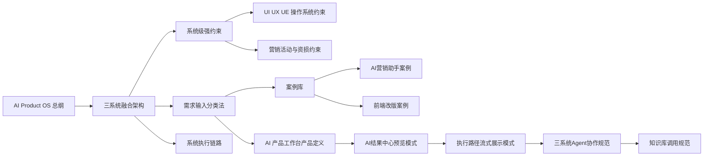

# AI Product OS 知识图谱

知识图谱不是装饰，它用于让人和系统都能看清“这条知识影响什么”。Quartz 右侧关系图会根据双链自动生成，因此每篇知识都要主动连接上下游。

## 主图谱

## 节点类型

| 类型 | 存放位置 | 作用 |
| --- | --- | --- |
| 系统节点 | [[00-系统说明/README|系统说明]] | 定义系统边界和执行链路 |
| 产品节点 | [[01-产品知识/README|产品知识]] | 定义业务域、用户意图和需求资产 |
| 约束节点 | [[02-规则约束/README|规则约束]] | 限制 AI 行为和 Patch 执行 |
| 案例节点 | [[03-案例库/README|案例库]] | 给策略生成提供历史参照 |
| 原型节点 | [[04-原型模式/README|原型模式]] | 定义预览、结果中心和流式展示 |
| Agent 节点 | [[05-Agent知识/README|Agent 知识]] | 定义角色、输入输出和协作流程 |

## 当前主干

- [[00-系统说明/AI Product OS 总纲|AI Product OS 总纲]]
- [[00-系统说明/三系统融合架构|三系统融合架构]]
- [[00-系统说明/系统执行链路|系统执行链路]]
- [[02-规则约束/系统级强约束|系统级强约束]]
- [[04-原型模式/AI结果中心预览模式|AI 结果中心预览模式]]
- [[05-Agent知识/三系统Agent协作规范|三系统 Agent 协作规范]]

## 维护要求

- 新增规则必须连接到一个系统节点和一个使用场景。
- 新增案例必须连接到一个业务域和一个约束节点。
- 新增原型模式必须连接到一个 UI/UX 约束和一个 Agent/执行链路。
- 新增 Agent 知识必须连接到输入规范、输出规范和执行状态展示。

更多细则见 [[00-系统说明/知识图谱维护规则|知识图谱维护规则]]。

