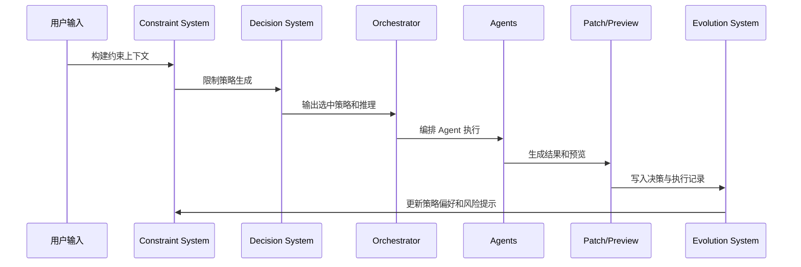

# 三系统融合架构

三系统融合是 AI Product Workbench 的运行底座。任何 AI 行为都不能只靠模型直接输出，而要同时经过约束、决策和进化记录。

## 三大系统

### Constraint System

约束系统把知识转成行为边界。它从 [[02-规则约束/README|规则约束]] 中读取 `must_follow`、`prefer`、`avoid`、`warn`，然后生成 Constraint Context。

典型来源：

- [[02-规则约束/系统级强约束]]
- [[02-规则约束/UI UX UE 操作系统约束]]
- [[02-规则约束/需求文档沉淀/需求文档通用约束]]
- [[02-规则约束/需求文档沉淀/营销活动与资损约束]]

### Decision System

决策系统负责生成多个策略并选择最优策略。它不能绕过 Constraint Context，也不能只输出单一方案。

策略最少包含：

- 保守策略：低风险、低改动、优先稳定。
- 平衡策略：兼顾体验、成本和风险。
- 增强策略：更强效果，可能带来更高实现成本。

评分公式：

```text
score = usability * 0.25 + feasibility * 0.25 + businessValue * 0.3 - risk * 0.2
```

### Evolution System

进化系统记录每次决策、执行结果和反馈，用于更新策略权重、Agent 权重和风险偏好。

记录对象：

- 输入内容。
- 使用的知识和约束。
- 生成策略。
- 选中策略。
- 执行结果。
- QA 和用户反馈。

## 主流程



## Orchestrator 边界

Orchestrator 只负责编排，不负责替代三系统。

- 不直接生成最终策略。
- 不直接绕过 Review 或 Preview。
- 不直接写数据库。
- 不跳过 Evolution Trace。

## 和知识库的关系

- [[01-产品知识/README|产品知识]] 提供业务语义。
- [[02-规则约束/README|规则约束]] 提供行为边界。
- [[03-案例库/README|案例库]] 提供历史参照。
- [[04-原型模式/README|原型模式]] 提供结果展示方式。
- [[05-Agent知识/README|Agent 知识]] 提供执行角色规范。

