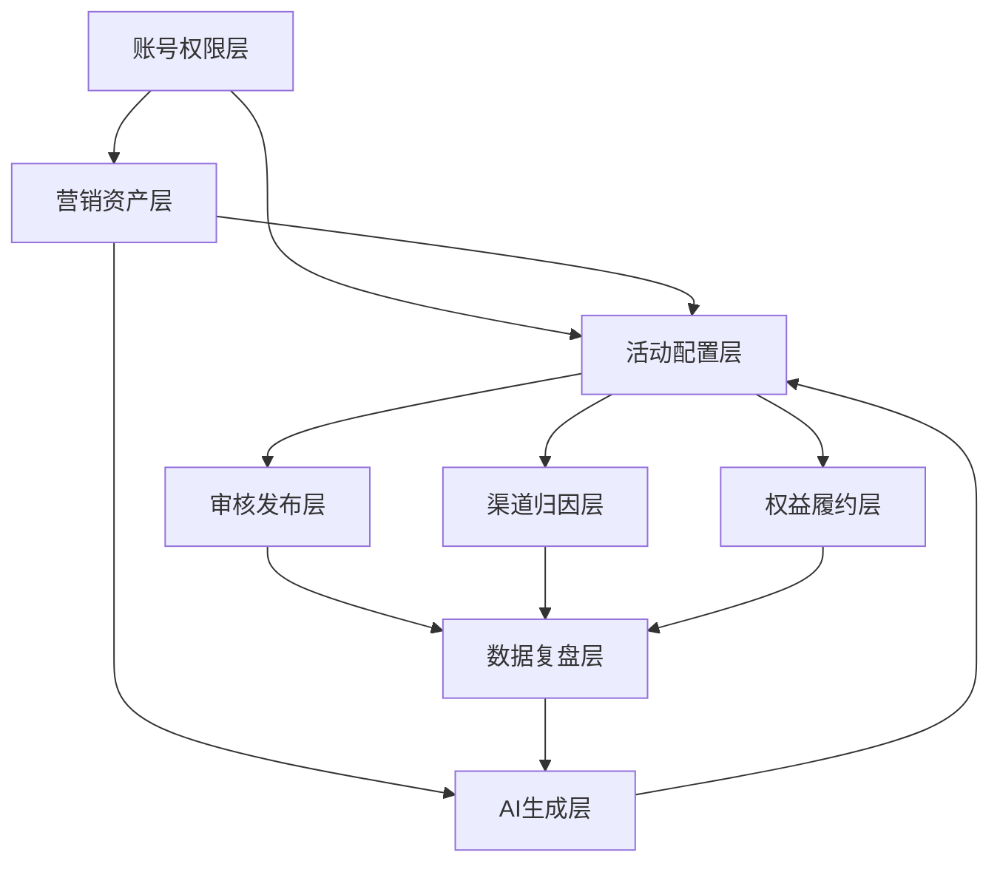

# 产品能力地图

策划宝/云溪营销活动平台的核心价值是把营销活动从“人手工配置”推进到“模板化、配置化、可审核、可复盘、可 AI 辅助生成”的能力平台。

## 能力分层

| 能力层 | 包含模块 | 产品职责 | 关键知识来源 |
| --- | --- | --- | --- |
| 账号权限层 | 4A 登录、门店零售入口、组织、省份、角色、权限点 | 决定谁能进入、看到什么、操作什么、导出什么。 | [[07-来源资产索引/原始手册与原型资产索引|原始手册与原型资产]] |
| 营销资产层 | 素材库、模板库、专题、标签、营销日历、广告位、案例库 | 管理可复用内容资产，支持活动创建和 AI 生成。 | [[02-业务域知识/素材库与营销资产|素材库与营销资产]] |
| 活动配置层 | 模板选择、活动信息、规则配置、页面/海报配置、活动集 | 把业务诉求配置成可发布、可统计的活动。 | [[02-业务域知识/活动发布与模板配置|活动发布与模板配置]] |
| 权益履约层 | 奖品、券、流量包、销售品、库存、概率、核销、对账 | 管理权益发放和资损控制。 | [[02-业务域知识/奖品券与资损核销|奖品券与资损核销]] |
| 渠道归因层 | 活动码、一人一码、短链、企微、渠道编码、运营位编码、发展人 | 记录活动传播来源、人员归属和转化路径。 | [[02-业务域知识/数据报表与渠道归因|数据报表与渠道归因]] |
| 审核发布层 | 预览、二维码、校验、审核、发布、下线、回滚、操作日志 | 控制上线质量、风险和可追溯性。 | [[02-业务域知识/权限审核与运营治理|权限审核与运营治理]] |
| 数据复盘层 | 活动报表、订单报表、抽奖报表、问卷报表、数字大屏、导出审计 | 复盘活动效果和运营动作。 | [[02-业务域知识/数据报表与渠道归因|数据报表与渠道归因]] |
| AI 生成层 | AI 营销助手、案例复用、Dify 工作流、长图/文案/活动方案生成 | 基于历史案例和业务知识辅助生成营销内容。 | [[02-业务域知识/AI营销助手与案例库|AI营销助手与案例库]] |

## 能力关系

## 产品设计原则

- 新需求先判断属于哪一层能力，再判断影响哪个核心对象。
- 如果需求跨多个能力层，PRD 和原型必须展示跨层关系。
- 活动发布是主线，素材、奖品、渠道、报表、审核和 AI 都围绕活动形成闭环。
- 账号权限、审核发布、数据复盘是横切能力，不能只在页面端隐藏。

## 进化方向

- 素材资产层从“素材管理”进化为“营销资产中台”。
- 活动配置层从“单活动配置”进化为“活动方案工作台”。
- 权益履约层从“奖品配置”进化为“权益风控引擎”。
- 渠道归因层从“编码工具”进化为“投放归因模型”。
- 数据复盘层从“报表导出”进化为“运营洞察和建议”。
- AI 生成层从“内容生成”进化为“营销活动 Copilot”。

## 关联知识

- [[01-产品架构/核心对象模型|核心对象模型]]
- [[01-产品架构/端到端业务流程|端到端业务流程]]
- [[03-产品进化规划/产品进化路线图|产品进化路线图]]
