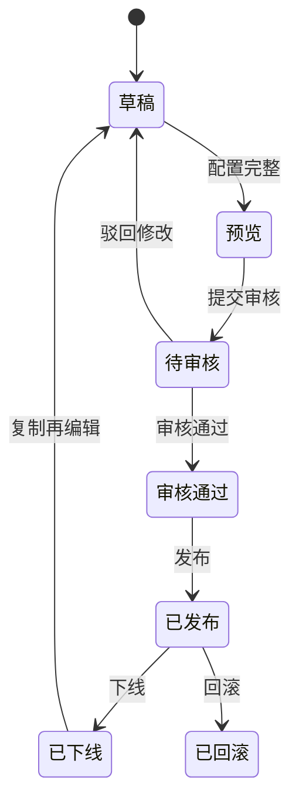

# 端到端业务流程

策划宝/云溪营销活动的默认流程是一个完整营销闭环。任何需求都应定位到这个闭环中的一个或多个环节。

## 主流程

```text
营销目标/省份需求
  ↓
选择历史案例或模板
  ↓
准备素材/文案/页面结构
  ↓
配置活动基础信息和规则
  ↓
配置奖品/权益/渠道/门店/商机
  ↓
生成预览二维码或预览链接
  ↓
提交审核
  ↓
发布上线
  ↓
用户参与/预约/下单/领取/核销
  ↓
数据统计/报表导出/数字大屏
  ↓
复盘优化/沉淀案例/AI 再生成
```

## 状态流转



## 端到端覆盖点

| 环节 | PRD 必写 | 原型必画 |
| --- | --- | --- |
| 目标与模板选择 | 业务目标、活动类型、模板适配、是否复用历史案例。 | 模板列表、筛选、预览、选择结果。 |
| 素材准备 | 素材来源、标签、专题、引用影响、审核状态。 | 素材选择器、预览、无素材、素材下线提示。 |
| 活动配置 | 基础信息、规则、页面内容、奖品、渠道、目标用户。 | 配置表单、字段组、校验、预览联动。 |
| 预览审核 | 校验规则、审核人、驳回原因、变更前后值。 | 预览二维码、审核列表、审核详情、驳回态。 |
| 发布上线 | 发布范围、生效时间、下线回滚、操作日志。 | 发布确认、发布成功、发布失败、下线弹窗。 |
| 用户参与 | 登录授权、参与条件、领取/预约/下单、失败兜底。 | 移动端前台页、按钮状态、异常提示。 |
| 数据复盘 | 指标口径、筛选、导出、脱敏、数据延迟。 | 指标卡、图表、明细表、导出状态、无权限。 |

## 回滚与历史影响

涉及历史业务增量时，必须判断影响对象：

- 草稿活动：是否自动带新字段，默认值是什么。
- 待审核活动：是否需要退回重提。
- 已发布活动：是否立即生效，是否需要灰度或重新发布。
- 已下线活动：复制时是否带新规则。
- 历史报表：新字段是否补历史数据，空值如何显示。

## 关联知识

- [[03-产品进化规划/历史业务增量规则|历史业务增量规则]]
- [[04-产品文档规范/验收风险清单|验收风险清单]]
- [[05-原型设计规范/历史业务增量原型规则|历史业务增量原型规则]]
