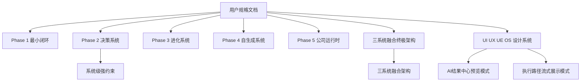

# 用户规格文档

本目录沉淀用户在对话中给出的系统规格。它是 AI Product OS 的“源规格层”，用于保留阶段目标、强制约束、模块边界、验收标准和前端交互要求。

> [!important] 使用原则
> 本目录保留用户意图和阶段规格，不替代实现代码。系统执行时应先读取这里的源规格，再进入 [[02-规则约束/系统级强约束|系统级强约束]]、[[00-系统说明/三系统融合架构|三系统融合架构]] 和 [[05-Agent知识/知识库调用规范|知识库调用规范]]。

## 阶段规格

- [[06-规格文档/00-总体执行规格|00-总体执行规格]]
- [[06-规格文档/01-Phase1最小闭环|01-Phase1 最小闭环]]
- [[06-规格文档/02-Phase2决策系统|02-Phase2 决策系统]]
- [[06-规格文档/03-Phase3进化系统|03-Phase3 进化系统]]
- [[06-规格文档/04-Phase4自生成系统|04-Phase4 自生成系统]]
- [[06-规格文档/05-Phase5AI产品公司运行时|05-Phase5 AI 产品公司运行时]]
- [[06-规格文档/06-三系统融合终极架构|06-三系统融合终极架构]]

## 交互与知识库规格

- [[06-规格文档/07-UI UX UE OS设计系统|07-UI UX UE OS 设计系统]]
- [[06-规格文档/08-前端改版与预览交互需求|08-前端改版与预览交互需求]]
- [[06-规格文档/09-部署与知识库运行要求|09-部署与知识库运行要求]]

## 和现有图谱的关系

## 敏感信息处理

用户提供过服务器、账号、密码和模型 key。知识库只记录运行要求和安全原则，不保存明文密码或 API Key。

