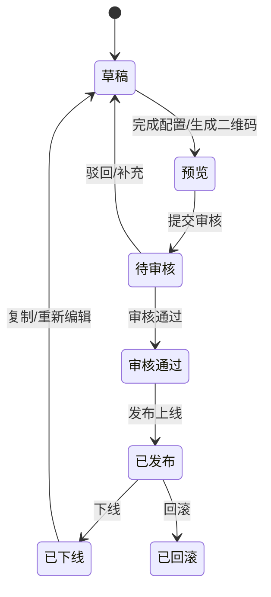

# 产品架构与能力地图

策划宝/云溪营销活动产品不是单一活动页面工具，而是一套面向集团、省、市、区和一线运营的营销活动能力平台。它把素材生产、活动配置、奖品权益、审核发布、渠道归因、报表复盘和 AI 生成串成一个闭环。

## 产品定位

```text
营销活动能力平台
  = 活动发布平台
  + 素材库/模板库
  + 奖品与销售品管理
  + 审核发布与权限治理
  + 渠道/运营位/活动码/一人一码
  + 数据报表与数字大屏
  + 案例库与 AI 营销助手
```

## 用户与角色

| 角色 | 关注点 | 典型动作 |
| --- | --- | --- |
| 集团/平台管理员 | 平台规则、模板、活动集、跨省数据、审核治理 | 配置模板、管理活动集、查看全局报表、配置审核和权限。 |
| 省/市/区管理员 | 本级活动创建、审核、发布和复盘 | 创建活动、配置奖品、提交审核、查看本级数据。 |
| 一线运营/客户经理 | 快速制作素材、发布活动、承接商机 | 选择模板、生成海报、一人一码、分享活动、查看线索。 |
| 审核人员 | 风险、合规、发布质量 | 审核素材、活动、奖品、外链、报表导出和高风险操作。 |
| 终端用户 | 参与活动、领取权益、提交订单或商机 | 浏览页面、登录授权、参与抽奖、预约、下单、核销。 |

## 能力分层

| 能力层 | 主要模块 | 核心职责 | 必读知识 |
| --- | --- | --- | --- |
| 账号权限层 | 4A 登录、门店零售系统入口、角色权限、省份组织 | 决定谁能看、谁能建、谁能审、谁能导出。 | [[07-来源资产索引/旧版整理/01-产品知识/策划宝操作手册/账号权限与登录\|账号权限与登录]] |
| 素材资产层 | 素材库、模板、专题、标签、营销日历、广告位 | 管理可复用素材、模板和营销内容资产。 | [[07-来源资产索引/旧版整理/01-产品知识/策划宝操作手册/素材库操作手册\|素材库操作手册]] |
| 活动配置层 | 模板选择、活动信息、活动规则、页面/海报、奖品权益 | 把业务目标配置成可发布活动。 | [[07-来源资产索引/旧版整理/01-产品知识/策划宝操作手册/活动配置与奖品管理\|活动配置与奖品管理]] |
| 风险发布层 | 预览二维码、校验、审核、发布、下线、回滚、日志 | 保证上线前可检查、上线后可追溯、异常可回滚。 | [[07-来源资产索引/旧版整理/04-原型模式/需求文档沉淀/配置化页面与后台模式\|配置化页面与后台模式]] |
| 履约交易层 | 奖品、券、流量包、销售品、订单、商机预约、核销 | 管理权益发放、交易转化和资损风险。 | [[07-来源资产索引/旧版整理/02-规则约束/需求文档沉淀/营销活动与资损约束\|营销活动与资损约束]] |
| 渠道归因层 | 渠道编码、运营位编码、活动码、一人一码、短链、企微 | 识别投放来源、人员归属和转化链路。 | [[07-来源资产索引/旧版整理/01-产品知识/策划宝操作手册/数据报表与数字大屏\|数据报表与数字大屏]] |
| 数据复盘层 | 活动报表、数字大屏、运营数据统计、导出审计 | 复盘活动效果、渠道效果、订单和奖品数据。 | [[07-来源资产索引/旧版整理/01-产品知识/策划宝操作手册/数据报表与数字大屏\|数据报表与数字大屏]] |
| AI 生成层 | 案例库、AI 营销助手、Dify 工作流、长图/文案生成 | 从历史案例和知识库生成营销内容与活动方案。 | [[07-来源资产索引/旧版整理/03-案例库/需求案例库/AI营销助手案例\|AI营销助手案例]] |

## 核心对象

| 对象 | 含义 | 常见关系 |
| --- | --- | --- |
| 活动 Activity | 一次可发布、可统计、可复盘的营销承载对象。 | 关联模板、页面、奖品、渠道、报表、审核记录。 |
| 模板 Template | 可复用的活动结构和页面/配置骨架。 | 决定活动类型、页面能力和配置项。 |
| 素材 Material | 图片、海报、长图、Banner、文案、专题内容。 | 可被模板、活动、专题、广告位引用。 |
| 奖品/销售品 Prize/Product | 活动权益、实物、券、流量包、订单分类。 | 关联库存、概率、领取资格、核销和对账。 |
| 渠道 Channel | 投放来源、运营位、客户经理、企微、活动码。 | 决定归因统计、人员绑定和跳转参数。 |
| 审核任务 AuditTask | 发布前或高风险操作前的审批记录。 | 关联提交人、审核人、变更前后值和驳回原因。 |
| 报表指标 Metric | PV、UV、订单、中奖、领取、核销、导出字段。 | 来自活动、渠道、奖品、用户行为和订单数据。 |
| AI 生成任务 AIJob | AI 助手、Dify、案例复用和内容生成过程。 | 关联用户意图、来源案例、输入输出、失败兜底和确认发布。 |

## 通用状态流转



任何活动、素材、模板、奖品、外链和高风险后台操作，只要影响线上用户、权益、统计或权限，都应映射到类似的状态链路。

## AI 理解原则

- 先识别需求影响哪一层能力，再判断它改变哪个核心对象。
- 如果需求看似只是“新增字段/按钮/筛选项”，也要追问它影响状态流转、权限、历史数据、报表、审核和原型展示哪里。
- 活动类需求默认不是单页需求，通常至少包含后台配置、用户端展示、预览审核、发布复盘四个面。
- 新产品创新要接入已有能力层，除非明确说明要建立全新能力层。

## 关联知识

- [[07-来源资产索引/旧版整理/00-AI使用总纲/业务域到产品逻辑映射|业务域到产品逻辑映射]]
- [[07-来源资产索引/旧版整理/00-AI使用总纲/产品进化方向判断规则|产品进化方向判断规则]]
- [[07-来源资产索引/旧版整理/01-产品知识/策划宝操作手册/README|策划宝操作手册知识库]]
- [[07-来源资产索引/旧版整理/04-原型模式/需求文档沉淀/活动模板配置与原型模式|活动模板配置与原型模式]]
