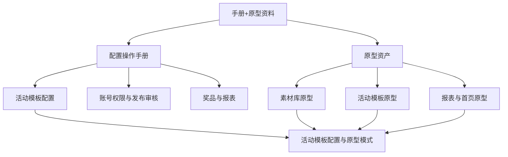

# 手册与原型资料库

本目录沉淀 `手册+原型.zip` 中的配置操作手册、培训资料和 Axure 原型资产。内容属于策划宝、云溪营销活动、全智 AI 营销活动平台、素材库和活动模板相关业务知识，不属于本知识库系统自身说明。

## 导入摘要

| 类型 | 数量 | 用途 |
| --- | ---: | --- |
| 配置操作手册 | 24 | 活动模板、登录权限、活动创建、奖品配置、报表配置和发布审核操作 |
| 原型资产 | 31 | 页面结构、交互流程、活动模板、素材库、报表和专项需求原型 |
| HTML 原型导出包 | 1 | 可浏览原型页面、页面样式、交互数据和图片素材 |
| 其他资料 | 3 | 产品综述、培训和补充资料 |
| 总资产 | 59 | 手册和原型的统一索引 |

## 业务域分布

| 业务域 | 资产数 | 说明 |
| --- | ---: | --- |
| 素材库与模板配置 | 27 | 素材库、模板配置、手机版策划宝、终端长图、素材同步与重构 |
| 运营配置与活动治理 | 10 | 云溪活动、聚合页、短链、裂变、省份活动、打卡活动 |
| 号卡与 OAO 流程 | 6 | 互联网卡、OAO、商机预约、发展人编码、低升高 |
| 奖品券与资损核销 | 5 | 速抢好福利、抽奖、奖品运营、广西抽奖 |
| 数据统计与报表 | 2 | 一人一码数据报表、首页数据 |
| 其他需求资产 | 8 | 文档中心、案例、首页、未明确业务域原型 |

## 阅读路径

1. [[07-来源资产索引/旧版整理/01-产品知识/手册与原型资料库/配置手册资产清单-2026-06-23|配置手册资产清单-2026-06-23]]：查看全部 58 个资产和分类。
2. [[07-来源资产索引/旧版整理/01-产品知识/手册与原型资料库/活动模板配置手册索引|活动模板配置手册索引]]：查看各类活动模板的配置手册和适用场景。
3. [[07-来源资产索引/旧版整理/01-产品知识/手册与原型资料库/原型资产索引|原型资产索引]]：查看 Axure 原型资产按业务域的归档。
4. [[07-来源资产索引/旧版整理/01-产品知识/手册与原型资料库/原型转HTML资产索引-2026-07-03|原型转HTML资产索引-2026-07-03]]：查看 HTML 原型导出包的项目归档、文件统计和使用限制。
5. [[07-来源资产索引/旧版整理/04-原型模式/需求文档沉淀/活动模板配置与原型模式|活动模板配置与原型模式]]：查看从手册和原型中沉淀的页面、流程和配置模式。

## 关系图

## 使用规则

- 需要回答“某类活动怎么配置”时，优先读取 [[07-来源资产索引/旧版整理/01-产品知识/手册与原型资料库/活动模板配置手册索引|活动模板配置手册索引]]。
- 需要回答“某个页面/流程应如何设计”时，优先读取 [[07-来源资产索引/旧版整理/01-产品知识/手册与原型资料库/原型资产索引|原型资产索引]] 和 [[07-来源资产索引/旧版整理/04-原型模式/需求文档沉淀/活动模板配置与原型模式|活动模板配置与原型模式]]。
- 涉及奖品、抽奖、优惠、库存、核销时，必须同步读取 [[07-来源资产索引/旧版整理/02-规则约束/需求文档沉淀/营销活动与资损约束|营销活动与资损约束]]。
- 涉及素材库、专题、标签、活动码、一人一码、运营日志、报表导出时，必须同步读取 [[07-来源资产索引/旧版整理/02-规则约束/需求文档沉淀/运营配置与素材库治理约束|运营配置与素材库治理约束]]。

## 关联资料

- [[07-来源资产索引/旧版整理/01-产品知识/策划宝操作手册/README|策划宝操作手册知识库]]
- [[07-来源资产索引/旧版整理/01-产品知识/需求文档知识库/业务域补充索引-2026-06-23|业务域补充索引-2026-06-23]]
- [[99-收件箱/手册原型导入记录-2026-06-23|手册原型导入记录-2026-06-23]]
- [[99-收件箱/原型转HTML导入记录-2026-07-03|原型转HTML导入记录-2026-07-03]]
