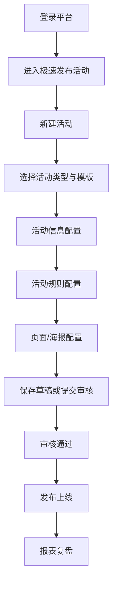

# 活动模板配置手册索引

本页沉淀 `手册+原型.zip` 中各类活动模板配置手册的可复用知识。

## 通用配置流程

## 模板分类

| 模板/场景 | 代表手册 | 配置重点 |
| --- | --- | --- |
| 聚合页链接单点跳转 | 聚合页（新）链接单点跳转模板、安徽派出所、企微短链加粉 | 跳转链接、参数透传、渠道编码、运营位编码、多个省内链接 |
| 互联网卡 | 互联网卡、互联网卡模版 | 商机预约、互联网卡模板、活动规则、海报配置、订单统计 |
| 商机预约 | 商机预约（发奖）、商机预约（终端） | OAO 奖品、商机单、预约门店、发奖规则 |
| 企微加粉/短链加粉 | 企微加粉、企微短链加粉、宁夏短链原型 | 客户经理、企微员工列表、短链、加粉数据 |
| 分享裂变 | 分享裂变、湖南裂变原型 | 分享任务、裂变路径、拉新统计 |
| 抽奖/速抢好福利 | 速抢好福利、广西抽奖、抽奖重构 | 奖品、库存、中奖概率、抽奖组件、风控与对账 |
| 宠粉福利/券化 | 北京宠粉福利、江西券化 | 权益券、奖品、页面配置、领取与核销 |
| 低升高/OAO 引流 | 深圳低升高、广东存量升高套 OAO 引流 | 号卡/OAO、商机流转、订购路径 |
| 麦芒/AI 双节/CityWalk | 麦芒集约操盘、AI 双节、CityWalk | 活动模板复用、省份运营、素材与奖品配置 |
| 手机版策划宝 | 手机版策划宝操作指南 | 移动端素材、活动辅助、AI 工具箱 |

## 通用字段与规则

- 登录与权限：多数配置手册都包含 4A 登录、角色权限、同级审批、本人不可审批本人发起活动等规则。
- 活动基础信息：活动名称、活动时间、活动类型、适用范围、活动集、是否测试活动。
- 规则配置：参与条件、参与次数、中奖次数、目标用户、登录方式、二次确认。
- 页面配置：Banner、背景图、活动文案、按钮、规则说明、楼层图片、跳转链接。
- 奖品配置：奖品名称、奖品类型、奖品库存、中奖概率、发放规则、核销方式。
- 发布审核：保存草稿、提交审核、审核通过、发布上线、下架、回滚。
- 数据复盘：活动订单、活动客流、加粉数据、商机预约、抽奖记录、渠道和运营位数据。

## 约束沉淀

- 模板配置必须区分活动信息、规则、页面/海报、奖品、报表五类内容。
- 涉及跳转链接时，必须明确渠道编码、运营位编码和活动编码透传。
- 涉及奖品/抽奖时，必须明确库存、概率、发放、失败回退和对账。
- 涉及商机/OAO/互联网卡时，必须明确订单、商机单、预约门店和状态回传。
- 涉及分享裂变/企微加粉时，必须明确人员绑定、短链失效、加粉统计和异常提示。

## 关联知识

- [[07-来源资产索引/旧版整理/01-产品知识/策划宝操作手册/活动配置与奖品管理|活动配置与奖品管理]]
- [[07-来源资产索引/旧版整理/01-产品知识/手册与原型资料库/原型资产索引|原型资产索引]]
- [[07-来源资产索引/旧版整理/02-规则约束/需求文档沉淀/营销活动与资损约束|营销活动与资损约束]]
- [[07-来源资产索引/旧版整理/04-原型模式/需求文档沉淀/活动模板配置与原型模式|活动模板配置与原型模式]]
