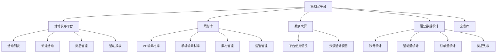

# 策划宝操作手册知识库

本目录沉淀《【策划宝】操作手册》的平台操作知识，覆盖 AI 策划宝活动发布平台、素材库、数据大屏、运营数据统计、账号权限和常见操作。该资料属于业务平台操作知识，不属于本知识库系统自身说明。

## 来源概况

| 项目 | 数量 |
| --- | ---: |
| 正文段落 | 1454 |
| 表格 | 13 |
| 图片/截图 | 121 |
| 主要模块 | 活动发布平台、素材库、数字大屏、运营数据统计、案例库 |

> [!note]
> 原始 Word 中包含大量截图。本知识库优先沉淀可搜索、可引用、可复用的流程、字段、状态和规则；截图不直接搬运到公开知识库页面。

## 阅读路径

1. [[07-来源资产索引/旧版整理/01-产品知识/策划宝操作手册/账号权限与登录|账号权限与登录]]：查看角色权限、4A 登录、门店零售系统入口和常见登录问题。
2. [[07-来源资产索引/旧版整理/01-产品知识/策划宝操作手册/活动发布平台操作手册|活动发布平台操作手册]]：查看首页概览、活动列表、活动状态、号卡活动和平台功能导航。
3. [[07-来源资产索引/旧版整理/01-产品知识/策划宝操作手册/活动配置与奖品管理|活动配置与奖品管理]]：查看新建活动、分步式/整合式配置、活动类型、奖品和销售品管理。
4. [[07-来源资产索引/旧版整理/01-产品知识/策划宝操作手册/数据报表与数字大屏|数据报表与数字大屏]]：查看活动报表、运营位/渠道编码、数字大屏和运营数据统计。
5. [[07-来源资产索引/旧版整理/01-产品知识/策划宝操作手册/素材库操作手册|素材库操作手册]]：查看素材库 PC 端、手机端、素材管理、营销管理和用户信息查询。

## 平台模块地图

## 使用规则

- 查询具体功能怎么操作时，优先进入对应模块页，不直接查原始 Word。
- 涉及素材、专题、标签、活动码、一人一码、运营日志和报表导出时，同步读取 [[07-来源资产索引/旧版整理/02-规则约束/需求文档沉淀/运营配置与素材库治理约束|运营配置与素材库治理约束]]。
- 涉及奖品、券、库存、抽奖、核销、资损时，同步读取 [[07-来源资产索引/旧版整理/02-规则约束/需求文档沉淀/营销活动与资损约束|营销活动与资损约束]]。
- 涉及后台配置、预览、审核、发布、下线和回滚时，同步读取 [[07-来源资产索引/旧版整理/04-原型模式/需求文档沉淀/配置化页面与后台模式|配置化页面与后台模式]]。

## 关联资料

- [[07-来源资产索引/旧版整理/01-产品知识/需求文档知识库/业务域索引|业务域索引]]
- [[07-来源资产索引/旧版整理/01-产品知识/需求文档知识库/业务域补充索引-2026-06-23|业务域补充索引-2026-06-23]]
- `99-收件箱/策划宝操作手册导入记录-2026-06-23`（仅本地归档）
