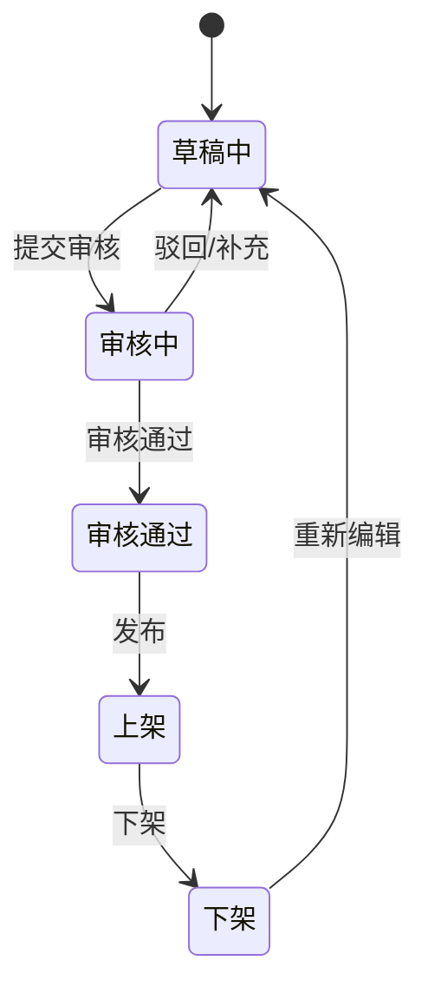

# 活动发布平台操作手册

AI 策划宝活动发布平台面向集团及各省业务，提供活动创建、审核、发布、奖品管理、报表分析、渠道管理和小工具等能力。

## 首页概览

| 模块 | 说明 | 操作/口径 |
| --- | --- | --- |
| 核心数据 | 展示当前用户权限范围内的活动发布平台核心数据汇总。 | 普通订单、高值订单的分类来自奖品/产销品配置，历史统计数据分类变更后不能回写修改。 |
| 热门案例 | 展示集团、省、市可复制活动案例。 | 需要联系集团运营配置，手册未说明支持分省自配置。 |
| 营销日历 | 展示最近五场营销节日。 | 现阶段主要展示规划内容。 |
| 数据分布 | 展示当前用户权限范围内可见活动当天 PV、UV、订单量。 | 数据产生后同步更新。 |
| Top 活动榜单 | 展示 PV 排名前 5 和订单量排名前 5 活动。 | 榜单每小时更新一次。 |

## 活动状态

| 状态 | 含义 | 可执行动作 |
| --- | --- | --- |
| 草稿中 | 用户编辑后保存或系统自动保存的活动。 | 编辑、提交审核；草稿活动有唯一活动编码。 |
| 审核中 | 用户确认配置并通过系统初步校验后提交审核。 | 等待审核结果。 |
| 审核通过 | 审核通过但未必已经上线。 | 可发布或下架。 |
| 上架/上线 | 线上活动生效，用户可访问并参与。 | 可查看数据，按权限执行下架等操作。 |
| 下架 | 活动入口停止访问。 | 可重新编辑并再次提交审核。 |

## 活动列表

- 非号卡类活动在活动列表中展示；号卡类活动在号卡活动列表中单独展示。
- 活动编码是创建活动时产生的唯一 ID。
- 活动名称由用户输入，允许重复。
- 测试活动数据不计入数据统计。
- 系统默认按近一个月活动日期展示，其他时间范围需要手动切换。
- 活动集用于集约活动统一管理。
- 集团、平台管理员可筛选集团和省份；省及以下管理员通常只能查看本省、本级或下级范围内审核通过/已上线活动。

## 筛选项

| 筛选项 | 能力说明 | 备注 |
| --- | --- | --- |
| 活动编码搜索 | 通过活动唯一 ID 搜索活动。 | 搜索草稿活动时，仅能搜到自己创建的草稿。 |
| 活动名称 | 通过用户输入的活动名称搜索。 | 活动名称允许重复。 |
| 活动状态 | 支持草稿中、审核中、审核通过、上线、下架等状态。 | 审核通过后可发布或下架。 |
| 活动类型 | 按活动模板种类筛选。 | 用于快速定位模板类型。 |
| 是否为测试活动 | 筛选测试活动或非测试活动。 | 测试活动数据不计入统计。 |
| 活动日期 | 按活动开始/结束时间筛选。 | 默认近一个月。 |
| 活动集 | 展示某一活动集下所有活动。 | 用于集约活动管理。 |
| 省份 | 按权限范围筛选可见活动。 | 不同角色可见范围不同。 |
| 创建日期 | 按活动创建日期筛选。 | 用于追踪创建批次。 |
| 我的活动 | 仅展示当前账号创建的活动。 | 适合个人运营复盘。 |

## 活动卡片

- 展示活动状态、活动开始时间、活动结束时间、模板类型、创建账号省市区县、创建人脱敏姓名、活动创建时间。
- 草稿中活动支持编辑和提交审核。
- 提交审核前系统会自动校验活动完整性；校验失败时应提示用户补齐活动信息。
- 分页支持每页 8/16/50 条、页码跳转和输入页码跳转。

## 平台功能导航

- 首页概览：核心数据、热门案例、营销日历、数据分布、榜单。
- 极速活动发布：活动列表、号卡活动、新建活动。
- 奖品管理：独立奖品、销售品管理。
- 活动集管理：集约活动管理。
- 活动权限：目标用户列表。
- 文件管理：协议管理、第三方协议。
- 小工具：抽奖记录管理、文档中心、案例管理。
- 渠道管理：渠道管理、客户经理管理。
- 跳转链接：链接配置和参数透传。
- 活动报表：订单、抽奖、商机预约、客流、清单、问卷、互联网卡、加粉、一人一码等。

## 关联知识

- [[07-来源资产索引/旧版整理/01-产品知识/策划宝操作手册/活动配置与奖品管理|活动配置与奖品管理]]
- [[07-来源资产索引/旧版整理/01-产品知识/策划宝操作手册/数据报表与数字大屏|数据报表与数字大屏]]
- [[07-来源资产索引/旧版整理/02-规则约束/需求文档沉淀/营销活动与资损约束|营销活动与资损约束]]
- [[07-来源资产索引/旧版整理/04-原型模式/需求文档沉淀/配置化页面与后台模式|配置化页面与后台模式]]
