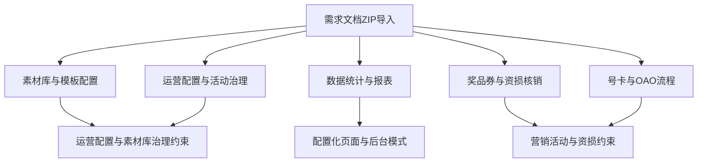

# 业务域补充索引-2026-06-23

本页从 `需求文档.zip` 中抽取业务域知识，用于补充 [[07-来源资产索引/旧版整理/01-产品知识/需求文档知识库/业务域索引|业务域索引]]。本次重点是素材库、活动治理、运营数据和审核发布链路。

## 素材库与模板配置

- 资产规模：83 个。
- 代表资产：素材库接入活动创建、素材库后台操作审核、素材库审核功能优化、素材库专题关联搜索、素材库创建专题筛选及排序、素材库标签体系、老素材库同步至新素材库、极速发布平台专题素材池建设。
- 高频规则：
  - 素材库能力要区分 PC、手机端、后台、极布嵌入页等入口。
  - 专题、标签、筛选、排序和搜索优化要保留历史兼容规则，避免影响既有素材。
  - 素材替换、素材同步、素材下线要有影响范围、回滚方式和发布前预览。
  - 涉及用户查询、登录维度、白名单和权限开放时，必须补充个人信息、权限边界和日志留痕。
- 关联约束：[[07-来源资产索引/旧版整理/02-规则约束/需求文档沉淀/运营配置与素材库治理约束|运营配置与素材库治理约束]]。

## 运营配置与活动治理

- 资产规模：17 个。
- 代表资产：策划宝分省活动码、四川一人一码、短链加粉、抽奖模板整合、活动类型筛选、专题可见性控制及推送、订购模板整合。
- 高频规则：
  - 活动码、一人一码、短链和企微链路必须明确生成、绑定、展示、跳转和失效规则。
  - 活动类型筛选、专题可见性和推送范围必须明确省份、账号、角色、场景和默认值。
  - 抽奖整合、订购模板和宠粉福利站要优先接入 [[07-来源资产索引/旧版整理/02-规则约束/需求文档沉淀/营销活动与资损约束|营销活动与资损约束]]。
  - 配置类需求必须同时说明后台配置项、前台展示、审核发布、异常提示和运营日志。

## 数据统计与报表

- 资产规模：15 个。
- 代表资产：运营日志、首页数据优化、素材库用户明细统计维度、用户明细查询导出审核、省份数据报表查询。
- 高频规则：
  - 报表字段必须明确口径、时间范围、维度、权限、脱敏和导出格式。
  - 运营日志必须覆盖操作人、操作时间、操作对象、变更前后值、结果状态和失败原因。
  - 首页数据类需求必须区分展示口径、计算口径、缓存口径和异常兜底。
  - 查询和导出能力必须与权限体系绑定，避免跨省、跨角色或跨组织查看。

## 奖品券与资损核销

- 资产规模：2 个。
- 代表资产：北京电信宠粉福利站、广西抽奖后台需求。
- 高频规则：
  - 抽奖、奖品、库存、领取、券和白名单必须进入资损评审。
  - 奖品库存要明确发放前校验、发放中扣减、发放后对账、失败回退。
  - 活动前台展示、后台配置和数据报表必须使用同一活动编码和奖品编码。

## 号卡与 OAO 流程

- 资产规模：2 个。
- 代表资产：策划宝 OAO 流量包下单前校验、号卡活动增加活动类型筛选。
- 高频规则：
  - OAO 和号卡类需求必须明确下单前校验、失败提示、重新发起、状态回传和日志记录。
  - 涉及号码、身份、订单、商机单或入网信息时，必须补充个人信息保护和权限边界。

## 关系连接建议

## 关联知识

- [[07-来源资产索引/旧版整理/01-产品知识/需求文档知识库/需求资产清单-2026-06-23|需求资产清单-2026-06-23]]
- [[07-来源资产索引/旧版整理/02-规则约束/需求文档沉淀/运营配置与素材库治理约束|运营配置与素材库治理约束]]
- [[07-来源资产索引/旧版整理/03-案例库/需求案例库/素材库与活动治理案例补充|素材库与活动治理案例补充]]
