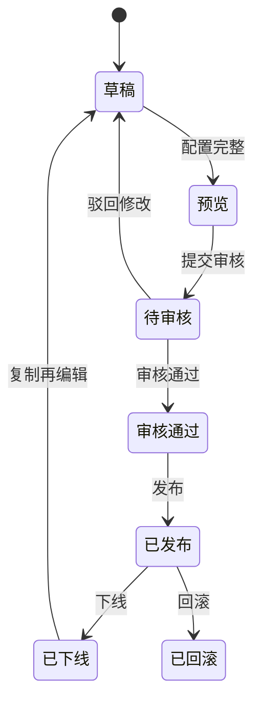

# 端到端业务流程 / 状态流转

## 来源元数据

| 项目 | 内容 |
| --- | --- |
| 旧知识 ID | `vault_1fffca4659ceb681532e6632aedf10e1` |
| 分类 | 产品架构 |
| 类型 | `product_architecture` |
| 范围 | `global` |
| 优先级 | `high` |
| 旧状态 | `active` |
| 新检索状态 | 仅查来源 |
| 旧来源类型 | `file_extraction` |
| 创建时间 | 2026-06-30T02:36:45.226 |
| 更新时间 | 2026-07-10T06:40:38.881 |
| 历史版本 | 2 个；最新版本号 2 |

## 旧库摘要

状态流转

## 旧库当前内容

来源文件：01-产品架构/端到端业务流程.md
切片序号：3

## 状态流转

