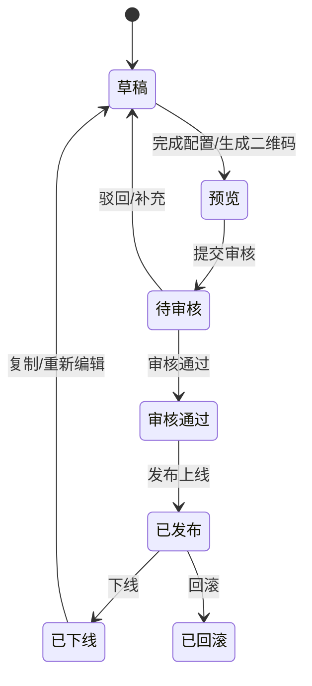

# 产品架构与能力地图 / 通用状态流转

## 来源元数据

| 项目 | 内容 |
| --- | --- |
| 旧知识 ID | `vault_8c747d2ad82b01f2b14488e93fb171e0` |
| 分类 | 来源资产索引 |
| 类型 | `default_rule` |
| 范围 | `global` |
| 优先级 | `low` |
| 旧状态 | `active` |
| 新检索状态 | 仅查来源 |
| 旧来源类型 | `file_extraction` |
| 创建时间 | 2026-06-30T02:36:45.924 |
| 更新时间 | 2026-07-10T06:40:40.005 |
| 历史版本 | 2 个；最新版本号 2 |

## 旧库摘要

通用状态流转

## 旧库当前内容

来源文件：07-来源资产索引/旧版整理/00-AI使用总纲/产品架构与能力地图.md
切片序号：6

## 通用状态流转

任何活动、素材、模板、奖品、外链和高风险后台操作，只要影响线上用户、权益、统计或权限，都应映射到类似的状态链路。

