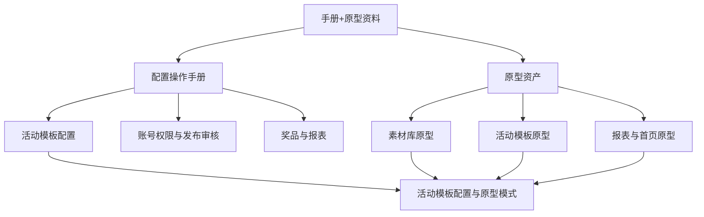

# 手册与原型资料库 / 关系图

## 来源元数据

| 项目 | 内容 |
| --- | --- |
| 旧知识 ID | `vault_034b5171cb0e4a0e53ad216a287f8047` |
| 分类 | 来源资产索引 |
| 类型 | `default_rule` |
| 范围 | `global` |
| 优先级 | `low` |
| 旧状态 | `active` |
| 新检索状态 | 仅查来源 |
| 旧来源类型 | `file_extraction` |
| 创建时间 | 2026-06-30T02:36:46.064 |
| 更新时间 | 2026-07-10T06:40:40.183 |
| 历史版本 | 2 个；最新版本号 2 |

## 旧库摘要

关系图

## 旧库当前内容

来源文件：07-来源资产索引/旧版整理/01-产品知识/手册与原型资料库/README.md
切片序号：5

## 关系图

