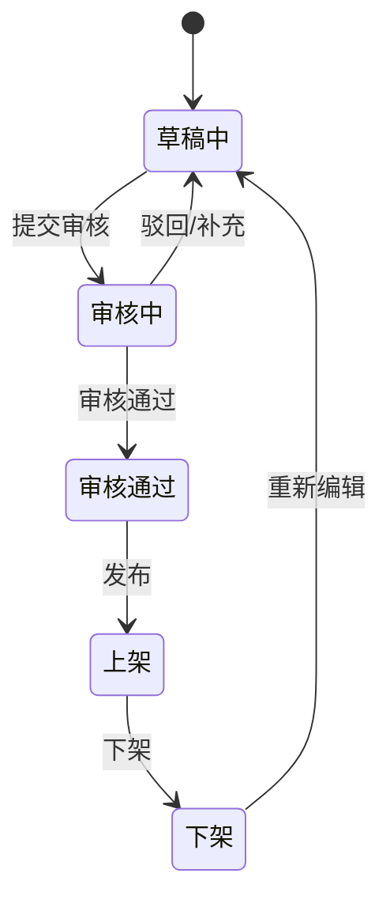

# 活动发布平台操作手册 / 活动状态

## 来源元数据

| 项目 | 内容 |
| --- | --- |
| 旧知识 ID | `vault_6d7f18b85261923ec593cbb03ee7d44e` |
| 分类 | 来源资产索引 |
| 类型 | `default_rule` |
| 范围 | `global` |
| 优先级 | `low` |
| 旧状态 | `active` |
| 新检索状态 | 仅查来源 |
| 旧来源类型 | `file_extraction` |
| 创建时间 | 2026-06-30T02:36:46.265 |
| 更新时间 | 2026-07-10T06:40:40.511 |
| 历史版本 | 2 个；最新版本号 2 |

## 旧库摘要

活动状态

## 旧库当前内容

来源文件：07-来源资产索引/旧版整理/01-产品知识/策划宝操作手册/活动发布平台操作手册.md
切片序号：3

## 活动状态

| 状态 | 含义 | 可执行动作 |
| --- | --- | --- |
| 草稿中 | 用户编辑后保存或系统自动保存的活动。 | 编辑、提交审核；草稿活动有唯一活动编码。 |
| 审核中 | 用户确认配置并通过系统初步校验后提交审核。 | 等待审核结果。 |
| 审核通过 | 审核通过但未必已经上线。 | 可发布或下架。 |
| 上架/上线 | 线上活动生效，用户可访问并参与。 | 可查看数据，按权限执行下架等操作。 |
| 下架 | 活动入口停止访问。 | 可重新编辑并再次提交审核。 |

