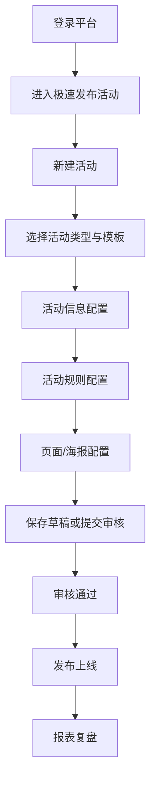

# 活动模板配置手册索引 / 通用配置流程

## 来源元数据

| 项目 | 内容 |
| --- | --- |
| 旧知识 ID | `vault_77389ac2408d982692c934f676cded1b` |
| 分类 | 来源资产索引 |
| 类型 | `default_rule` |
| 范围 | `global` |
| 优先级 | `low` |
| 旧状态 | `active` |
| 新检索状态 | 仅查来源 |
| 旧来源类型 | `file_extraction` |
| 创建时间 | 2026-06-30T02:36:46.137 |
| 更新时间 | 2026-07-10T06:40:40.323 |
| 历史版本 | 2 个；最新版本号 2 |

## 旧库摘要

通用配置流程

## 旧库当前内容

来源文件：07-来源资产索引/旧版整理/01-产品知识/手册与原型资料库/活动模板配置手册索引.md
切片序号：2

## 通用配置流程

