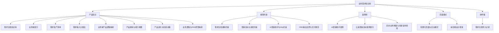

# 业务需求知识库

这里不是系统说明文档，也不是平台自身的设计文档。这里仅维护可复用的业务知识，包括历史需求资产、业务域索引、需求写作规则、营销活动风险、AI 营销助手案例和配置化页面模式。

> [!important] 维护原则
> 只沉淀业务知识、需求规则和案例经验；不存放系统架构、内部流程、平台技术方案或平台自身设计说明。

## 推荐阅读路径

1. [[01-产品知识/README|产品知识]]：先建立业务域、能力与目标映射。
2. [[01-产品知识/产品架构与能力地图|产品架构与能力地图]]：建立产品能力结构图。
3. [[01-产品知识/产品进化与创新决策|产品进化与创新决策]]：判断历史增量、平台化扩展、新产品创新边界。
4. [[01-产品知识/业务逻辑与PRD原型映射|业务逻辑与 PRD/原型映射]]：统一把规则映射为 PRD 与原型结构。
5. [[01-产品知识/业务域产品逻辑映射|业务域产品逻辑映射]]：把业务域先转成具体对象、状态和异常逻辑。
6. [[02-规则约束/需求文档沉淀/需求文档通用约束|需求文档通用约束]]：查看需求文档和方案输出时必须补齐的结构。
7. [[02-规则约束/需求文档沉淀/PRD输出边界与交付规范|PRD 输出边界与交付规范]]：确认 PRD/开发边界。
8. [[02-规则约束/需求文档沉淀/营销活动与资损约束|营销活动与资损约束]]：查看奖品、券、抽奖、报表和资损类风险。
9. [[03-案例库/需求案例库/历史业务增量与创新复用矩阵|历史业务增量与创新复用矩阵]]：判断可复用历史案例与创新点。
10. [[04-原型模式/需求文档沉淀/配置化页面与后台模式|配置化页面与后台模式]]：查看后台配置、预览、发布和报表类页面模式。
11. [[04-原型模式/前后端设计框架|前后端设计框架]]：查看前端页面、配置字段、状态和发布闭环对齐规则。

## 知识地图

## 核心目录

- [[01-产品知识/README|01-产品知识]]：业务域、需求类型、历史需求资产和输入分类。
  - [[01-产品知识/业务域产品逻辑映射|业务域产品逻辑映射]]
  - [[01-产品知识/产品架构与能力地图|产品架构与能力地图]]
  - [[01-产品知识/产品进化与创新决策|产品进化与创新决策]]
  - [[01-产品知识/业务逻辑与PRD原型映射|业务逻辑与 PRD/原型映射]]
- [[02-规则约束/README|02-规则约束]]：从历史需求文档沉淀出的需求写作、风控、资损和 AI 工作流约束。
  - [[02-规则约束/需求文档沉淀/PRD输出边界与交付规范|PRD 输出边界与交付规范]]
- [[03-案例库/README|03-案例库]]：AI 营销助手、云溪活动、号卡、报表、奖品等案例索引。
  - [[03-案例库/需求案例库/历史业务增量与创新复用矩阵|历史业务增量与创新复用矩阵]]
- [[04-原型模式/README|04-原型模式]]：后台配置、活动页面、预览发布、报表导出等页面模式。
- [[04-原型模式/前后端设计框架|04-原型模式/前后端设计框架]]：前后端字段、状态和发布约束框架。
- [[99-收件箱/README|99-收件箱]]：新增资料的临时收集区。

## 最近重点维护

- [[01-产品知识/需求文档知识库/需求资产清单-2026-06-22|需求资产清单-2026-06-22]]：历史需求资产清单。
- [[01-产品知识/需求文档知识库/业务域索引|业务域索引]]：按 AI 营销、云溪活动、号卡、素材、奖品、报表、安全等业务域组织资产。
- [[02-规则约束/需求文档沉淀/需求文档通用约束|需求文档通用约束]]：需求文档必须覆盖的结构、流程、风险和验收要求。
- [[02-规则约束/需求文档沉淀/营销活动与资损约束|营销活动与资损约束]]：营销活动、奖品券、核销和报表导出的风险清单。
- [[04-原型模式/需求文档沉淀/配置化页面与后台模式|配置化页面与后台模式]]：配置、预览、审核、发布、统计和回滚的通用页面结构。
- [[01-产品知识/产品架构与能力地图|产品架构与能力地图]]：产品能力和对象边界。
- [[01-产品知识/产品进化与创新决策|产品进化与创新决策]]：历史增量与创新边界判定。
- [[01-产品知识/业务域产品逻辑映射|业务域产品逻辑映射]]：每个业务域对应的对象、流程与异常逻辑映射。

## 维护动作

- 新知识先写成独立 Markdown，不把多个主题塞进一篇。
- 每篇至少链接一个业务来源和一个可复用场景。
- 涉及奖品、券、抽奖、报表、第三方跳转、个人信息、安全评审的内容，必须连接到 [[02-规则约束/需求文档沉淀/营销活动与资损约束|营销活动与资损约束]]。
- 涉及后台配置、页面模板、二维码预览、审核发布、报表导出的内容，必须连接到 [[04-原型模式/需求文档沉淀/配置化页面与后台模式|配置化页面与后台模式]]。
