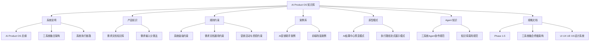

# AI Product OS 知识库

这里是 AI Product Workbench 的中文知识中枢，用来维护产品知识、系统约束、案例沉淀、原型模式和 Agent 协作规则。知识库面向两类使用方式：

- **人工维护**：你可以用 Obsidian 打开本目录，按 Markdown Vault 方式持续补充知识。
- **系统调用**：AI Product Workbench 会把这里的知识接入 [[00-系统说明/三系统融合架构|三系统融合架构]]，用于约束、决策、执行和进化。

> [!important] 维护原则
> 所有内容使用中文；每条知识要有明确适用场景；关键条目必须用双链连接到约束、决策、案例、原型或 Agent 节点；待整理材料先进入 [[99-收件箱/README|收件箱]]。

## 推荐阅读路径

1. [[00-系统说明/AI Product OS 总纲|AI Product OS 总纲]]：理解系统定位，不把它当成普通 PRD 工具。
2. [[00-系统说明/三系统融合架构|三系统融合架构]]：理解 Constraint、Decision、Evolution 如何共同约束 AI。
3. [[02-规则约束/系统级强约束|系统级强约束]]：查看系统必须遵守的底线规则。
4. [[04-原型模式/AI结果中心预览模式|AI 结果中心预览模式]]：理解 PRD 和原型在哪里预览。
5. [[05-Agent知识/三系统Agent协作规范|三系统 Agent 协作规范]]：理解多 Agent 如何被约束和流式展示。
6. [[06-规格文档/源文档覆盖清单|源文档覆盖清单]]：确认用户提供的阶段规格和交互文档已入库。

## 知识地图

## 核心目录

- [[00-系统说明/README|00-系统说明]]：系统目标、架构边界、运行流程和知识图谱维护方式。
- [[01-产品知识/README|01-产品知识]]：业务域、用户需求、产品定义和历史需求资产。
- [[02-规则约束/README|02-规则约束]]：must_follow、prefer、avoid、warn 四类行为约束。
- [[03-案例库/README|03-案例库]]：可复用案例、反例、复盘结论和产品决策参考。
- [[04-原型模式/README|04-原型模式]]：布局、预览、交互、流式反馈和结果展示模式。
- [[05-Agent知识/README|05-Agent知识]]：Agent 角色、输入输出、协作边界和执行状态展示规则。
- [[06-规格文档/README|06-规格文档]]：用户提供的阶段规格、交互规格和部署运行要求。
- [[99-收件箱/README|99-收件箱]]：临时导入、待判断、待拆分、待归档内容。

## 最近重点维护

- [[01-产品知识/需求文档知识库/README|需求文档知识库]]：2026-06-22 导入的需求文档结构化知识。
- [[01-产品知识/需求文档知识库/业务域索引|业务域索引]]：按 AI 营销、云溪活动、号卡、素材、奖品、报表、安全等业务域组织资产。
- [[02-规则约束/需求文档沉淀/需求文档通用约束|需求文档通用约束]]：从历史需求文档沉淀出的通用规则。
- [[03-案例库/需求案例库/AI营销助手案例|AI营销助手案例]]：策划宝 AI 营销助手和案例库流程沉淀。
- [[04-原型模式/执行路径流式展示模式|执行路径流式展示模式]]：多 Agent 执行过程默认收起、可展开查看。
- [[06-规格文档/README|用户规格文档]]：Phase 1 到 Phase 5、三系统融合、UI/UX/UE 和部署要求的源规格沉淀。

## 系统调用入口

当 AI Product Workbench 接收用户输入时，应按下面顺序读取知识：

1. 从 [[01-产品知识/需求输入分类法|需求输入分类法]] 判断业务域和需求类型。
2. 从 [[02-规则约束/系统级强约束|系统级强约束]] 与相关业务约束生成 Constraint Context。
3. 从 [[03-案例库/README|案例库]] 选择可复用参考。
4. 从 [[04-原型模式/README|原型模式]] 选择展示和交互模式。
5. 从 [[05-Agent知识/知识库调用规范|知识库调用规范]] 约束 Agent 输入输出。
6. 遇到阶段实现、前端改版或部署问题时，读取 [[06-规格文档/README|用户规格文档]]。

## 维护动作

- 新知识先写成独立 Markdown，不把多个主题塞进一篇。
- 每篇至少链接一个上游来源和一个下游使用场景。
- 涉及系统底线、UI/UX/UE、资损、安全、发布、Patch 的内容，必须链接到 [[02-规则约束/系统级强约束|系统级强约束]]。
- 涉及 PRD、Prototype、执行路径展示的内容，必须链接到 [[04-原型模式/AI结果中心预览模式|AI 结果中心预览模式]] 或 [[04-原型模式/执行路径流式展示模式|执行路径流式展示模式]]。
